# 小红书 `3DCodeFactory` 出题与 Rubric 体系拆解及 2D / CAD 双轨并发造数规范

> **成文日期**：2026-11-27  
> **上游对照源码**：`3DCodeFactory`（`arXiv:2611.28783v1`，Apache-2.0，`assets/prompts/P01..P11.txt`、`assets/fewshots/{press,hall}/case.json`、`src/code3dfactory/{validation.py,workflow.py}`）  
> **配套分类树与交付规格**：[Anim2D-Tree v2.0](../configs/taxonomies/anim2d_tree_v2_0.json) · [CadQuery-Tree v2.0](../configs/taxonomies/cadquery_tree_v2_0.json) · [三轨顶级交付产物规格 v2.0](THREE-TRACK-DELIVERABLE-SPEC.md) · [XHS 对齐统一 SFT 标准](XHS-UNIFIED-SFT-STANDARD.md)

---

## 一、核心结论：小红书到底怎么造题、怎么写 Rubric？

逐行拆解 `3DCodeFactory` 的 `P01–P11` 提示词、两个官方 Few-Shot（机械压机 `press/case.json` 与巴洛克镜厅 `hall/case.json`）以及 `validation.py` / `workflow.py` 后，其高质量造数体系可浓缩为 **“一套输入输出隔离契约 + 六条刚性法则”**：

### 1.1 解题输入与盲测 Rubric 严格隔离（`Task Package` 契约）

每道题在进入沙盒 Rollout 前，都会先合成为一份结构化 `case.json`（Task Package），内部严格拆成两半：

- **给解题 Agent 看的唯一输入 `x = (I, task_prompt)`**：
  - `reference_image I`（可选）：单视角干净参考图（`1536×1024`，经 `P03` 筛除多宫格拼图、残缺裁切与物理悬浮畸变）；对于纯工程规约或抽象动态任务，也原生支持无图/草图锚点模式。
  - `task_prompt`：一段自然流畅但工程边界完备的用户指令，由 **应用场景上下文 `C`（Context）+ 结构与尺寸规约 `S`（Specification）+ 交互功能 `F`（Functions，0–3 项）** 无缝融合而成，并附带 `P08` 离线可复现与自检交付要求。Agent **绝对看不到** `V01/S01/F01` 等 Rubric 编号或评分锚点。
- **仅给评测沙盒与 VLM Judge 用的盲测标尺 `(rubrics, difficulty)`**：
  - `visual_rubrics_R_vis`（**`3–6` 条**，`V01..V06`）：对照渲染多视图检验外观轮廓、部件层级、材质光影与版面构图；
  - `specification_rubrics_R_spec`（**`2–5` 条**，`S01..S05`）：通过**代码/场景图/B-rep 实测脚本**（而非看源码注释或变量名！）检验真实独立网格/实体数、包围盒尺寸公差、离线自包含与零报错；
  - `functional_rubrics_R_func`（**`0–3` 条**，`F01..F03`，ID 必须与 `functions_F` 一一对应）：通过真实点击/拖拽/参数触发，对比触发前后状态与画面检验联动与复位；
  - `difficulty`（`P06` 先验难度定级）：对 `content_complexity`（`1..5`）与 `geometry_complexity`（`1..5`）独立打分，用于在终审时对高几何复杂度题目给予合理视觉分补偿。

---

### 1.2 小红书造题与写 Rubric 的六条刚性法则

| 法则 | 上游实现（`P01–P11` & `validation.py`） | 解决的核心痛点 |
| --- | --- | --- |
| **法则 1：双用户画像 × 多参考模式路由（`P01` + `P04`）** | 种子预打标 `requirement_style ∈ {professional, ordinary}`（专业工程师写明尺寸比例/层级公差 vs 普通用户自然描述用途/部件/体验）与 `reference_mode ∈ {faithful_reconstruction, local_modification, grounded_extension}`，兼顾中英双语。 | 防止训出的模型只会接“八股工程文档”，遇到真实普通用户的口语化需求或“在原图基础上改局部”就懵。 |
| **法则 2：先置消歧与“真结构实例化”铁律（`P04` `S`）** | 在出题阶段显式补齐单张图/简短描述中未定界的 `design_assumptions`（背面结构、壁厚、配合间隙）、`scope_exclusions`（忽略背景杂物），并强制声明 **`geometry_instantiation_constraint`（严禁用平面贴图/静态假 UI 冒充真实结构）**。 | 杜绝模型偷懒画一张静态图或合并成一个不可编辑死块来骗视觉分。 |
| **法则 3：视觉复杂度与交互深度的“弹性跷跷板”（`P04` + `P05`）** | **重几何/重版面题**：控轻交互（`|F| ∈ {0,1,2}`），配重 `R_vis`（`5–6` 条）、精简 `R_spec`（`2–3` 条）；**重机构/重交互题**：基座干净利落，做深联动（`|F| ∈ {2,3}`），配 `R_vis`（`3–4` 条）+ `R_spec`（`4–5` 条）+ `R_func`（`2–3` 条）。单题总计 **8–13 条**。 | 避免把一道题塞成“既要百件超写实雕花又要十个复杂物理交互”的不可能任务，防止长程轨迹超时烂尾。 |
| **法则 4：零套话 `{0, 0.5, 1}` 部件级锚点（`P05`）** | 严禁写 `"未实现 / 部分实现 / 完全实现"` 套话！ • `"0"`：点名具体缺失主件、贴图造假、穿模干涉、控件无响应； • `"0.5"`：点名主结构已具备，但哪些次级零件、比例跨度、转轴支点或复位逻辑缺失； • `"1"`：点名全部子部件数量、空间对位公差、材质对比与触发→响应→复位闭环。（纯二值事实用 `binary {"0","1"}`，其余用 `tiered_0_05_1`。） | 让多模态 Judge 打分高度一致、可解释，且每条扣分都能直接定位到具体工程缺陷。 |
| **法则 5：Rollout 前 `P07`“零隐藏考题”双轮自审** | 在花钱跑多轮轨迹前，用 `P07` 逐条交叉核查：① 图文零矛盾（冲突时以图为准修文案）；② **零暗箱考题（`R_vis / R_spec / R_func` 里考的每一项必须在 `task_prompt` 中明确交代，未交代的要么补进 `task_prompt`、要么从 Rubric 删除）**；③ 条目互斥不重复扣分。最多自动修订 `2` 轮，仅 `safe_to_export == true` 放行。 | 彻底消灭“题目没说要 12 根壁柱，Rubric 却按 12 根扣分”的冤假错案，大幅提升合格率与数据信噪比。 |
| **法则 6：五维木桶准入 + Best-of-2 早停优选（`validation.py` + `workflow.py`）** | 汇总 5 个归一化维度：`s_vis_adj`（加几何难度补偿 `[0, 0.006, 0.022, 0.052, 0.060]`）、`s_spec`、`s_func`（无交互题自动豁免）、`s_stab`（多视角稳定性 `1..5 / 5`）、`s_aes`（整体美学 `1..5 / 5`）。**所有适用维度 `≥ 0.50` 且总均分 `≥ 0.60`** 才算 `qualified`；收齐 `2` 条合格轨迹立即早停，选均分最高者导出，并对报错回合打轮级 loss mask。 | 单维木桶底线（`0.50`）挡住偏科残次品，早停机制省掉无谓的重复采样开销。 |

---

## 二、向我方 2D 与 CAD 双轨的 1:1 落地映射规范

由于 Track 1（3D 展厅级场景）共享盘已完整就位小红书 `401/401` 分片，我方并发自产火力 **100% 聚焦外部空白的 Track 2（2D Web 多文件交互动画，`Anim2D-Tree v2.0`）与 Track 3（CAD 多模块参数化建模与装配，`CadQuery-Tree v2.0`）**。

我们在完全继承小红书 `Task Package (C, S, F) + Rubrics (R_vis, R_spec, R_func) + P07 Audit + 5-Dim Gate` 框架的基础上，加上一道关键省钱增效设计：**“免费确定性沙盒硬检前置短路（Hard-Gate First）”**——凡未通过本地零成本确定性校验器（`check_2d_v2.mjs` / `cad_inspect.py`）的 Rollout，直接记为不合格并短路跳过 VLM Judge，确保 **失败样本消耗 `0` Judge Token**。

### 2.1 Track 2：2D Web 多文件交互动画（`Anim2D-Tree v2.0`，5 大类 × 4 词条 = 20 词条）

- **任务包 `(C, S, F)` 生成要求**：
  - `context_C`：覆盖 `ordinary`（产品经理/内容创作者自然提需求）与 `professional`（动效设计师/前端架构师明确模块与缓动曲线），中英双语 `50:50`；目标交付固定为离线多文件工程 `output/{index.html, css/styles.css, src/*.js (≥3 个职责分离模块), assets/*.svg}`，预置本地 `vendor/gsap.min.js`，暴露确定性 `window.renderAt(t)` 与 `#play / #pause / #scrub` 控制接口，支持一键导出 MP4。
  - `specification_S`：明确主舞台版式层级、配色字阶、多阶段时间轴编排（如开场 `clip-path` 揭幕 → 主体刚体支点铰接/路径推进 → 高潮定格与循环衔接）、视口自适应无遮挡约束（`1280×720` 与 `1440×900` 零文字裁切、零 HUD 压主体），以及 **`true_vector_canvas_instantiation`（严禁空白框、纯文字糊弄或静态死图冒充动态图元）**。
  - `functions_F`（`1–3` 项业务级交互，不含基础播放条）：例如参数滑块（调节物理阻尼/速率/数据年份）、章节/视角状态切换按钮、画布图元点击拆解或悬停高亮联动，以及一键 Reset 复位。
- **盲测 Rubric 配额与锚点设计（总计 `8–12` 条）**：
  - `R_vis`（`3–5` 条）：对照 `t0 / t1 / t2 / t3` 多关键帧截图，考核版式构图层级、核心视觉主体还原度、关键帧运动推进幅度（支点不脱节、造型不崩坏）、色彩对比与字体可读性。
  - `R_spec`（`2–4` 条）：结合 `check_2d_v2.mjs` 实测 JSON 指标，考核多文件模块拆分（`≥3` JS 模块、零外链 CDN）、`window.renderAt(t)` 确定性随机跳转与首尾无缝衔接、双视口（`1280×720` & `1440×900`）零文字重叠/零 HUD 遮挡、MP4 正常编码导出。
  - `R_func`（`1–3` 条）：Playwright 真实点击/拖动 `F01..F03` 控件前后截图与 DOM/Canvas 像素差分，验证真实业务状态跃迁与干净复位。
- **五维映射**：`(s_vis_adj, s_spec, s_func, s_stab [双视口与跨帧渲染稳定度], s_aes [版式与动效审美 1..5/5])`，全部 `≥ 0.50` 且均值 `≥ 0.60`。

---

### 2.2 Track 3：CAD 多模块机械系统与整机结构总成（`CadQuery-Tree v2.0`，5 大类 × 4 词条 = 20 词条）

- **硬性复杂度底线（彻底砍掉“白布单个工件”）**：
  - **严禁生成任何孤立简单单件**（如单个安装角码、单个法兰盘、单个带盖空盒、单个裸齿轮——`Qwen3.8-27B Base` 在简单单件上已达 `9/12`，继续造纯属浪费 API 与算力）。
  - 对标小红书 `press/case.json`（16 部件齿轮齿条压机总成），在 `P01` 筛种与 `P06` 难度定级处设立硬门槛：**仅放行 `content_complexity ≥ 4` 且 `geometry_complexity ≥ 4` 的完整多部件机械装置、工装治具总成或整机结构装配体**（强制交付 `output/src/{params.py, parts/*.py (4–10 个功能耦合独立零件), assembly.py}`，装配体总面数 **`60–250+` B-rep 面**，交付 `STEP + 3MF + STL + GLB` 四格式与 4 视图 + 剖视图 `section_view.png` + 爆炸图 `exploded_view.png`）。
- **任务包 `(C, S, F)` 生成要求**：
  - `context_C`：覆盖 `ordinary`（创客/产品需求方描述完整夹具台、减速器、云台、仪器整机的用途与联动方式）与 `professional`（机械工程师给出各子部件基准面、配合公差、孔系与接口尺寸），中英双语 `50:50`。
  - `specification_S`：
    - **强制非 XY 起草基准配额**：跨题库强制路由主起草平面 **`XY 40% / XZ 30% / YZ 30%`**（专治 27B 轴向画反顽疾）；
    - **显式配合间隙与内部结构**：写明总体包围盒尺寸 `dims_mm`、孔轴/止口/滑槽配合间隙（如 `0.20–0.40 mm` 3D 打印公差）、下伸止口/抽壳腔体/沉头孔/阵列等复合特征，以及 **`true_brep_manifold_constraint`（严禁零件布尔粘死成单块冒充装配体、严禁非水密破面与零件空间穿模干涉）**。
  - `functions_F`（`1–2` 项**参数化工程探针 Parametric Probes**，作为 CAD 赛道的 `R_func` 等价物）：要求 `params.py` / `model.py` 暴露命名清晰的 `DEFAULT_PARAMS`，当验收器注入参数覆盖探针（例如将管夹夹持管径从 `24 mm` 改为 `32 mm`，或将壳体长度从 `110 mm` 改为 `140 mm`）时，全套零件必须自适应联动重算且保持水密与零干涉！
- **盲测 Rubric 配额与锚点设计（总计 `8–12` 条）**：
  - `R_vis`（`3–5` 条）：对照 **4 视图 + `section_view.png`（必查内止口朝向、盲孔深度、抽壳壁厚均匀度）+ `exploded_view.png`（必查多零件相对方位、轴向对准与分色清晰度）** 逐项锚定打分。
  - `R_spec`（`3–5` 条）：基于 `cad_inspect.py` OCCT 实测结果，考核独立水密零件数（2-manifold `watertight == true`）、`STEP` B-rep 独立回读一致性、外包络 `dims_mm` 误差（`≤ ±5%`）、**两两零件布尔交集体积 `0.0 mm³`（零穿模干涉）**、可打印悬垂/壁厚合规。
  - `R_func`（`1–2` 条）：基于 `--probe key=val` 实测重跑结果，验证目标尺寸按预期方向响应变化，同时重算后依然 `100%` 水密、零报错、零干涉。
- **五维映射**：`(s_vis_adj, s_spec, s_func [参数探针通过分], s_stab [OCCT 拓扑稳健度与无退化碎面], s_aes [工业造型比例、倒角细节与装配协调度 1..5/5])`，全部 `≥ 0.50` 且均值 `≥ 0.60`。

---

## 三、双轨并发造数流水线与防呆护栏

```mermaid
flowchart LR
  T["v2.0 分类树 20 词条 × 配额采样<br/>(画像 × 语言 × 基准面/渲染栈)"] --> S1["Stage 1 · 并发造题与 Rubric 合成<br/>P04 (C,S,F) + P05 (R) + P06 (难度)"]
  S1 --> S2["Stage 2 · P07 零隐藏考题自审<br/>(最多 2 轮自动修补 · 16–24 并发)"]
  S2 -->|"safe_to_export = true"| S3["Stage 3 · 并发多轮沙盒 Rollout<br/>claude --bare + logging-proxy (kimi-k3.1-pro)"]
  S3 --> G1["Stage 4A · 免费确定性硬检短路<br/>check_2d_v2 + MP4 / cad_inspect + 零干涉"]
  G1 -->|"硬检通过"| G2["Stage 4B · 多模态 Rubric 终审<br/>P10 视觉美学 + R_spec/R_func 汇总"]
  G2 -->|"5 维 ≥0.50 & 均分 ≥0.60<br/>分层 Best-of-2 早停"| E["Stage 5 · 原生多段 SFT 导出<br/>logging_proxy_to_swift + convert_native_to_xhs_ready"]
```

### 开工前四条硬性工程护栏
1. **统一绑定已恢复的 `kimi-k3.1-pro` 专用通道**：所有新合成器、Judge 与 Rollout 并发器默认 `--env-file` **必须指向 `${WORKSPACE}/3d-animation-agent/.env`（`ANIM3D_MODEL=kimi-k3.1-pro`）**，严禁误引 `eval_3d_v3.py` 中旧的 `.env.deepseek`（额度已耗尽返回 `401`）。
2. **两级并发速率控制，榨干吞吐且不触发网关限流**：
   - **出题 + Rubric + `P07` 自审阶段（纯 API 轻量 JSON）**：单题仅 3–4 次请求、无本地重渲染，直接开 **`16` 并发**，几分钟即可产出并审完百道高规格题目包；
   - **多轮沙盒 Rollout 阶段（含 Headless Chromium / OCCT 剖视与爆炸图渲染）**：受单机 CPU/内存与浏览器实例数约束，建议开 **`6–8` 个并行沙盒 Worker**，配合**分层 Best-of-2 早停**（首轮均分 `≥ 0.90` 且无单维短板直接录取；`0.60–0.90` 补跑第 2 轮选优；硬检不过立即短路不调 Judge），将有效轨迹产出速率最大化。
3. **先小步 Canary 验证，再全量放开并发**：首次点火先按两棵 `v2.0` 树各抽 **5 道代表性高难题（5 CAD + 5 2D = 10 题）** 跑通 `P04→P05→P07→Rollout→硬检→Judge→XHS-ready JSONL` 闭环，实测核对题面接地气程度、Rubric 区分度、平均轮数与单题 Token 成本，确认无误后一键拉满 Phase 1 全量并发（`150–160` 题/轨）。
## 四、从 `qwen-sft-6414` 真实轨迹补齐的三条“追求质量上限”提示词铁律（v2.1 必守）

复盘发现：仅看小红书开源仓库里的 `P04.txt` 与论文附录 `hall/case.json` 容易把题面写成“机械罗列 `#dom-id` 和函数名的单元测试标书”；而实查小红书 `qwen-sft-6414` 真正入训轨迹（如 `xhs-val-06-0df9c93c.txt`、`xhs-val-11-32dd01c8.txt` 与 `/opt/code3d/TOOLS.md`），其**推高作品质量上限**的核心提示词设计有三条铁律，必须在合成与采样全链路强制执行：

1. **四段式极简包裹 + 工具说明独立成文（`TOOLS.md` 解耦）**
   - 严禁在用户需求里堆砌冗长的命令行教程。统一采用小红书真实入训四段式结构：
     - **6 行极简顶栏**：声明交付目录、真实可编辑结构与 `Work until the task is done.`（不催促早停，释放多轮打磨空间）；
     - **`USER REQUEST:`**：纯粹、自然、高标准的产品/工程与审美需求正文；
     - **`REFERENCE IMAGES:`**：`use Read to inspect reference-0.jpg before modeling`；
     - **工具指路单行尾注**：`Preinstalled rendering and verification tools: read TOOLS.md in your workspace.`（具体 CLI 用法全部收进工作区 `TOOLS.md`，顺带训练模型先读环境文档的真实工程习惯）。
2. **`ordinary`（普通用户）画像彻底去 `#dom-id` 化，保留真实交互设计留白**
   - 在 50% 的 `ordinary` 画像题中，**严禁替模型起好 `#aperture-prev`、`#btn-reset` 等死板选择器名字**，必须对齐小红书原味表达（如 *“我想能挑不同的切片来看……具体怎么触发由你来安排”*），倒逼模型自主设计合理的 UI 布局与控件，同时由评测端 Playwright 脚本按语义/DOM 角色自动发现并触发交互控件。
3. **每题末尾强制注入“审美与工艺上限激发语（Quality-Ceiling Directive）”**
   - 造数据的根本意义不是凑及格线功能，而是逼出教师模型的**质量天花板**与“全局看大图 → 局部/剖面放大挑刺 → 多轮精修”习惯。每道 `USER REQUEST` 末尾必须自然收束于上限激发指令：
     - 中文：*“在满足上述需求的前提下，请充分发挥创作能力，持续打磨整体美感、构图层次、材质光影与机械/动效细节精度，让作品具有极高的吸引力与完成度。”*
     - 英文：*“Under the premise of satisfying the above requirements, please give full play to creativity and iteratively refine overall aesthetics, composition hierarchy, material/lighting craft, and mechanical/motion precision so the work is deeply attractive and complete.”*

---

## 五、Canary 实跑与 AGY 沙盒盲测暴露出的四项“验收策略防误杀/防漏放”修正（v2.1 实证闭环）

通过对 `10` 道自造高难题 + `2` 道小红书官方锚点题（`xhs_anchor_press_cad` / `xhs_anchor_agate_2d`）以及 `2` 道 AGY 纯净沙盒盲测（`cad_v2_09` / `anim2d_v2_07`）做逐帧/逐零件人工复核，我们定位并修复了第一版验收策略中的 **4 个真实工程盲区**：

1. **导出校验器对“前序废分支过滤”的误杀（`_verify_exported_sft_record` 假阴性 — 已修复）**
   - **现象**：`xhs_anchor_press_cad`（`0.96` 分）与 `cad_v2_09`（`0.952` 分）主会话完全健康（`accepted=1`，`0` 路径泄露），仅因 `claude --bare` 首轮存在一段被 `logging_proxy_to_swift.py` 正常拦截丢弃的短分支（`rejected=1`），被旧版导出门禁误判为 `export_failed`。
   - **修复**：仅当被拒分片属于 `compact_before` / `compact_recovery` 断链污染时才阻断导出；普通废分支由导出器精准剥离，保留干净主干直通 `convert_native_to_xhs_ready.py`。
2. **`cad_inspect.py` 质心径向爆炸与单向半切剖视导致的“校验器自摆乌龙”（已升级）**
   - **现象 A（径向爆炸偏移同轴度）**：旧版 `cad_inspect.py` 按零件质心相对总成质心的向量 `delta = p_center - asm_center` 径向推开零件；遇到带局部剖窗的不对称壳体（如 `cad_v2_09`）或质心靠近原点的衬套座（如 `cad_v2_02`），会把原本严格同轴的零件推偏轴线或聚成一团，导致 Judge 在 `V04/V05` 误扣 `0.5` 分（AGY 沙盒探针在自检 `exploded_view.png` 时甚至主动发现了该问题并手写了沿主轴同轴拉开脚本！）。
   - **现象 B（半切剖视切掉前后面板零件）**：旧版 `section_view.png` 粗暴切除整个 `y < y_mid` 前半空间，导致位于前半区的斜面前框与提手（如 `cad_v2_07` 的 `front_bezel`、`folding_handle`）在剖视图中整件消失。
   - **修复**：① 剖视图升级为 **ISO 标准 90° 四分之一象限剖切（Quarter-Quadrant Cutaway：`x < x_mid ∧ y < y_mid`）**，在等轴测下同时暴露 X/Y 正交双剖面内腔止口与轴孔，且 **100% 零件保留在右/后半区绝不消失**；② 爆炸图升级为 **底板下沉（`-Z`）+ 主水平轴序同轴等距拉开**，严保轴系共线与独立零件簇清晰分离。
3. **`P07` 新增“总包络与子零件跨度物理自洽性核查”（防 `cad_v2_02` 型尺寸自相矛盾）**
   - **现象**：`cad_v2_02` 题面同时写了 *“默认总包络约 `180×110×130 mm`”* 与 *“底座 `150×76×12 mm`，不要额外添加工作台”*——肘节夹具沿 Y 向最宽零件就是 `76 mm` 底座，物理上不可能凑出 `110 mm` 的 Y 向总包络，导致忠实按底座建模的 `kimi-k3.1-pro` 在 `S02` 被冤扣 `0` 分。
   - **修复**：在 `P07` 自审提示词中强制增加 **Envelope vs Sub-Part Geometric Feasibility** 核查，要求三轴总包络必须与最宽/最长/最高子部件跨度严格物理自洽。
4. **2D 交互评测支持 `ordinary` 画像无选择器语义发现**
   - **修复**：当 `ordinary` 画像题面隐藏 `#dom-id` 时，`_capture_2d_sheets_and_interactions` 按 `<label>` 文本、`aria-label`、按钮文案及未消费的 `<input type="range">` / `<select>` / `<button>` 角色自动匹配触发，彻底打通自然口语需求与自动化交互验收。

