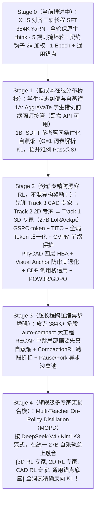

# 3D / 2D / CAD 三轨 Agent 在小红书 SFT 之后的强化学习与自蒸馏前沿调研（v2.0 全面升级版）

> 公开整理版 · 2026-11-27。保留成文时点的记录；计划、文献结果和本地实测请分别理解。 环境路径已泛化，未收录的附件已标注；发布范围见 [整理说明](../../PROVENANCE.md)。

- **成文与升级日期**：2026-11-27（v2.0：融合 **38 篇新下载一手核验文献** + 2026 下半年最新同源视觉/3D/Web 项目 + 一线模型厂后训练技术报告）
- **调研范围**：紧扣小红书 `3DCodeFactory`（[arXiv:2611.28783](../arxiv-2611.28783/README.md)）第 6 节留白——*“目前完整合成与验证管线仅用于强教师离线过滤，未来将扩展至自蒸馏（Self-Distillation）与强化学习（Reinforcement Learning）”*——系统检索、下载并一手精读 **38 篇核心文献**（重点覆盖 `2026.06–2026.11` 最新发表的 3D/2D/Web/CAD 同源 RL 论文及 `DeepSeek-V4`、`Kimi K3`、`Qwen3.8-Next` 等最新旗舰技术报告），结合本地既有 4 篇精读（`DAgger`、`Sampling SFT`、`3DCodeVerse`、`3DCodeFactory`）与本仓库三轨基建，给出面向 **`Qwen3.8-27B`** 的 **五阶段（Stage 0 $\to$ Stage 4）后训练演进架构**。
- **姊妹篇与终极执行收敛版直达**：
  0. **【优先必读 · 工程落地唯一准绳】[主调研方 × Claude Opus 5.5 联合去杂糅审查与终极收敛蓝图](../3d-agent-rl-opus-review-and-consolidation-20261127/README.md)**（已完成 19 项机制冲突裁决、指标三层断舍离、现行检查器 4 处硬漏洞定位，并将五阶段压缩为 `2×8 H800` 可在 1 周内跑通的 **`Step 0 SFT -> Step 1 单模型三轨等权 Repair-RL -> Step 2 384K RFT 回灌`** 极简闭环！）；
  1. 作者初始踩坑细节、Appendix 负向消融与防刷分补丁见 **[2026 同源 RL 踩坑避坑大全与大厂实战手册](../visual-3d-agent-rl-pitfalls-and-lab-lessons-20261127/README.md)**；
  2. `Qwen4-Max`（09-22 云端未开源，`Qwen3.8-27B` 确认为 2026 H2 头号稠密开源底座）、`Kimi K3.1 Pro`（11-04 开源重点攻克 `Three.js/Unity/Godot` RL）、`GLM-5.3/5.4`（`slime + SAO` 状态 RL 涨 `6×`）、`DeepSeek-V4.1-Flash-1017`、`Anthropic Opus 5.5 / Fable 5.2` 与 `OpenAI GPT-6 / 6.2 Astra` 一手博客时间线见 **[2026 下半年八大前沿实验室 Agentic RL & 视觉代码技术博客专题](../frontier-labs-agentic-rl-blogs-2026h2/README.md)**。
- **使用边界说明**：本报告严格区分**论文一手实证事实**（标注基座规模、上下文长度、评测集与精确涨跌幅）与**面向本项目的工程迁移推论**；所有建议作为 SFT 收口后的下一阶段路线储备，未改动任何现行线上训练/评测任务与 `decisions.md`。

---

## 1. 起点诊断：为什么小红书停在离线 SFT？SFT 之后会撞上哪六堵墙？

### 1.1 小红书 `3DCodeFactory` 的精确边界（原文 §6 核实）
在 `3DCodeFactory` 原文第 6 节中，小红书团队明确指出其工作停留在 **Offline Teacher Rejection Sampling SFT（RFT）**：
- **已有资产**：`P01–P07` 接地气产品级出题与五维实例级 Rubric（`s_vis_adj`、`s_spec`、`s_func`、`s_stab`、`s_aes`，底线 `>=0.50`、均分 `>=0.60`），`P08` Docker + Claude Code（`384K` 自动压缩窗口）沙盒管线与 `P09–P11` 多模态验收器。
- **未走完的一步**：这套昂贵验证器**只用来从 `DeepSeek-V4.1-Flash-1017` 的 `13,312` 条离线轨迹里筛出 `5,045` 条（拆为 `6,414` 条压缩段）喂给 `Qwen3.8-27B` 做 1 epoch SFT**；学生 `27B` 从未在自身在线采样分布上经历过自蒸馏、沙盒强化学习或多专家在线合模。

### 1.2 纯离线 SFT 提能后的六大固有瓶颈（均由 2026 最新同源实验钉死）
1. **三维几何预判短板与“自我宽容偏置”**：`3DCodeEdit`（[2610.38231](../arxiv-2610.38231/README.md)）实测 **`Qwen3.8-27B`** 参数微调 `G1` 达 `84.3%`，但结构重构 `G4` 仅 `17.1%`、空间组合 `C` 仅 `1.6%`；且只让它看自身渲染图自审时**平均修改不足 `<0.6` 轮**（`33.0%`），而配独立挑刺反馈即飙升至 **`50.3%`（反超单轮 `Kimi K3` `46.8%`）**！
2. **多轮编辑非单调退化与肉眼评几何失灵**：`LEGO-Anything`（[2609.36380](../arxiv-2609.36380/README.md)）实测多轮 3D 编辑中 **`29.6%` 的修改会降低场景分**，且连 `GPT-6` 凭 RGB 图判断 3D 几何改进的一致率都只有 **`45.8%`**（不如抛硬币 `50%`）！
3. **SFT 能修语法，推不高几何/视觉精细度上限**：`IterCAD`（[2606.13368](../arxiv-2606.13368/README.md)）二阶段纠错 SFT 把无效代码压到 `0.80%`，但 Mean CD 反而从 `10.55` 退化至 `12.44`，唯有在线 RL 才能将其砍半至 **`5.09`**；`MSRL`（[2508.13587](../arxiv-2508.13587/README.md)）同样证实继续堆 SFT 数据迅速陷入平台期。
4. **直接把功能探针或五维均值搬去跑裸 GRPO 必踩刷分大坑**：
   - **删美感保功能**：`WebCatalyst`（[2611.05151](../arxiv-2611.05151/README.md)）单跑 GUI 功能 RL 使美学暴跌 **`-10.2` 分**；
   - **平面求和倒退**：`PhyCAD`（[2611.09401](../arxiv-2611.09401/README.md)）线性加权使联合可行率比 SFT 倒退 **`-2.96 pp`**；
   - **碎笔画与 CSS 伪装**：`RULER`（[2609.25270](../arxiv-2609.25270/README.md)）标量美学模型诱发 **`21×` 代码暴涨**，`AeSlides`（[2604.22840](../arxiv-2604.22840/README.md)）抓到 `overflow: hidden` 截断作弊与 VLM `30%` 零方差死组；
   - **负分吓退看图**：`ReLook`（[2510.11498](../arxiv-2510.11498/README.md)）对改差扣负分导致模型彻底拒绝调看图反馈工具！
5. **99.9% 触发 `auto-compact` 下的长程信用断链**：无压缩感知的 RL 在压缩推理时反跌 `-4.3 pp`，按段平均 Loss 更暴跌 **`-6.4 pp`**（`CompactionRL` [2607.05378](../arxiv-2607.05378/README.md)、`RECAP` [2611.31258](../arxiv-2611.31258/README.md)）。
6. **三轨异构奖励混合 RL 的跷跷板干扰**：`DeepSeek-V4`（[2606.19348](../arxiv-2606.19348/README.md)）与 `Kimi K3`（[2607.24653](../arxiv-2607.24653/README.md)）一致证明，跨多个异构领域硬跑混合 RL 极易顾此失彼，**分轨训专精 RL 专家再用多教师在线蒸馏（`OPD / MOPD`）合入单模型**才是 2026 下半年的最优解！

---

## 2. 本次新增精读的 38 篇核心文献分类全景矩阵

### 2.1 2026 下半年最新 3D / 动画 / 交互网页 / SVG / CAD 同源 RL 与评测文献（22 篇）

| 赛道与主题 | 论文与精读入口 | 基座与时间（事实） | 核心贡献与关键实证增益（事实） |
|---|---|---|---|
| **3D 反应式编辑 RL** | **BlenderFORGE**（[2611.10768](../arxiv-2611.10768/README.md)） | 多模态 MLLM, 2026.11 | 自蒸馏轨迹 SFT + **通用 SFT 锚点** + `GSPO` AgentLoop-RL：`SR@.5` 从 `24.0%` 跃升至 **`36.0%`**（去通用锚点反跌至 `21.0%`！）。 |
| **3D 局部编辑与自审诊断** | **3DCodeEdit**（[2610.38231](../arxiv-2610.38231/README.md)） | **`Qwen3.8-27B`** / `Kimi K3` / `Opus 5.5` / `GPT-6.1`, 2026.10 | 测出 `27B` `G1=84.3%` vs `G4=17.1%` 及自审 `<0.6` 轮瓶颈；配独立挑刺 Reviewer 使 `27B` 涨至 **`50.3%`** 超单轮 `Kimi K3`。 |
| **3D 重建轨迹退化与防倒退** | **LEGO-Anything**（[2609.36380](../arxiv-2609.36380/README.md)） | `GPT-6-astra/sol/luna`, 2026.09 | 发现 `29.6%` 编辑倒退与自评几何仅 `45.8%`；VGGT 初始化 + SAM3/深度残差 + 版本回滚使 6 模型普涨（`GPT-5.6` `+55%~63%`）。 |
| **3D 功能房间过程奖励** | **FuncRoom-Agent / ScenePRM**（[2608.29519](../arxiv-2608.29519/README.md)） | **`Qwen3.6-35B-A3B`**, 2026.08 | 阶段级执行接地过程奖励 `ScenePRM` 较终态 GRPO 暴涨 **`+13.3` FOC / `+13.8` FOP**。 |
| **3D/2D 代码视频生成 RL** | **Video-Coder**（[2611.09894](../arxiv-2611.09894/README.md)） | 多模态编码 Agent, 2026.11 | 空目录冷重跑防残留作弊 + 执行奖励指数退火 $e^{-\mathrm{steps}/T} R_{\mathrm{exe}}$ 消除保守症（`0.65 -> 0.67`）。 |
| **2D 教育动画视觉自纠错** | **ManimCode**（[2611.08294](../arxiv-2611.08294/README.md)） | 含 **`Qwen3.8-27B`**, 2026.10 | 双向正反交换顺序成对视觉奖励（两次一致胜出才给 `+1`），根治公式重叠与位置偏置。 |
| **交互网页高保真 RL** | **WebCatalyst**（[2611.05151](../arxiv-2611.05151/README.md)） | **`Qwen3.6-35B-A3B`**, 2026.11 | 冻结强锚点 **`Visual Anchor`**（修复 `-10.2` 美感崩塌至 `87.5`）+ CDP 运行时调用栈 **`Action-Trace Credit`**（快 `1.84×`，640 题超 `Opus 4.7`）。 |
| **可执行测试驱动网页 RL** | **InterWebCoder**（[2610.28610](../arxiv-2610.28610/README.md)） | **`ms-swift`** `9B` vs `Qwen3.8-27B`, 2026.10 | 离线故障归因合成 Pytest + **`data-testid` `2×` 加权 SFT** + TDRL：省 `>97%` 奖励耗时，`9B` 超零样本 `27B` 与 `Gemini-3.7-Flash`。 |
| **单模型三角色闭环 RL** | **WebLoop**（[2610.11543](../arxiv-2610.11543/README.md)） | **`Qwen3.5-9B / 27B`**, 2026.10 | 同模型分饰 Generator/Critic/Refiner 角色专属 GRPO + Critic 两阶段课程（15 步判别力 $\to$ 下游净修复率）+ 伪改归零。 |
| **中间子集渲染稠密 RL** | **IR4RL**（[2609.34587](../arxiv-2609.34587/README.md)） | CAD / SVG / 3D 原语, 2026.09 | 无需额外 PRM，直接截断渲染代码块前缀算边际视觉增益 $\Delta R_k$，防外壳遮挡内部废件。 |
| **SVG 实例级防膨胀 RL** | **RULER**（[2609.25270](../arxiv-2609.25270/README.md)） | Ant Group & Oxford, 2026.09 | 揭示标量美学模型致 `21×` 代码膨胀与 `<text>` 作弊；三维正交实例 Rubric + 简洁度彻底根治。 |
| **SVG 视觉残差热力图 RL** | **RefineSVG**（[2607.27699](../arxiv-2607.27699/README.md)） | ACM MM, 2026.07/11 | 带通过滤冷启动防推倒重写 + `YCbCr` 三通道显式 `Diff-Map` + 余弦代码效率奖。 |
| **排版可验证防作弊 RL** | **AeSlides**（[2604.22840](../arxiv-2604.22840/README.md)） | Z.AI `slime`, 2026.04 | 剥离 CSS `overflow: hidden` + 高斯模糊防噪点骗留白 + `GDPO` 分量标准化（死组 `30% -> 0.14%`）。 |
| **网页功能+美学双奖 RL** | **WebGen-R1**（[2604.20398](../arxiv-2604.20398/README.md)） | Alibaba Tongyi, 2026.04 | Playwright 真实交互状态迁移分 + 多视口等级锚定美学分。 |
| **CAD 多轮前缀保护 RL** | **IterCAD**（[2606.13368](../arxiv-2606.13368/README.md)） | **`ms-swift`** `Qwen3.5-4B`, 2026.06 | 渐进 SFT + **`GSPO + GVPM` 可行前缀掩码**，无效代码压至 `0.30%`，Mean CD 砍半 `12.44 -> 5.09`。 |
| **CAD 物理硬约束分层 RL** | **PhyCAD（HBA）**（[2611.09401](../arxiv-2611.09401/README.md)） | `Qwen2.5-3B` / `Qwen3-4B` / `Ministral-3B`, 2026.11 | **分层平衡优势 HBA**（$\lambda_L=1.0 > 2\lambda_w=0.50$）：`Qwen2.5-3B` 联合可行率 `21.76% -> 39.49%`（平加反跌至 `18.80%`），`Qwen3-4B` 达 **`36.64% -> 55.71%`**（远超直出 `Opus 5` `7.29%` / `GPT-5.6 Sol` `15.51%`）。 |
| **基础经典机制（6 篇）** | [ReLook](../arxiv-2510.11498/README.md) · [WebGen-Agent](../arxiv-2509.22644/README.md) · [MSRL](../arxiv-2508.13587/README.md) · [cadrille](../arxiv-2505.22914/README.md) · [CAD-Coder](../arxiv-2505.19713/README.md) · [WorldCraft](../arxiv-2502.15601/README.md) | 混元 / 港中大 / 美团 / ICLR Oral / NeurIPS / TOG | 奠定单调增益防罢工、即时工作区状态分（禁累加未来步）、无源码几何在线 RL + 难例挖掘、`8K` 极净胜 `70K` 噪数据与受控参数差分探针基础。 |

### 2.2 长序列压缩 RL、防黑客 Rubric 优化器与一线大厂最新旗舰报告（16 篇）

| 模块定位 | 论文与精读入口 | 核心机制与关键数字（事实） |
|---|---|---|
| **2026 H2 旗舰技术报告** | **DeepSeek-V4**（[2606.19348](../arxiv-2606.19348/README.md)） **Kimi K3**（[2607.24653](../arxiv-2607.24653/README.md)） **Qwen3.8-Next**（[2608.30320](../arxiv-2608.30320/README.md)） | **分域 RL 专家 $\to$ 多教师在线蒸馏 `OPD / MOPD` 取代混合 RL**；工具全轮保 `<think>`；`Kimi K3` 3D/WebGL 盲评净胜 `Opus 4.8` **`+59.1%`**；`AgentENV` `Pause/Fork`；`WAL` 防抢占短偏置；`Qwen3.8-27B` 官方基线与 `GR` 高学习率稳定机制。 |
| **大厂异步基建与安全基石** | **GLM-5 / slime**（[2602.15763](../arxiv-2602.15763/README.md)） **Kimi K2.5 Toggle**（[2602.02276](../arxiv-2602.02276/README.md)） **UI-TARS-2**（[2509.02544](../arxiv-2509.02544/README.md)） **Qwen3-VL**（[2511.21631](../arxiv-2511.21631/README.md)） **Anthropic 生产黑客**（[2511.18397](../arxiv-2511.18397/README.md)） | `TITO` 零重分词网关、确定性 `topk` + `IcePop`；`Toggle` 熟题限长省 `25%~30%` token；最近 $N=5$ 截图滑窗保百轮 `<think>`；只读隔离防 `sys.exit(0)` / `conftest` 篡改。 |
| **跨压缩长程 RL** | **RECAP**（[2611.31258](../arxiv-2611.31258/README.md)） **CompactionRL**（[2607.05378](../arxiv-2607.05378/README.md)） | 摘要失真奖励 + 压缩后自蒸馏（SWE `+4.3 pp`）；全局可训 Token 归一化（去之跌 `-6.4 pp`）+ 跨段 GAE 折扣（`GLM-4.5-Air` `+6.6 pp` 已上 `GLM-5.2`）。 |
| **序列优化与防刷分 Rubric** | **GSPO**（[2507.18071](../arxiv-2507.18071/README.md)） **GiGPO**（[2505.10978](../arxiv-2505.10978/README.md)） **POW3R**（[2605.20164](../arxiv-2605.20164/README.md)） **SRaR**（[2605.17291](../arxiv-2605.17291/README.md)） **Rubric Hacking**（[2605.12474](../arxiv-2605.12474/README.md)） **SDFT**（[2601.19897](../arxiv-2601.19897/README.md)） | `GSPO-token` 序列似然比根治长序列崩塌；`POW3R` 类内方差加权快 `2.5–4×`；`SRaR` 死循环 `48.1% -> 26.5%`；`2605.12474` 负向条款与 $\Delta^{(t)}$ 零成本早停；`SDFT` $G=1$ 解析词表 KL 防遗忘在线自蒸馏。 |

---

## 3. 面向我们 `Qwen3.8-27B` 三轨项目的五阶段后训练总蓝图（v2.0）

结合 `DeepSeek-V4` 与 `Kimi K3` 最新验证的 **「分轨专精 RL $\to$ 多教师在线蒸馏合模」** 架构，我们将原四阶段路线正式升级为 **五阶段闭环**：

### 关键设计升级点（对比 v1.0 的四大质变）

1. **新增 Stage 4 多专家在线蒸馏合模（`DeepSeek-V4 OPD` + `Kimi K3 MOPD`）——彻底解放单轨 RL 迭代效率！**
   - 过去最大的顾虑是：“如果同时混训 `3D + 2D + CAD + 通用` 在线 RL，CAD 的秒级几何分和 3D 的慢速多视角 VLM 分怎么对齐尺度？单训一轨把另外两轨训忘怎么办？”
   - 现在答案极其清晰：**Stage 2 完全按轨道独立训专精 `Qwen3.8-27B` LoRA 专家**（例如先用几天纯 CPU/OpenCascade 秒级硬检查把 `CAD-RL-Expert` 训透，再训 `2D-RL-Expert` 和 `3D-RL-Expert`）；随后在 **Stage 4**，因为所有专家共享同一个 `Qwen3.8-27B` 底座与词表，只需在四类混合题池上让学生采样 **$G=1$ 条**轨迹，按题所属轨道切换对应 LoRA 专家算 **全词表精确反向 KL（`DeepSeek-V4` §5.1.2）或截断对数比优势（`Kimi K3` Eq. 15）**，仅需约 `1/5` 常规 RL 算力即可把三轨峰值能力与通用底座无损合入单一权重！
2. **Stage 2 植入 `WebCatalyst` 冻结 `Visual Anchor` + `CDP Action-Trace Credit` + 本地 `Qwen3.8-27B` 零 API 费裁判**：
   - 在 `L3` 合格层内同时约束“相对强教师参考帧的单边视觉不退化惩罚”与“Playwright CDP 真实触发 JS 函数调用栈的局部 token 信用回传（$\gamma=0.9, \beta=0.5$）”，彻底堵死“删光材质阴影换交互通过率”的漏洞并加速 `1.84×` 收敛；
   - **重磅成本突破（`WebCatalyst` Table 10 & `ManimCode`）**：实测本地部署 **`Qwen3.8-27B`** 充当交互视觉裁判与人类专家相关性达 **`r = 0.838`**（反超闭源 `GPT-5.6 Terra` 的 `0.812`），且用 `Qwen3.8-27B` 执行正反交换双序成对盲评（`b1 == b2 == new -> +1`）完全规避了标量 VLM 在微差 `<0.25` 时仅 `29%` 一致率的失灵区——我们在空闲 `H800` 上自托管 `27B` 裁判即可实现 **`$0` 外部 API 账单**！
3. **Stage 0 $\to$ Stage 2 植入 `InterWebCoder` 契约钩子 `2×` 加权、`CompactionRL` 原生 9 节摘要保梯度与双层公开/隐藏探针**：
   - SFT 阶段对 `window.renderAt(t)`、`__SCENE_READY__`、`DEFAULT_PARAMS` 等 `<1%` 关键契约 token 乘 `loss_scale = 2.0`，且**100% 保留 Claude Code 原生 9 节 `
` 梯度监督**（`CompactionRL` 实测抹掉同构摘要 loss 会暴跌 `-7.8 pp`，且 `RECAP` 仅需拼接压缩前单工作窗 $\le 2L_{\mathrm{work}}$ 即不爆显存）；
   - RL 阶段用“公开诊断探针 + 随机时间戳 `renderAt(t+δ)` / 隐藏环绕相机机位 + 空目录 Fork 副本冷测”阻断硬编码特判。
4. **问题自适应动态预算（`Kimi Toggle` + `K3 Budget Curriculum`）**：
   - 仅当某题组内 `L3` 合格率已超过 $\lambda = 0.75$ 时才温和奖励更少冗余轮数，在未攻克的复杂装配与大场景题上 `100%` 放开多轮看图与自修探索空间。

---

## 4. 启动在线 RL 前的五道硬性准入门禁（Go / No-Go Checklist v2.0）

1. **`TITO` 与训推一致性门禁（源自 `GLM-5` & `GSPO`）**：确认异步采样管线直接传递原始 token IDs 与采样 logprobs（零文本重分词），压测前 30 步训推概率比与策略熵无异常尖峰；沙盒超时/容器异常标记为 `infra_error` 剔除重采，绝不混入 `0` 分梯度，且绝不丢弃长未完请求制造短偏置（`DeepSeek-V4`）。
2. **组内有效方差与难例挖掘门禁（源自 `POW3R`、`cadrille` & `AeSlides`）**：剔除 SFT 已 `4/4` 饱和的简单题与 `4/4` 全挂 `L0` 的超纲题（后者先走 Stage 1A `AggreVaTe` 强师前缀纠偏），结合 `GDPO` 分项标准化确保有效非零方差组占比 **`>= 85%`**。
3. **反作弊确定性硬门禁（源自 `AeSlides`、`RULER`、`Video-Coder` & `Anthropic`）**：验证脚本与工作区只读隔离、空目录副本冷启动、剥离伪装 `overflow: hidden`、审计 `<text>` 字牌作弊、附加随机非整数探针点。
4. **视觉锚点与双向盲评防偏置门禁（源自 `WebCatalyst`、`ManimCode` & `2605.12474`）**：每道 RL 题备妥冻结强参考图 `Visual Anchor`；修订优劣采用正反双向一致胜出判定；Rubric 含 `25%–30%` 负向洁净度项。
5. **OOD 外部留出榜与 $\Delta^{(t)}$ 早停门禁**：每 25–50 步在无污染留出集（`BenchCAD`、`AnimWeb-Bench`、`MotionGraphicsBench`、`xhs-threejs-val-v1`、`ModelForge`）同步监控 Rubric-Free 整体盲评与 Self-Internalization Gap $\Delta^{(t)}$。

---

## 5. 全量 42 篇馆藏单篇精读索引（38 篇本次新下 + 4 篇既有基石）

### A. 2026 下半年最新 3D / 2D / Web / SVG / CAD 同源文献（16 篇）
- [arxiv-2611.10768](../arxiv-2611.10768/README.md) — `BlenderFORGE`（反应式 3D 编辑自蒸馏 SFT + 通用锚点 + `GSPO`）
- [arxiv-2611.09894](../arxiv-2611.09894/README.md) — `Video-Coder`（代码视频生成空目录防残留 + 执行奖退火）
- [arxiv-2611.09401](../arxiv-2611.09401/README.md) — `PhyCAD`（CAD 物理硬约束严格优先分层平衡优势 `HBA`）
- [arxiv-2611.08294](../arxiv-2611.08294/README.md) — `ManimCode`（含 `Qwen3.8-27B`，教育动画双向顺序一致视觉纠错）
- [arxiv-2611.05151](../arxiv-2611.05151/README.md) — `WebCatalyst`（冻结 `Visual Anchor` 防 `-10.2` 美感退化 + CDP 调用栈信用）
- [arxiv-2610.38231](../arxiv-2610.38231/README.md) — `3DCodeEdit`（`Qwen3.8-27B` / `Kimi K3` / `Opus 5.5` 3D 编辑瓶颈与独立挑刺 Reviewer）
- [arxiv-2610.28610](../arxiv-2610.28610/README.md) — `InterWebCoder`（`ms-swift` 契约钩子 `2×` 加权 SFT + 确定性 Pytest TDRL）
- [arxiv-2610.11543](../arxiv-2610.11543/README.md) — `WebLoop`（`Qwen3.5-27B` 同模型三角色 GRPO 与两阶段 Critic 课程）
- [arxiv-2609.36380](../arxiv-2609.36380/README.md) — `LEGO-Anything`（`GPT-6` 3D 重建 `29.6%` 倒退、自评 `45.8%` 与残差回滚插件）
- [arxiv-2609.34587](../arxiv-2609.34587/README.md) — `IR4RL`（图形代码前缀子集中间渲染边际奖励）
- [arxiv-2609.25270](../arxiv-2609.25270/README.md) — `RULER`（根治 SVG 标量美学 `21×` 膨胀与 `<text>` 字牌刷分）
- [arxiv-2608.29519](../arxiv-2608.29519/README.md) — `FuncRoom-Agent / ScenePRM`（`Qwen3.6-35B-A3B` 3D 房间阶段级过程奖励）
- [arxiv-2607.27699](../arxiv-2607.27699/README.md) — `RefineSVG`（带通过滤防全盘重写 + `YCbCr` 显式残差热力图）
- [arxiv-2606.13368](../arxiv-2606.13368/README.md) — `IterCAD`（`ms-swift` 渐进 SFT + `GSPO` + `GVPM` 可行前缀保护）
- [arxiv-2604.22840](../arxiv-2604.22840/README.md) — `AeSlides`（剥离 `overflow: hidden` + 高斯模糊防噪点 + `GDPO`）
- [arxiv-2604.20398](../arxiv-2604.20398/README.md) — `WebGen-R1`（网页 Playwright 动态功能与等级美学双奖 RL）

### B. 一线模型厂最新旗舰技术报告与生产 RL 基建（8 篇）
- [arxiv-2606.19348](../arxiv-2606.19348/README.md) — `DeepSeek-V4`（分域 RL $\to$ 全词表 `OPD` 合模、全轮保 `<think>`、`WAL` 防短偏置）
- [arxiv-2607.24653](../arxiv-2607.24653/README.md) — `Kimi K3`（9 专家 `MOPD`、3D/WebGL 盲评净胜 `+59.1%`、多脚手架与 `AgentENV`）
- [arxiv-2608.30320](../arxiv-2608.30320/README.md) — `Qwen3.8-Next`（含 `Qwen3.8-27B` 基线、Loss 与后训练背离、`GR` 稳定机制）
- [arxiv-2602.15763](../arxiv-2602.15763/README.md) — `GLM-5 / slime`（`TITO` 零重分词、确定性 `topk` + `IcePop`、跨阶段 OPD）
- [arxiv-2602.02276](../arxiv-2602.02276/README.md) — `Kimi K2.5`（视觉看图闭环起源与 `Toggle` 熟题条件预算算法）
- [arxiv-2511.18397](../arxiv-2511.18397/README.md) — `Anthropic Production RL`（生产代码 RL 篡改测试器黑客与只读隔离铁律）
- [arxiv-2509.02544](../arxiv-2509.02544/README.md) — `UI-TARS-2`（多图最近 $N$ 帧滑窗保百轮思考与数据飞轮）
- [arxiv-2511.21631](../arxiv-2511.21631/README.md) — `Qwen3-VL`（动态高分辨率视觉编码与多模态 `GSPO` 基石）

### C. 长序列压缩 RL、防黑客 Rubric 优化器与经典同源基石（18 篇：14 新下 + 4 既有）
- 跨压缩与优化器：[RECAP (2611.31258)](../arxiv-2611.31258/README.md) · [CompactionRL (2607.05378)](../arxiv-2607.05378/README.md) · [GSPO (2507.18071)](../arxiv-2507.18071/README.md) · [GiGPO (2505.10978)](../arxiv-2505.10978/README.md) · [POW3R (2605.20164)](../arxiv-2605.20164/README.md) · [SRaR (2605.17291)](../arxiv-2605.17291/README.md) · [Rubric Hacking (2605.12474)](../arxiv-2605.12474/README.md) · [SDFT (2601.19897)](../arxiv-2601.19897/README.md)
- 经典同源方法基石：[ReLook (2510.11498)](../arxiv-2510.11498/README.md) · [WebGen-Agent (2509.22644)](../arxiv-2509.22644/README.md) · [MSRL (2508.13587)](../arxiv-2508.13587/README.md) · [cadrille (2505.22914)](../arxiv-2505.22914/README.md) · [CAD-Coder (2505.19713)](../arxiv-2505.19713/README.md) · [WorldCraft (2502.15601)](../arxiv-2502.15601/README.md)
- 本地既有基石精读：[3DCodeFactory (2611.28783)](../arxiv-2611.28783/README.md) · [DAgger (2605.12913)](../arxiv-2605.12913/README.md) · [Sampling SFT (2610.02140)](../arxiv-2610.02140/README.md) · [3DCodeVerse (2610.22341)](../arxiv-2610.22341/README.md)
