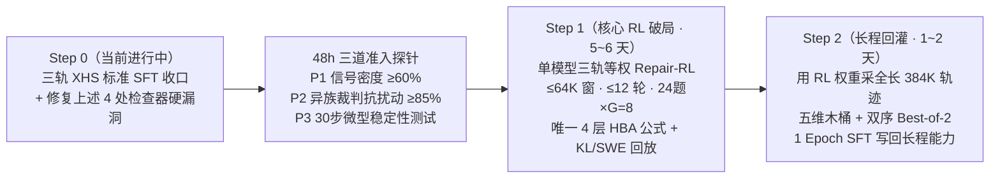

# SFT 后强化学习方案联合去杂糅审查与终极收敛蓝图（主调研方 × Claude Opus 5.5）

> 公开整理版 · 2026-11-27。保留成文时点的记录；计划、文献结果和本地实测请分别理解。 环境路径已泛化，未收录的附件已标注；发布范围见 [整理说明](../../PROVENANCE.md)。

- **成文日期**：2026-11-27
- **联合审查背景**：针对前期汇总 38 篇论文形成的[五阶段 RL/MOPD 调研报告 v2.0](../3d-agent-post-sft-rl-survey-20261127/README.md)中**“指标繁多、15+ 项技术机制叠床架屋、战线过长”**的核心工程隐患，按 `joint-research` 独立双盲规范启动专用路由 `claude-opus-5-5` 联合源码级审查与收敛。
- **独立报告与运行核验凭据**：
  - 主调研方独立自审草案（阅读 Opus 结论前完成）：[main-consolidation.md](main-consolidation.md)
  - Claude Opus 5.5 独立审查报告：[opus-review.md](opus-review.md)（专用启动器 `claude-phanthy.sh` → `${LOCAL_ADAPTER}`；Session ID：`50af93c2-5a2f-4bf7-b5e9-a66077ae76e0`；30 轮源码与文献深查 + `--effort low` 正文导出，`is_error=false`，`modelUsage` 实核为 `claude-opus-5-5`；注：首轮 `-p` 在过渡文本处提前收束、次轮 `--effort high` 写长 JSON 触及 300s 流超时，第 3 次续跑完整导出 283 行报告）
- **使用边界**：本报告为 SFT 收口后的下一阶段**精简工程执行蓝图**，未修改 `decisions.md` 及任何在跑线上任务。

---

## 一、核心裁决速览：从“15 项全明星杂糅 + 7 轮训练”砍成“1 公式 + 1 单模型 Repair-RL + 1 轮 384K RFT”

双方各自独立实查三轨检查器源码（`verify_xhs_output.cjs`、`check_2d_v2.mjs`、`cad_inspect.py`、`threejs_rubric_judge.py`、`xhs_v2_produce.py`）后达成高度一致的核心判断：

1. **果断砍掉 6 处在同一优势张量上互相打架的叠加项**：
   - 原方案将 `PhyCAD HBA`、`GDPO`、`POW3R`、`GVPM max(A,0)`、`CDP ATC`、`SRaR`、`RECAP`、`SDFT`、`MOPD` 叠在一起，会**直接击穿 `HBA` 跨层严格保序不等式（$\lambda_L > 2\lambda_w$）并破坏组内零均值平衡**。
2. **用硬算力账否决“从零 384K 在线 RL”与“7 轮串联训练”**：
   - 在 `gpu34 + gpu38`（`2×8 H800`）上，`Qwen3.8-27B` 跑 `384K` 多图长轨迹的 KV Cache 约 `25 GB/条`，8 卡推理池仅能并发 ~20 条，单条 50–150 轮含渲染耗时 `1–2.5 小时` $\implies$ **单步（192 条）需 ~15 小时，300 步要跑半年，物理上必然卡死**！
   - 反之，改为 **Step 1：短程 `Repair-RL`（`≤64K` 上下文、`≤8~12` 轮，从 SFT 自身 `L1–L3` 中等瑕疵工作区快照起步）**，单条 KV 仅 `~4 GB`、并发 `100+`、单步 **`20–30 分钟`**，**5–6 天即可跑完 300 步**；随后通过 **Step 2：用训好的检查点在全长 `384K` 题上离线采样 + 五维门控 Best-of-2 做 1 Epoch `RFT` 回灌**，即可把精修与视觉审美能力无损迁回从零长程生成！
3. **否决 MVP 阶段拆 3 个单轨专家再跑 `MOPD` 合模**：
   - 组相对优势本就在**同一题 $x$ 的 $G$ 条 rollout 内部**归一化，三轨绝不在同一组比大小，“跨轨奖励量纲打架”在优势层并不成立！真正的不均衡来自 **3D 轨迹 token 数是 CAD 的近 10 倍**——只需**先在各轨内部做可训 token 均值，再按 `(1/3, 1/3, 1/3)` 等权合并三轨 Loss**（配 `10–15%` 通用 SWE SFT 回放 + `low-var KL` $\beta=0.01$），一套单模型训练即可同时推进三轨！
4. **抓出开 RL 前必须先修的 4 处现行验收器硬漏洞**（不修会被 RL 策略瞬间钻穿拿满分，见第四节）。

---

## 二、19 项候选机制“去杂糅”四分类终裁表

| 候选机制（源自 38 篇论文） | 最终裁决 | 数学冲突根因与工程去留硬理由 |
|---|---|---|
| **1. `GSPO-token` + `IcePop` 越界归零** | **保留（主干）** | 长序列似然比稳定器（`ms-swift` / `verl` 原生支持）；`IcePop`（$\rho \notin [0.5, 2.0]$ 置零）仅一行代码直接并入裁剪。 |
| **2. `TITO` 词元直通 + `infra_error` 剔除 + 整组原子提交** | **保留（红线）** | 消除重分词漂移、沙盒超时误罚 `0` 分与抢占存活短偏置的底层前提。 |
| **3. `PhyCAD HBA`（四层硬门禁 + $L_3$ 层内秩）** | **保留（唯一奖励骨架）** | 唯一具备严格跨层保序证明（$\lambda_L=1.0 > 2\lambda_w=0.50$）与无量纲吞噬性质的合成器。 |
| **4. 轨内可训 Token 均值 + 三轨 `(1/3, 1/3, 1/3)` 等权合并** | **保留（新增纠偏）** | 继承 `CompactionRL` 轨内防烂段霸权，同时解决 3D（数十 K tok）吞噬 CAD（数 K tok）梯度份额问题。 |
| **5. `WebCatalyst Visual Anchor`** | **合并化简** | 原方案与 Rubric 视觉分重复计分（`C7`）；现合并为 $L_3$ 层内质量分 $q_i$ 的单边退化扣分项 $\kappa[a^{\mathrm{ref}}-a_i-\delta]_+$。 |
| **6. `IterCAD GVPM`** | **砍半保留** | **只留零偏置后缀 `loss_mask=0`**（连续 2 轮退化后屏蔽后缀）；**坚决砍掉 $\max(\hat{A}, 0)$ 截断**（会破坏零均值、给长失败轨迹注入净正梯度，`C3`）。 |
| **7. 裁判前置 `"reasoning"` + 删 `"such as"` + `≥25%` 负向条款** | **保留（零成本规范）** | 防止裁判排名崩溃（`POW3R`）与半截复合/堆砌刷分（`2605.12474`）。 |
| **8. 净室空目录重跑 + 只读隔离验证器 + 隐藏随机探针** | **保留（防作弊底线）** | 物理封死残留文件缓存、修改测试器与固定时间戳特判。 |
| **9. `GDPO` 多分量各自白化求和** | **坚决砍掉** | 与 `HBA` 正面冲突（`C1`）：除 $\sigma_L$ 扭曲层间距，视觉白化值域达 $\pm 2.6$ 直接击穿 $\lambda_L > 2\lambda_w$！ |
| **10. `SRaR` 在线轮次偏置** | **坚决砍掉** | 二阶矩为 1 的轮次偏置在 token 级击穿 `HBA` 跨层保序（`C5`），且每轮调裁判使 API 成本乘 $\times T$。 |
| **11. `SDFT` 蓝图条件化自蒸馏** | **坚决砍掉** | 与 `Repair-RL + KL/SFT 回放` 功能重叠且产生多目标 KL 拉扯（`C6`）。 |
| **12. `s_vis_adj` 几何难度补偿进 RL** | **移出在线 RL** | 同题 $G$ 条 rollout 补偿常数完全相同，组内减均值后 `100%` 恒等抵消（`C8`），仅留给离线 `RFT` 跨题准入。 |
| **13. 本地自托管 `Qwen3.8-27B` 当在线主裁判** | **移出在线主环** | 在 `16×H800` 上占走 `4–8` 卡腰斩训练吞吐，且与 `27B` Actor 共享视觉编码器盲区极易发生对抗共谋（§4.1）；改用异族 `kimi-k3.1-pro` 仅评 $L_3$，`27B` 仅做离线影子共谋监控。 |
| **14. `ManimCode` 正反双序成对盲评** | **移至离线 RFT / Eval** | 组内全成对需 $G(G-1)=56$ 次调用（单点打分取秩仅需 $|S_3|\approx 3\sim 4$ 次，`C10`）；专用于离线 `Best-of-2` 与留出盲评。 |
| **15. `POW3R` 方差重加权** | **移至离线清洗** | 在线 $L_3$ 幸存样本常不足 $\ge 0.75G$（`C2`）；改为离线清洗剔除全满/全零死 Rubric 条目。 |
| **16. `3 个单轨 LoRA 专家 + MOPD 合模`** | **降级为触发式备选** | 仅当单模型合训中某轨留出 `Accepted@1` 连续两次评测比 SFT 倒退 `>2 pp` 时，才对该轨单开 LoRA + 单师 OPD。 |
| **17. `RECAP / CompactionRL` 跨压缩在线 RL** | **暂缓（Phase 2）** | MVP 通过 `≤64K Repair-RL + 384K RFT` 绕开超长在线采样；仅保留 SFT 阶段 9 节 `<summary>` 梯度监督。 |
| **18. `AggreVaTe` 强师前缀接管** | **暂缓（触发式）** | 仅当某轨候选 RL 题池中 `$L_0$ 全挂死组率 > 40%` 时对全挂题定向启用。 |
| **19. `CDP ATC` 调用栈归因 & `Kimi Toggle` 预算交替** | **暂缓（Phase 2）** | 多文件多轮 `Edit` 字节区间无法唯一映射 token（`C4`）；`Toggle` 与超时丢弃同向叠加短偏置（`C9`），MVP 硬限 `≤12` 轮即可。 |

---

## 三、指标三层断舍离与全系统唯一 45 行优势合成公式

### 3.1 繁杂指标各归其位（严禁把离线/评测指标全塞进在线奖励）

| 归属层 | 包含指标 | 设计准则 |
|---|---|---|
| **① 在线 RL 奖励层**<br>（极简、仅 **3** 个输入信号） | 1. 确定性脚本四级定层 $L_i \in \{0, 1, 2, 3\}$（0 次 VLM 调用）；<br>2. **仅对 $L_i=3$ 样本**计算的异族裁判 Rubric 均分减单边锚点退化 $q_i \in [0, 1]$；<br>3. 二值 `token_mask` $m_{i,t} \in \{0, 1\}$（5 类坏轮 + GVPM 连续 2 轮退化后缀 + 非模型轮）。 | 零跨指标权重调参、严格保序、零均值、token 级只做 0/1 掩码绝不乘加改写优势符号。 |
| **② 离线造数 / Step 2 RFT 过滤层** | 小红书五维木桶（单维 $\ge 0.50$、均分 $\ge 0.60$）、$\Delta(d_{\mathrm{geo}})$ 几何难度补偿、正反双序 `Best-of-2` 择优、`POW3R` 死条目剔除、Ideal 样本自洽度 $\ge 0.9$ 校验、`<text>` 字牌密度告警。 | 允许慢速多视角精评与跨题绝对阈值卡控，反哺全长 `384K` 轨迹质量。 |
| **③ 留出评测层（Eval-Only）**<br>（永不进训练防 Goodhart） | **三轨独立主指标 `Accepted@1`**、`BenchCAD`（含外部 `Voxel IoU`，注：现行 `cad_inspect.py` 未内置体素 IoU）、`AnimWeb-Bench`、`MotionGraphicsBench`、`xhs-threejs-val`、`ModelForge / SWE` 通用基准、Rubric-Free 人工/Opus 双序盲评、**`27B 影子分 − 异族裁判分` 共谋漂移监控**。 | 独立尺子度量真实泛化与跨轨负迁移。 |

### 3.2 三轨确定性四层（`L0–L3`）精确字段映射

| 层级 | Track 1：3D（修补后 `verify_xhs_output.cjs`） | Track 2：2D（修补后 `check_2d_v2.mjs`） | Track 3：CAD（`cad_inspect.py --no-render` 先行） |
|---|---|---|---|
| **$L=0$**<br>入口/构建崩 | 缺 `index.html`、`load_error`、AST/模块导入断链 | `missing_html`、`browser_or_protocol_error`、缺 `window.renderAt` | AST 违禁、`cad_build_error`、`step_readback_failed` |
| **$L=1$**<br>静态/拓扑挂 | `L2_offline_webgl_clean=false`（报错 / 外链 / WebGL 空白 / 缺本地 `three`） | `offline_or_page_error`、`target_not_visible`、`static_stage_or_hud_only_motion`、SVG 缺 `viewBox` | 非水密或非 2-流形、零件数低于契约下限、有效面数过低 |
| **$L=2$**<br>动态/干涉挂 | 冻结时钟后纯 `<canvas>` `orbit.responds=false` 或指定交互控件无实质变化 | 乱序 `seek` 不一致、重绘残影、循环接缝跳变、`#scrub/#play/#pause` 失效、剥离伪装 `overflow:hidden` 后越界/重叠 | 两两 B-rep 布尔干涉 `>0.05 mm³`（**含 `IsDone()=False` 布尔异常！**）、`--probe` 报错或死参数零响应 |
| **$L=3$**<br>硬检全通 | 上述全部通过（自动存多视角图送 $L_3$ 视觉评） | 上述全部通过且文字零重叠、MP4 正常导出 | 上述全部通过（**仅此时补跑多视图 + `section_view` + `exploded_view` 渲染送 $L_3$ 评！**） |

### 3.3 主审 × Opus 双盲对表：3 处细微分歧与最终合并公式

| 分歧点 | 主调研方初稿 (`main-consolidation.md`) | Opus 5.5 独立审查 (`opus-review.md`) | 最终采信决策与理由 |
|---|---|---|---|
| **1. `L0–L2` 失败层内部是否按 `-issue_count` 排秩？** | 默认在 `L0–L2` 内按违例条数越少排越高秩，降低早期零方差死组率。 | 默认令 `L0–L2` 层内秩 `At = 0`（防诱导“只消语法警告不修几何”），仅在探针 `P1` 死组率 `>40%` 时才对 `L1/L2` 启用 `-issue_count` 备选。 | **采信 Opus**：逻辑更严密，用 10 小时 `P1` 实测死组率决定开关，不预先给失败层留刷子分口子。 |
| **2. 组优势归一化分母是否除组内标准差 $\sigma_{\mathrm{grp}}$？** | 不除 $\sigma_{\mathrm{grp}}$（纯均值中心化 `Dr.GRPO`），防 `7 挂 1 过` 时 $\sigma \approx 0.33$ 把单条离群梯度放大 `3×`。 | 除 $\sigma_{\mathrm{grp}} + \epsilon$，使各题组优势严格单位方差，便于三轨等权合并。 | **折中合流（加下界保底 $\max(\sigma_{\mathrm{grp}}, 0.5)$）**：正常方差题保持单位方差对齐三轨尺度，极端 `7:1` 稀疏组封顶放大不超过 `2×`，兼顾两边优点！ |
| **3. 长程 `384K` 能力如何承接？** | 待 Phase 1 跑顺后按需上单轨 LoRA + OPD 或压缩 RL。 | 直接定死 **Step 2：`384K RFT` 离线回灌**（用 Step 1 Repair-RL 策略采全长轨迹，五维过滤后做 1 epoch SFT）。 | **采信 Opus**：彻底免除百万上下文在线 RL 基建负担，完美复用现成 `ms-swift` SFT 冠军管线！ |

#### 终极唯一优势与损失合成实现（全系统仅此一套，约 45 行 Python）：

```python
import math
import numpy as np

def q_score(rubric_scores: list[float], anchor_ref: float, anchor_cand: float,
            kappa: float = 1.0, delta: float = 0.10) -> float:
    """L3 合格样本专属质量分：异族裁判 Rubric 均分 - 相对强参考帧单边退化扣分"""
    base = float(np.mean(rubric_scores))
    degrade_penalty = kappa * max(0.0, anchor_ref - anchor_cand - delta)
    return float(np.clip(base - degrade_penalty, 0.0, 1.0))

def compute_group_advantages(
    L: list[int],
    q: list[float],
    infra_err: list[bool],
    lam_w: float = 0.25,
    std_floor: float = 0.50,
    tie_tol: float = 1e-3,
) -> dict[int, float] | None:
    """严格跨层保序 (1.0 > 2*0.25) + 精确零均值 + 防稀疏方差爆炸"""
    valid_idx = [i for i, bad in enumerate(infra_err) if not bad]
    if len(valid_idx) < math.ceil(0.75 * len(L)):
        return None  # 沙盒基础设施异常过多：整组丢弃重采，绝不记 0 分

    Ls = np.array([L[i] for i in valid_idx], dtype=float)
    qs = np.array([q[i] if L[i] == 3 else 0.0 for i in valid_idx], dtype=float)
    At = np.zeros(len(valid_idx), dtype=float)

    # 仅在 L3 合格层内部按连续质量分 q 计算居中并列秩 [-1, 1]（居中秩之和恒为 0）
    l3_pos = np.where(Ls == 3.0)[0]
    if len(l3_pos) > 1:
        vals = qs[l3_pos]
        ranks = np.zeros(len(vals), dtype=float)
        for idx_a, va in enumerate(vals):
            less = np.sum(vals < va - tie_tol)
            equal = np.sum(np.abs(vals - va) <= tie_tol)
            ranks[idx_a] = less + 0.5 * (equal + 1.0)  # 1..n 平均并列秩
        At[l3_pos] = (2.0 * ranks - (len(l3_pos) + 1.0)) / (len(l3_pos) - 1.0)

    raw = (Ls - Ls.mean()) + lam_w * At  # 组内精确零均值，且 L3 - L2 >= +0.50
    if np.allclose(raw, 0.0):
        return None  # 零方差死组：直接剔除并统计死组率

    denom = max(float(raw.std()), std_floor)
    A = raw / denom
    return dict(zip(valid_idx, A.tolist()))
```

- **训练批次多轨合并损失**：
  $$\mathcal{L}_{\mathrm{total}}(\theta) = \frac{1}{3}\sum_{d \in \{\text{3D},\text{2D},\text{CAD}\}} \mathcal{L}_{\mathrm{GSPO}}^{(d)}(\theta) + \beta\,\mathrm{KL}_{\mathrm{lowvar}}(\pi_\theta \parallel \pi_{\mathrm{SFT}}) + \alpha_{\mathrm{replay}}\,\mathcal{L}_{\mathrm{SFT}}^{\mathrm{SWE}}(\theta)$$
  其中每轨内部 $\mathcal{L}_{\mathrm{GSPO}}^{(d)}$ 严格除以该轨有效未掩码输出 token 总数 $|\mathcal{M}_d|$，$\beta = 0.01$，$\alpha_{\mathrm{replay}} \in [0.10, 0.15]$。

---

## 四、开工前必补的 4 处现行验收脚本硬漏洞（源码实查定位）

1. **统一 `threejs_rubric_judge.py` 与 `11-26` 小红书多文件标准**：现行 `GatePolicy` 默认 `require_standalone_inline / require_deterministic_render_at / require_working_slider = True` 且走 `file://`，会把合规的小红书多文件 `http.server` 3D 场景全部误判为失败；须按契约字段（`bundle_mode` / `needs_http_server`）分流，并移除已失效 `.env.deepseek` 硬依赖。
2. **封堵 `verify_xhs_output.cjs` 自转混分与全屏 HUD 假动漏洞**：
   - 第 268/523 行允许 `index_html_bytes >= 200000` 替代本地 `three.js`（塞注释即可凑够 200KB）；
   - 第 420–508 行未冻结 `requestAnimationFrame` 时钟且对整页（含 HTML 弹窗）截屏算 `MAD`：场景微弱自转或点按钮弹纯文字框即可骗过 `orbit.responds` 与 `controls.any_visual_change`。**修法**：接入 `page.clock.install()` 冻结自转时钟、仅截取 WebGL `<canvas>` 区域像素、并用 `elementFromPoint` 校验真实命中。
3. **封堵 `cad_inspect.py` 第 221 行布尔异常静默放行漏洞 + 在线默认 `--no-render`**：
   - `_check_pairwise_brep_interference` 中 `if not common.IsDone(): continue` 会把 OpenCascade 布尔求交失败的病态自交几何**静默当成零干涉放行**！**修法**：`not common.IsDone()` 一律记入 `issues`（归为 $L_2$ 干涉失败）；且在线检查先跑 `--no-render`（`<0.8s`），仅 `ok == True`（$L_3$）才启动 3 张 WebGL 视图渲染。
4. **补齐 `check_2d_v2.mjs` 视口防作弊检查**：在 `viewport_audit`（第 488–552 行）扩展普通 HTML 文本节点碰撞检测、临时剥离非画布容器伪装 `overflow: hidden` 测真实滚动溢出，并锁定统一 Docker 字体镜像防止跨机抗锯齿导致 `sha256` 误杀。

---

## 五、收敛后的极简三步路线图与 48 小时 Go/No-Go 探针



### 开工前 48 小时三道可证伪探针（任一未过先止损修复，绝不盲开正式 RL）
- **`P1` 信号密度探针（~10h，纯推理零训练）**：取 SFT 检查点在三轨各 20 道 Repair 题采 $G=8$（`T=1.0`），验证新公式非死组率 **`>= 60%`**、每轨 $L_3$ 占比落在 **`15%–85%`**、沙盒 `infra_error < 5%`（若有效组 `<35%` 先重调题池难度，不开 RL）。
- **`P2` 裁判抗刷分与抗共谋探针（~12h）**：对 200 个真实 $L_3$ 产物构造三类作弊扰动（删材质阴影留裸块、塞 `<text>` 字牌、微改敷衍），核验异族裁判（`kimi-k3.1-pro`）识别原件胜率 **`>= 85%`**，并测本地 `27B` 对自产样本偏置（若偏置 `>0.10`，锁死 `27B` 永不进在线奖励）。
- **`P3` 30 步微型稳定性与吞吐探针（~20h，先跑 CAD+2D）**：`16 题 × G=8`、`≤32K` Repair 模式跑 30 步，验证单步墙钟 **`<= 25 分钟`**、训推 `|Δlogp| p99 < 0.1`（验真 `TITO`）、策略熵降幅 `<30%`、$L$ 均值单调上升且留出 SWE 掉点 `<1 pp`（若熵崩且调 $\beta=0.04$ 无效，立即止损退回纯 `RFT` 迭代路线）。
