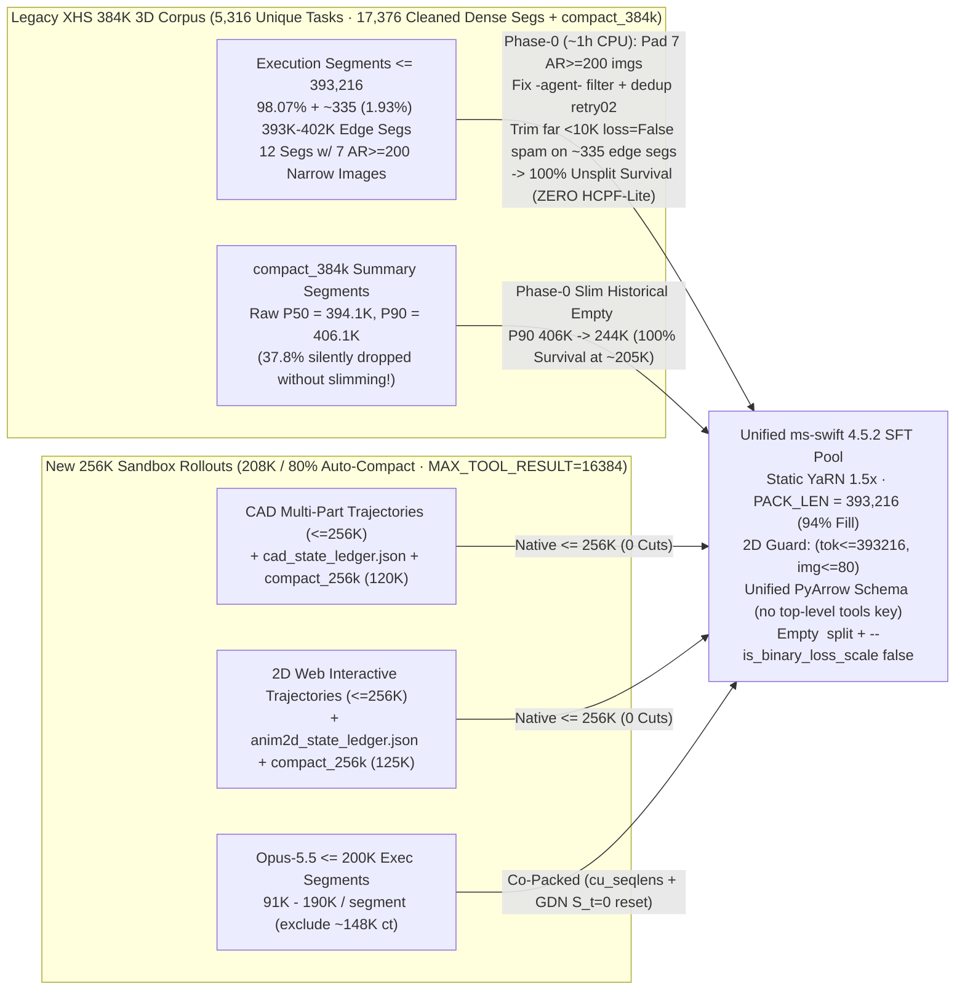

# Blueprint Track 01 · Option 2 Context Architecture: Unsplit `384K` (`Static YaRN 1.5×`) Training + Unified `256K` Sandbox & Serving Specification (3D · 2D · CAD)

> 公开整理版 · 2026-11-28。保留成文时点的记录；计划、文献结果和本地实测请分别理解。环境路径已泛化，未收录的附件已标注；发布范围见 [整理说明](../../PROVENANCE.md)。

> **Status**: **Revision 3 / Option 2 Aligned Specification** (`2026-11-27`)  
> **Canonical Master Sources**: [CLEANROOM-4MODEL-VERDICT-384K-TRAIN-256K-SERVE.md](../xhs-384k-to-200k-data-adaptation-20261127/CLEANROOM-4MODEL-VERDICT-384K-TRAIN-256K-SERVE.md) · [OPTION2-CAD-2D-DATA-EVAL-MIX-MASTER-PLAN.md](../xhs-384k-to-200k-data-adaptation-20261127/OPTION2-CAD-2D-DATA-EVAL-MIX-MASTER-PLAN.md)  
> **Scope**: Question 1 of the Multi-Domain Visual Code Agent Distillation Blueprint — **Train Long (`384K` Unsplit XHS on `32×H100` with `Static YaRN 1.5×`), Synthesize & Serve Short (`256K` Sandbox with `208K / 80%` Auto-Compaction, `MAX_TOOL_RESULT_TOKENS=16384`, `vLLM --max-model-len 327680` Same `config.json`), Phase-0 Zero-Drop XHS Cleaning (Zero `HCPF-Lite` Splitting), and Multi-Segment Horizon Decoupling** across **3D (`Blender 4.2.10 bpy` + `Three.js r180`)**, **Industrial CAD (`CadQuery 2.6.1 / OCCT`)**, and **2D Interactive Animation (`Canvas2D + SVG + GSAP`)**.  
> **Project & Historical Ground-Truth Sources**: `decisions.md`（本地附件未发布） · [XHS-UNIFIED-SFT-STANDARD.md](../../3d-animation-agent/docs/XHS-UNIFIED-SFT-STANDARD.md) · [STANDARD-PARAMS.md](../../3d-animation-agent/docs/STANDARD-PARAMS.md) · [THREE-TRACK-DELIVERABLE-SPEC.md](../../3d-animation-agent/docs/THREE-TRACK-DELIVERABLE-SPEC.md) · `agy_stats.json`（本地附件未发布） · `summary.json`（本地附件未发布） · [3DCodeFactory README.md](../arxiv-2611.28783/README.md) · *(Historical Rev 2 Archive)*: [joint-consolidation.md](../xhs-384k-to-200k-data-adaptation-20261127/archive/joint-consolidation.md) · [empirical_audit_200k_ledger.json](../xhs-384k-to-200k-data-adaptation-20261127/archive/empirical_audit_200k_ledger.json) · [exp1_gpu1_verified_results.json](../xhs-384k-to-200k-data-adaptation-20261127/archive/a100-experiments/exp1_gpu1_verified_results.json)

---

## 1. Executive Decision & Core Architectural Answer

**Question**: *Given Xiaohongshu's `384K`-window 3D trajectories (`3DCodeFactory`, ~6,414–6,418 SFT records / 5,316 train + 216 val unique tasks, median multi-segment trajectory ~824K tokens, mean 1,094.5K tokens) and our expansion to **2D** and **CAD** on dense **`Qwen3.8-27B`**, what context window should our training, data-generation, and evaluation sandbox use, and why?*

### Definitive Answer (Option 2): Train Unsplit `384K` (`Static YaRN 1.5×`) on `32×H100`, While Locking Synthesis, Eval & Serving onto the `256K` (`208K / 80%`) Sandbox Under the Exact Same `config.json`

1. **Unified `Static YaRN 1.5×` Coordinate System (`MAX_LENGTH = 393,216`, Locked End-to-End)**:
   - Every training stage (Stage 1 `384K` XHS, Stage 2 Multi-Track Anneal, `1×8×H100` Canary, Stage 3 `Repair-RL`, Stage 4 `RFT`) and online `vLLM` serving MUST use the **exact same `Static YaRN 1.5×` `config.json`**: `max_position_embeddings = 393216`, `rope_scaling = {"rope_type": "yarn", "factor": 1.5, "original_max_position_embeddings": 262144, "mrope_interleaved": true, "mrope_section": [11, 11, 10], "partial_rotary_factor": 0.25, "rope_theta": 10000000}`. **NEVER strip `rope_scaling` or switch to Dynamic YaRN at inference time.**
   - Why `Static YaRN 1.5×` incurs `<0.5%` residual noise on `Qwen3.8-27B`: `48/64` (`75%`) `GatedDeltaNet` layers use no RoPE, and `75%` of dimensions in the `16` full-attention layers are `NoPE` — only `6.25%` of attention dims use RoPE, `15/32` high-frequency pairs (`≤8K`) have `0.0%` phase shift, only `3.32%` of head dims interpolate, and full-parameter SFT absorbs the `+2.07%` effective temperature shift to `<0.5%`.
   - `32×H100` (`TP=4, PP=4, CP=2, DP=1, SP=true`, asymmetric slicing `[8, 20, 20, 16]`, `recompute=full/uniform/1`, `vit_gradient_checkpointing=true`, `optimizer_cpu_offload=true`, `LM_HEAD_LOSS_CHUNK_SIZE=16384`, FP32 `main_grad`, and 2D packing guard `(tok<=393216, img<=80)`) is physically verified on full `384K` by `start-full-32g-s3-v1` Step 1 (`applied=True, loss=1.0625, grad_norm=1.5135, peak_alloc=61.97 GiB, peak_reserved=73.48 GiB`).
2. **Unified `256K` (`262,144`) Synthesis / Eval / Serving Sandbox (`208K / 80%` Auto-Compaction)**:
   - New CAD/2D synthesis, evaluation, Stage 3 RL (`≤64K` repair), and Stage 4 `RFT` run in the **`256K` sandbox**: `AGENT_CONTEXT_WINDOW_TOKENS=262144`, `CLAUDE_CODE_AUTO_COMPACT_WINDOW=208000` (`CLAUDE_AUTOCOMPACT_PCT_OVERRIDE=80`), `CLAUDE_CODE_MAX_OUTPUT_TOKENS=32768`, and `MAX_TOOL_RESULT_TOKENS=16384` (`208K + 16.4K + 4K + 32.8K = 261.2K < 262,144`, guaranteeing zero overflow). Compaction prompts MUST NOT hardcode `/384K` or `/256K` denominators (preventing Context Anxiety).
   - Online `vLLM` (`TP ≥ 2`) serves the exact same `Static YaRN 1.5×` `config.json` with `--max-model-len 327680` (or `393216` burst cushion) + `--enable-prefix-caching --mamba-cache-mode align` — PagedAttention allocates `0` extra steady-state KV bytes while preventing HTTP 400 spikes near `208K–220K`.
3. **Strict Decoupling of Single-Segment Sandbox (`256K`) from Total Task Horizon (`500K–1.2M+` tokens)**:
   - A `256K` active sandbox window **never caps total reasoning depth**. Both Xiaohongshu's `3DCodeFactory` (`2.05M` tokens across `4` compactions on `xhs_headland_set_bpy`) and our historical `realhard6_20261127` runs (`Kimi-K3.1-Pro` executing `502K–782K` tokens; `AGY` solving BenchCAD `T5` at `0.9703` and `T2` at `0.9387` in `330K–336K` total tokens) prove that persistent workspace files + structured `compact_task` handovers support **`500K–2.0M+` cumulative tokens**.
   - Pairing `208K / 80%` compaction (`MAX_TOOL_RESULT_TOKENS=16384`, `MAX_PIXELS=401408` contact sheets) with **Domain-Structured Workspace State Ledgers (`state_ledger.json`) + Per-Domain `
` Invariant Blocks** cuts compactions per hard task from `30–36` down to **`1–3`** and eliminates multi-compaction geometric drift.
4. **Zero `HCPF-Lite` Splitting: Phase-0 Zero-Drop XHS `384K` Cleaning + `PACK_LEN = 393,216`**:
   - **Why `HCPF-Lite@256K` splitting was rejected**: Splitting XHS `384K` trajectories into `256K` causes **Off-Policy Causal Leakage** in the `200K–384K` range (`P(a_t | h_t)` conditioned on missing original code/viewport context).
   - Instead, **Phase-0 CPU Cleaning (~1h CPU)** achieves **`100%` unsplit survival** at `≤393,216`: pad `7` `AR >= 200` images (rescuing `12` segs), slim `384K compact_task` historical empty `<think>` (`P90 406K -> 244K`, rescuing `37.8%` `compact_task`), fix `"-main-agent-"` -> `"-agent-"` (`8` subagent segs dropped) + dedup `retry02`, and trim only far `<10K` irrelevant `loss=False` spam logs on `~335` (`1.93%`) `393K–402K` edge segments. Both unsplit XHS `384K` segments and new `≤256K` CAD/2D/`Opus` segments pack natively into **`PACK_LEN = 393,216` (`94%` fill = `369.62K`/pack)** with `(tok <= 393216, img <= 80)`.

---

## 2. Architecture Trade-Off Matrix (`Option 1 All-384K` vs **`Option 2 384K Train + 256K Sandbox`** vs `Archived Rev 2 Split`)

Historical raw tokenizer counts below are from `${MODEL_ROOT}/Qwen3.8-27B` (`vocab_size = 248,320`, `@512` visual tokens/image at `MAX_PIXELS = 401408`) ([archived empirical_audit_200k_ledger.json](../xhs-384k-to-200k-data-adaptation-20261127/archive/empirical_audit_200k_ledger.json) L1–141, [archived exp1_gpu1_verified_results.json](../xhs-384k-to-200k-data-adaptation-20261127/archive/a100-experiments/exp1_gpu1_verified_results.json), `audit-summary.json`（本地附件未发布）; Rev 1/Rev 2 split simulations in [archived opus-review.md](../xhs-384k-to-200k-data-adaptation-20261127/archive/opus-review.md) and `empirical_audit_200k_ledger.json` L142–238 are superseded).

| Coupled Dimension / Metric | Option 1 · All-`384K` (Train + Synth + Serve) | 🏆 **Option 2 · `384K` Unsplit Train (`Static YaRN 1.5×`) + `256K` Sandbox/Serve (Ratified)** | Option 3 (Archived Rev 2) · Split into Native `256K` (`HCPF-Lite@256K`, YaRN OFF) |
| :--- | :---: | :---: | :---: |
| **`Qwen3.8-27B` Position Encoding** | `Static YaRN 1.5×` (`393,216`) | **Unified `Static YaRN 1.5×` (`393,216`) across Stage 1–4 & `vLLM` (`6.25%` RoPE dims, `3.32%` interp, `<0.5%` residual after SFT)** | Native `262,144` (`rope_type="default"`, retired) |
| **XHS `384K` Causal Integrity** | `100%` unsplit | **`100%` unsplit survival** (Phase-0 zero-drop clean + `<10K` spam trim on `~335` edge segs) | **Rejected**: splits `80.9%` (`586/724`) of XHS segments (`596` cuts), causing **Off-Policy Causal Leakage** |
| **New Data Synth / Eval Watermark** | `~325K–340K` (triggers `4–6 pp` `Context Rot` drop) | **`256K` (`262,144`) · `208K / 80%` auto-compact · `32768` out · `16384` tool cap** (`261.2K < 262,144`) | Historical Rev 2: `220000 / 85%` (`190000` for `64K`) |
| **`32×H100` Full-Param SFT VRAM (`freeze_vit=false`)** | `PACK_LEN = 393,216` | **`TP4·PP4·CP2·DP1`, `[8, 20, 20, 16]` + `recompute=full/uniform/1` + `vit_grad_ckpt` + CPU offload + chunked CE `16384` + FP32 `main_grad` + `2D (tok<=393216, img<=80)`** (`61.97 / 73.48 GiB` proven Step 1) | Historical Rev 2: `[10, 19, 19, 16]` @ `262,144` |
| **Online `vLLM` & Stage-3 RL Efficiency** | `+125%` prefill FLOPs, `+50%` KV, `2×` slower data gen | **Optimal sweet spot**: `256K` sandbox keeps steady-state `≤208K–256K` (`2.25×` less full-attn FLOPs, `33%` less KV), while `vLLM --max-model-len 327680` costs `0` extra steady-state KV bytes | Same sandbox compute, but breaks XHS `384K` causal continuity |

---

## 3. Deep Dive across the Four Coupled Architectural Dimensions

### 3.1 Dimension 1: Student Model (`Qwen3.8-27B`) `Static YaRN 1.5×` Proof & Physical `384K` SFT/RL VRAM Laws

1. **Exact `Qwen3.8-27B` Hybrid Architecture & Unified `Static YaRN 1.5×` Coordinate System**:
   - `Qwen3.8-27B` (`${MODEL_ROOT}/Qwen3.8-27B`) is a `64`-layer hybrid multimodal dense model (`hidden_size = 5,120`, `vocab_size = 248,320`) interleaving **`48` linear-attention `GatedDeltaNet` (`GDN`) layers** (`linear_num_key_heads = 16`, **NO RoPE**) with **`16` full-attention `GatedSelfAttention` layers** (`3:1` ratio, `num_attention_heads = 16`, `num_key_value_heads = 4`), coupled to a **`27`-layer Vision Transformer + Aligner** (`~675M` vision params, `MAX_PIXELS = 401408` $\to$ `2,048` raw patches $\to$ `512` merged visual tokens/image).
   - Inside the `16` full-attention layers, `partial_rotary_factor = 0.25` (`75%` `NoPE`), so **only `6.25%` of total network attention dimensions use RoPE** (`mrope_interleaved = true`, `mrope_section = [11, 11, 10]`, `rope_theta = 10,000,000`). Applying **`Static YaRN 1.5×`** (`max_position_embeddings = 393216`, `original_max_position_embeddings = 262144`, `factor = 1.5`) keeps `15/32` high-frequency pairs (`≤8K`, covering local code syntax and image spatial coordinates) at **`0.0%` shift**, interpolates only **`3.32%`** of head dimensions (`+2.07%` effective temperature shift), and full-parameter SFT absorbs it to **`<0.5%` residual difference at `≤256K`**, provided the exact same `config.json` is kept across Stage 1–4 and `vLLM` serving (never strip `rope_scaling` or enable Dynamic YaRN).
2. **Physical SFT Memory Wall Solved on `32×H100` (`start-full-32g-s3-v1` + [exp1_gpu1_verified_results.json](../xhs-384k-to-200k-data-adaptation-20261127/archive/a100-experiments/exp1_gpu1_verified_results.json))**:
   - *Root Cause A — `PP-Last` Logits Explosion*: Megatron's `fused_vocab_parallel_cross_entropy` allocates an internal **FP32 (`4`-byte)** buffer atop **BF16 (`2`-byte)** logits (`6 bytes × S_local × V_shard`). Unchunked `384K` (`TP=4, CP=2 → S_local=196,608, V_shard=62,080`) requires **`22.73 GiB` BF16 + `45.47 GiB` FP32 = `68.20 GiB`** for the LM-head alone (historically crashing `smoke32-c1-tp4pp4cp2-v3`). Removing the `not self.output_layer.weight.requires_grad` guard at `gdn_v3_plugin.py:213` with **`LM_HEAD_LOSS_CHUNK_SIZE=16384`** and **`main_grads_dtype = fp32`** cuts transient overhead to `5.68 GiB`/chunk (`wgrad` relative L2 error **`2.10e-5`** vs **`3.00e-3` [`142×` worse]** under BF16 accumulation).
   - *Root Cause B — `PP-First` Unfrozen ViT Tail Spike & `384K` Physical Solution*: Per `decisions.md`（本地附件未发布）, `--freeze_vit false --freeze_aligner false` is mandatory. Because `ms-swift` executes the `27`-layer ViT unsharded on `PP0`, `384K` requires `recompute=full/uniform/1`, `vit_gradient_checkpointing=true`, `optimizer_cpu_offload=true`, asymmetric slicing **`[8, 20, 20, 16]`** (`PP0` reduced to `8` LLM layers), and a **2D packing guard `(tok <= 393216, img <= 80)`**. Live cluster telemetry from `start-full-32g-s3-v1` Step 1 (`applied=True, loss=1.0625, grad_norm=1.5135, 17.82M T_in, 11.58M U [65.0%], peak_alloc=61.97 GiB, peak_reserved=73.48 GiB`) physically proves `32×H100` runs full `384K` reliably.
   - **Stage-3 RL (`≤64K`), Stage-4 `RFT` (`256K`), & Online `vLLM` Serving**: While `256K` active segments keep full-attention KV (`64 KiB/tok` in BF16 = `16.0 GiB`/req vs `24.0 GiB`/req at `384K`) and quadratic prefill FLOPs `2.25×` lower than `384K` (preserving high rollout concurrency), `vLLM` (`TP≥2`) PagedAttention allocates KV dynamically — so launching with **`--max-model-len 327680` (or `393216`)** alongside `--enable-prefix-caching --mamba-cache-mode align` uses **`0` extra steady-state KV bytes** while giving a burst cushion above the `208K` compact trigger.
3. **Why Historical `200K` (`204,800`) and Rev 2 `HCPF-Lite@256K` Split Were Retired**:
   - `200K` wasted `21.9%–24.5%` native capacity and shattered `72.2%` of segments into 3 fragments ([archived opus-review.md](../xhs-384k-to-200k-data-adaptation-20261127/archive/opus-review.md)); Rev 2 `HCPF-Lite@256K` still split `80.9%` of XHS segments, inducing **Off-Policy Causal Leakage** in `200K–384K` (`CLEANROOM` §2.1). Option 2 resolves both cleanly.

---

## 3.2 Dimension 2: Decoupling Single-Segment Sandbox (`256K` / `208K / 80%` Auto-Compact) from Total Task Horizon (`500K–1.2M+`) & Curing `Kimi`'s `30–36`-Compaction Drift

#### A. Hard Empirical Proof That a Bounded Window Never Caps Total Reasoning Horizon

Both `3DCodeFactory` (`trajectory.py`（本地附件未发布）) and our `realhard6_20261127` benchmark (`summary.json`（本地附件未发布）, `agy_stats.json`（本地附件未发布）, `realhard6_{kimi,opus}_20261127/*/run_summary.json`) prove that total reasoning depth is governed by **Workspace Persistence + Compaction Handover Quality**, not single-segment window width:

1. **Xiaohongshu `3DCodeFactory` Ground Truth**:
   - Across `5,045` verified trajectories (`5.52B` tokens), the **average full-task horizon is `1,094.5K` tokens** (`413.6` tool calls, `4,270` median LoC; median multi-segment task `~824K` tokens) — **nearly `3×` larger than XHS's own `384K` sandbox window**!
   - On `xhs_headland_set_bpy` (`cc-ddb2m_076c1453e978c68aa52d`, `summary.json`（本地附件未发布）), the XHS teacher executed **`713` assistant turns**, inspected **`299` images**, and spanned **`2,050,241` tokens** (`2,940` LoC across 6 modular `.py` files) cleanly via **`4` `compact_boundary` transitions** (`1` `compact_before` + `4` `compact_recovery` segments).
2. **Complete `realhard6_20261127` Empirical Token, Compaction & Score Ledger (All 18 Runs Verified on Disk)**:

| Task ID (`Engine`) | `AGY` (High-Ctx Native, `0` Compactions) | `Claude-Opus-5-5` (`200K` Upstream Cap) | `Kimi-K3.1-Pro` (Bounded Window w/ Auto-Compact) | Key Architectural Takeaway |
| :--- | :--- | :--- | :--- | :--- |
| **`bc_t5_shear25`** (`CadQuery`, 25 inst) | `53` turns · `44` imgs · **`329,792` tok** · `0` compact 🏆 **Score `0.9703`** (`part=0.9997`, `asm=0.9706`, **`25/25` hit**) | `115` turns · `50` imgs · **`157,838` tok** · `0` compact Score `0.0121` (`part=0.7547`, `asm=0.0160`, `0/25` hit) | `253` turns · `122` imgs · **`609,388` tok** · **`30` compacts** (`3,474.7s` = `79.1%` time) Score `0.0087` (`part=0.4775`, `asm=0.0182`, `0/25` hit) | Winning solution needed only **`329.8K` total tok** (`≤2` segments of `256K`!); `Kimi` proved `609K` horizon works, but `30` prose compactions + no HLR overlay killed assembly |
| **`bc_t2_dual36`** (`CadQuery`, 36 inst) | `59` turns · `43` imgs · **`335,688` tok** · `0` compact 🏆 **Score `0.9387`** (`part=1.0000`, `asm=0.9387`, **`36/36` hit**) | `271` turns · `94` imgs · **`235,595` tok** · `1` compact (`pre=148.6K`) Score `0.0888` (`part=1.0000`, `asm=0.0888`, `0/36` hit) | `320` turns · `145` imgs · **`782,443` tok** · **`36` compacts** (`3,523.4s` = `73.4%` time) Score `0.0049` (`part=1.0000`, `asm=0.0049`, `0/36` hit) | Winning `36/36` assembly needed **`335.7K` tok** (`2` segments of `256K`); `Kimi` scaled to **`782.4K` tok** without crashing, proving unlimited multi-segment horizon |
| **`bc_t4_chuck9`** (`CadQuery`, 0-STEP) | `80` turns · `63` imgs · **`393,542` tok** · `0` compact 🏆 **Score `0.1597`** (`part=0.5044`, `asm=0.3166`) | `173` turns · `53` imgs · **`131,833` tok** · `0` compact Score `0.0073` (`part=0.0634`, `asm=0.1147`) | `280` turns · `133` imgs · **`616,350` tok** · **`30` compacts** (`2,576.3s` = `64.9%` time) Score `0.0190` (`part=0.2133`, `asm=0.0890`, `IoU=0.539`) | Even hardest perturbed-camera reverse engineering peaked at **`393.5K` tok** on `AGY` (`2` segments of `256K`) |
| **`xhs_chapel_ruins_3js`** (`Three.js`) | `41` turns · `16` imgs · **`214,011` tok** · `0` compact ✅ Clean (`7` files, `3,595` LoC, `0` runtime err) | `101` turns · `13` imgs · **`91,332` tok** · `0` compact ⚠️ Gateway 504 timeout (`resume` recovered `955` LoC) | `384` turns · `55` imgs · **`502,153` tok** · **`15` compacts** (`1,521.1s`) ✅ Clean (`7` files, `1,040` LoC, `0` runtime err) | `AGY` fit `3,595`-LoC XHS 3D scene **inside a single `256K` window (`214.0K`)**; `Kimi` cleanly spanned **`502.2K` tok** across compactions |
| **`xhs_e30_garage_3js`** (`Three.js`) | `56` turns · `26` imgs · **`227,061` tok** · `0` compact ✅ Clean (`7` files, `4,382` LoC, `0` runtime err) | `81` turns · `13` imgs · **`98,509` tok** · `0` compact ⚠️ Gateway 504 timeout (`resume` recovered `1,108` LoC) | `365` turns · `106` imgs · **`654,246` tok** · **`25` compacts** (`2,224.2s`) ✅ Clean (`7` files, `718` LoC, `0` runtime err) | `AGY` built `4,382`-LoC E30 garage **inside `1` `256K` segment (`227.1K`)**; `Kimi` spanned **`654.2K` tok** |
| **`xhs_headland_set_bpy`** (`Blender bpy`) | `53` turns · `29` imgs · **`280,161` tok** · `0` compact ✅ Clean (`6` files, `2,884` LoC, `314.9K` polys) | `139` turns · `32` imgs · **`187,404` tok** · `0` compact ✅ Clean (`9` files, `1,404` LoC, `999.4K` polys) | `463` turns · `68` imgs · **`611,225` tok** · **`16` compacts** (`1,618.7s`) ✅ Clean (`4` files, `1,033` LoC, `234.7K` polys) | `Opus` (`187.4K`) & `AGY` (`280.2K`) needed `1–2` `256K` segments; `Kimi` completed **`611.2K` tok** (`463` turns) cleanly |

#### B. Forensic Root-Cause Diagnosis: Why Did `Kimi` Suffer `30–36` Compactions and State Drift on BenchCAD?

Inspecting `realhard6_kimi_20261127/bc_t2_dual36/stream*.jsonl` and `bc_t5_shear25/stream*.jsonl` event-by-event reveals **three exact engineering bugs** (NOT an inherent flaw of `256K` windows):

1. **Bug 1 — Hidden `Claude Code` `200K` Registry Fallback (`modelUsage.contextWindow = 200000`)**:
   - During the `2026-11-27` `realhard6` run (`run_realhard6.py`（本地附件未发布）, which then exported `220000`), even when `AGENT_CONTEXT_WINDOW_TOKENS=262144` was exported, `Claude Code` internally looked up unknown non-Anthropic model IDs (`kimi-k3.1-pro`) against a `200,000` fallback ceiling and applied `Math.min`, clamping actual auto-compaction triggers down to **`141K–174K` input tokens** (`bc_t2_dual36` min `pre_tokens = 149,900`; `bc_t4_chuck9` min `141,628`; `xhs_chapel_ruins_3js` min `137,675`). Under Option 2, this is unified to `CLAUDE_CODE_AUTO_COMPACT_WINDOW=208000` (`PCT=80`) + `MAX_TOOL_RESULT_TOKENS=16384` with proper proxy registry alignment.
2. **Bug 2 — Unbounded Multi-Megapixel PNG `Read` Spam (`122–145` Raw Crops)**:
   - Without `MAX_PIXELS = 401408` downsampling or `4–6`-panel contact sheets, `Kimi` read `122–145` full-resolution `2000×1200` to `2960×980` PNG crops (`85 KB–195 KB` base64 each) plus raw OCCT stdout dumps. In `bc_t2_dual36/stream-attempt2.jsonl`, `pre_tokens` jumped from `15,940` post-compaction to `247,902` in just **`6` turns**, triggering compaction every **`4–10` turns** and burning **`3,523.4s / 4,800.5s` (`73.4%` of wall-clock time; `79.1%` on `bc_t5_shear25`)** just waiting on `30–36` synchronous summarization calls (`~95s` each)!
3. **Bug 3 — Recursive Free-Prose Compaction Drift (*The Compaction Cliff*, `arXiv:2608.22752`)**:
   - `Claude Code`'s generic prose `/compact` prompt recursively summarized its own previous summary `30–36` times. Consistent with Passau's *Compaction Cliff* (`53%` hard-constraint survival after `1` prose compaction, **`10%` after `5` compactions**) and Harvard's communication-complexity lower bound (`arXiv:2608.01326`), prose summaries preserved vague narrative goals ("inspect Section A–A and write `solve.py`") while **wiping out exact numerical invariants**: `4×4` row-major rigid matrices $T_i \in SE(3)$, bore/shaft axial sign conventions (`+X` vs `-X`, $\det(R)=+1$), First-Angle vs Third-Angle projection convention, and which station mates were already verified. Forced into amnesia every `8` turns, `Kimi` re-cropped and re-read the same PNGs in an endless loop before rushing an unverified `solve.py` (`asm_v1 = 0.0049–0.0182`).

#### C. Architectural Cure: Bounded-Payload `256K` Sandbox + Domain-Specific Structured State Ledgers

To guarantee **`1–3` compactions max per `500K–900K` hard trajectory** with **zero geometric/kinematic drift** across 3D, CAD, and 2D:

1. **Enforce True `256K` (`208K / 80%`) Watermark + `MAX_TOOL_RESULT_TOKENS=16384` + Contact-Sheet Discipline**:
   - Route custom `256K+` teachers through our `logging_proxy` / model-window alias so `Claude Code` honors the full `262,144` ceiling (`auto-compact` at **`208,000` / `80%`**, `CLAUDE_CODE_MAX_OUTPUT_TOKENS=32768`, `MAX_TOOL_RESULT_TOKENS=16384`), enforce `MAX_PIXELS = 401408` (`512` tok/img) + `4–6`-view PIL contact sheets (`8–16` image `Read`s/segment), and **forbid `/384K` or `/256K` denominators in compaction prompts** (preventing Cognition AI's *Context Anxiety* premature wrap-up). Each `256K` segment holds **`60–110` substantive coding/inspection turns** (`3` segments = `~650K` tokens with only **`2` compactions**, cutting compaction wall-clock overhead from `~3,500s` down to `<180s`!).
2. **Externalized JSON State Ledger + Domain-Specific Compaction Schema Extensions**:
   - Keep XHS's 9-section `<analysis> + 
` outer format (preserving 100% compatibility with pretrained/XHS `compact_task` trajectories), but enforce **two deterministic invariants** inside the sandbox harness and `logging_proxy`:
     - **Sacred Turn-0 Pinning (`Knowledge Triage`)**: Never let recursive compaction overwrite `messages[0..1]`; `logging_proxy` pins the exact initial `USER REQUEST`, output contract, and reference image `I_ref` (`reference-0.png` / `drawing.png`) verbatim at the head of every compacted continuation.
     - **Domain-Specific `./work/state_ledger.json` + Verbatim `
` Section 6 Block**: Before any compaction (and updated by sandbox verification scripts), deterministic state is written to disk and copied verbatim as a fenced JSON block inside `
` Section 6:

| Track | Persistent Sandbox Ledger File | Mandatory Verbatim State Preserved Across `compact_boundary` | Failure Mode Eliminated |
| :--- | :--- | :--- | :--- |
| **CAD (`CadQuery / OCCT`)** | `./work/cad_state_ledger.json` | ① Projection convention (`ISO First-Angle` vs `ASME Third-Angle`) & drawing scale; ② Per-`part_id` B-Rep local frame (`bbox`, principal cylinder/cone axes & centers from `BRepAdaptor_Surface`); ③ Locked `4×4` rigid matrices $T_i \in SE(3)$ ($\det(R)=+1$), pairwise boolean interference `mm³`, and `HLRBRep_Algo` 2D hidden-line overlay IoU per view | Eliminates `Kimi` `30–36`-compaction re-measurement loops AND `90°/180°` chirality/pose amnesia |
| **2D (`Canvas2D / SVG`)** | `./work/anim2d_state_ledger.json` | ① Camera/perspective lock (`view_mode`, `horizon_y`, vanishing points `VP1/VP2`, scale anchor against `reference-0.png`); ② Normalized `[x, y, w, h]` layout bounding boxes + `50%` alpha-overlay diff score; ③ Kinematic linkage graph (driver ID, gear tooth counts & signed angular-velocity ratios, slot travel bounds `[min, max]`, `window.renderAt(t)` state hashes at `t=0, 0.25T, 0.5T, T`) | Eliminates perspective mashing (`xhs_anchor_agate_2d`) and fake disconnected kinematics (`vintage paper press`) across segments |
| **3D (`Blender bpy / Three.js`)** | `./work/scene3d_state_ledger.json` | ① Collection/module hierarchy & vertex/poly counts (`blend_audit.json`); ② Camera rig `(eye, target, fov)` aligned to `I_ref`, PBR material/lighting registry; ③ Interactive controls `F_1..F_K` DOM/scene-graph delta assertions & multi-view `P09` pass/fail status | Eliminates cross-segment coordinate-axis (`Y-up` vs `Z-up`) confusion and missing interactive bindings |

---

### 3.3 Dimension 3: Teacher API Physical Ceilings & Multi-Teacher Routing Matrix

Different frontier teachers have distinct physical context ceilings and gateway behaviors. Under Option 2, our `256K` sandbox (`208K / 80%`) + `PACK_LEN = 393,216` (`Static YaRN 1.5×`) SFT architecture handles **all** of them cleanly with `94%` fill and **zero train-test skew**:

| Teacher Model | Upstream Physical Context / Max Output | Exact Sandbox Configuration (`AGENT_CONTEXT_WINDOW_TOKENS` / Compact Trigger) | How Resulting Trajectories Enter `Qwen3.8-27B` `PACK_LEN = 393,216` SFT |
| :--- | :---: | :--- | :--- |
| **`Kimi-K3.1-Pro`** (`80–85%` Primary Teacher) | **`256K` (`262,144`)** / `32K` out | Set `AGENT_CONTEXT_WINDOW_TOKENS=262144`, `CLAUDE_CODE_AUTO_COMPACT_WINDOW=208000`, `CLAUDE_AUTOCOMPACT_PCT_OVERRIDE=80`, `CLAUDE_CODE_MAX_OUTPUT_TOKENS=32768`, `MAX_TOOL_RESULT_TOKENS=16384`. **Mandatory Fix**: bypass Claude Code's `200K` unknown-model fallback via `logging_proxy` / model-window registry patch (`xhs_v2_produce.py` `max_export_tokens=262144`, ban same-family `kimi` self-judge, judge `max_tokens>=12000`). | **100% Native `256K -> 384K` Packing**: Both execution segments (`≤256K`) and `208K` `compact_256k` summary segments (slimmed to `≤125K`) enter `PACK_LEN=393216` directly under `Static YaRN 1.5×` with `cu_seqlens` + `GatedDeltaNet` $S_t=0$ reset. |
| **`DeepSeek-V4.1` / `V4.1-Flash`** (If active) | `384K–1M` / `32K–64K` out | **Clamp sandbox intentionally to `256K`**: `AGENT_CONTEXT_WINDOW_TOKENS=262144`, `CLAUDE_CODE_AUTO_COMPACT_WINDOW=208000`, `CLAUDE_AUTOCOMPACT_PCT_OVERRIDE=80`, `MAX_OUTPUT=32768`, `MAX_TOOL_RESULT_TOKENS=16384`. | **100% Native `1:1` Isomorphic**: Clamping the sandbox at `208K` forces clean multi-segment `compact_task` handovers at the exact `256K` sandbox watermark; resulting `≤256K` trajectories pack seamlessly into `PACK_LEN=393216`. |
| **`Gemini / AGY` High-Context** (Historical Benchmark Baseline) | `1M` (`1,048,576`) / `32K–64K` out | **Mode A (Sandbox Rollout)**: Run inside the `256K / 208K` sandbox harness so segments naturally cap at `≤256K`. **Mode B (Uncut High-Ctx Rollouts, e.g. `realhard6` `214K–393.5K`)**: No `HCPF-Lite` splitting needed — trajectories `≤393,216` enter `PACK_LEN=393216` directly! | Mode A co-packs into `PACK_LEN=393216` (`94%` fill); Mode B (`330K–393.5K` BenchCAD winners) also fits inside `393,216` unsplit (NO `HCPF-Lite@256K` splitting). |
| **`Claude-Opus-5-5`** (`15–20%` Secondary Teacher) | **`200K` (`200,000`) Hard Cap** / `32,000` out | Upstream physically caps input+output at `200,000`; Claude Code `Math.min` clamps auto-compaction to **`~148K–165K`** (`opus/bc_t2_dual36` compacted at `148,605` tok). Enforce `MAX_THINKING_TOKENS=8000–16000`, `MAX_OUTPUT=16384–32000`, and modular `≤220`-line `Write/Edit` calls to prevent Phanthy HTTP 504 timeouts. | **Zero-Padding Varlen Co-Packing + Execution-Only Supervision**: ① **0% Padding Waste**: `ms-swift 4.5.2` `binpack@393216` packs Opus execution segments (`91K–190K`) alongside CAD/2D or SWE segments into `393,216` packs (`94%` fill) using FA2 + GDN `cu_seqlens` and per-sample 3D `mRoPE`. ② **Watermark Isolation**: Keep `100%` of Opus execution segments (`main / compact_before / compact_recovery`), **exclude Opus `~148K` `compact_task` rows** so `compact_256k` supervision stays locked to `208K`. |

---

### 3.4 Dimension 4: Option 2 Phase-0 Zero-Drop Unsplit XHS `384K` Cleaning & Unified PyArrow Packing

#### A. Exact Raw Segment-Level Measurements (`Qwen3.8-27B` Tokenizer — Preserved Historical Audit)

1. **Canonical `3dcodefactory-paper-s3-v1` (`29,795` segments across `5,532` unique tasks) & `v1-dense` (`18,108` execution segments: `17,384` train + `724` val)** ([archived empirical_audit_200k_ledger.json](../xhs-384k-to-200k-data-adaptation-20261127/archive/empirical_audit_200k_ledger.json) L1–129; note L142–238 Rev 1/Rev 2 split simulations are superseded by Option 2):

| Segment Class | Val / Train Rows | Raw Multimodal Tokens (`P50` / `P90` / `Max`) | `≤256K` (`≤254K`) | Option 2 Phase-0 Action & Survival (`≤ 393,216`) |
| :--- | ---: | :---: | ---: | :--- |
| `main` (uncut 1-seg) | `2` / `110` | `386,037` / `386,037` / `386,037` | `0.0%` | **`100%` unsplit survival** (fits `393,216` directly!) |
| `compact_before` (init) | `254` / `6,056` | `385,837` / `396,451` / `404,579` | `0.0%` | **`100%` unsplit survival** (pad 7 `AR>=200` imgs + trim far `<10K` irrelevant `loss=False` spam logs on `393K–402K` edge segs) |
| `compact_recovery` (cont.) | `468` / `11,218` | `363,917` / `393,351` / `414,506` | `28.4%` (`133/468`) | **`100%` unsplit survival** (no `HCPF-Lite` splitting; preserves `200K–384K` causal chain) |
| **All `v1-dense` Exec** | **`724` / `17,384`** | **`380,480` / `394,477` / `414,506`** | **`18.4%` (`133/724`)** | **`100.0%` unsplit survival** after Phase-0 CPU clean (`5,316` tasks / `17,376` cleaned dense segs) |
| `compact_task` (`v1` full) | `468` / `11,686` | `394,075` / `406,106` / `424,391` *(trainable `
` P50=`11,011`)* | `0.0%` raw | **`100%` survival (`P90 406K -> 244K`, `205K` mean)** via historical empty `<think>` slimming (rescuing `37.8%` previously dropped rows) |

2. **Fine-Grained 5-Bucket Audit on `6,002` Raw Three.js Segments (`231` Shards, `audit-summary.json`（本地附件未发布）)** and `120`-Segment Component Anatomy (`asst_think_train` `45.6%`, `asst_tc_train` `23.5%`, `tool_obs_txt` `18.2%`, `vis_512` `5.3%`, `sys_plus_tools` `4.6%`, `user0_anchor` `1.2%`): proves why naive observation pruning alone could never compress `384K` into `256K` (`P50 = 302,672 > 262,144`), which is precisely why Option 2 trains `384K` unsplit under `Static YaRN 1.5×`.

#### B. Option 2 Phase-0 Zero-Drop Cleaning, Unified PyArrow Schema, & `PACK_LEN = 393,216` Protocol

*(Historical Rev 2 `HCPF-Lite@256K` reference builder `exp2_build_and_verify_hcpf_lite_256k.py`（本地附件未发布） is archived and **retired** under Option 2.)*

1. **Phase-0 Zero-Drop XHS `384K` CPU Cleaning (~1h CPU, `0` Splits)**:
   - **Image Aspect-Ratio Rescue**: Letterbox-pad the `7` `AR >= 200` narrow images (`12` segments rescued from `smart_resize` `ValueError` silent drop).
   - **`384K compact_task` Slimming**: Empty historical `<think>` blocks in `loss=False` prefix turns of `384K` `compact_task` rows (`P90 406K -> 244K`, saving the `37.8%` [`~420/1,112`] compression segments previously deleted by `truncation_strategy delete`).
   - **Subagent & Duplicate Cleanup**: Fix `"-main-agent-"` -> `"-agent-"` regex (dropping `8` leaked subagent rows) and deduplicate `retry02` rows.
   - **Edge Segment Survival (`~335` rows, `1.93%` at `393K–402K`)**: Trim only far `<10K` irrelevant `loss=False` spam logs so **`100%` of XHS segments survive unsplit inside `393,216`**.
2. **Unified PyArrow Schema & `ms-swift 4.5.2` Pre-Flight Fixes (100% Token-Aligned Across All Tracks)**:
   - **Schema**: `{"id", "channel", "images", "messages": [{"role", "content", "loss", "loss_scale"}]}` with `channel ∈ {xhs_blender, xhs_threejs, cad_exec, anim2d_exec, compact_384k, compact_256k, swe_anchor}`, **NO top-level `tools` key** (tools pre-rendered into `messages[0]`), `role="tool_call"` / `role="tool"`, and compaction prompts stripped of `/384K` or `/256K` denominators.
   - **Empty-`<think>` Split Fix**: Because `ms-swift 4.5.2` silently bypasses `IgnoreEmptyThinkLossScale` when custom `"loss_scale": w_ch` is set, normalize every `loss=True` assistant turn with empty thinking into two segments: `{"loss": False, "loss_scale": 0.0}` for `<think>\n\n</think>` + `{"loss": True, "loss_scale": w_ch}` for body/tool call.
   - **Unbiased Channel Validation**: Set `loss_scale = 1.0` on all supervised tokens in `validation.jsonl` so `--enable_channel_loss` reports true NLL (`nats`).
   - **Balanced Loss Weighting**: Use `--is_binary_loss_scale false` with bounded sample weight $w_i = \text{clip}(\alpha_{\text{track}} \cdot (65\text{K}/\max(U_i, 2048))^{0.25},\ 0.55,\ 2.55)$ ($\mathbb{E}_U[w_i]=1.00$; `--is_binary_loss_scale true` retained only as Raw U% fallback).
3. **`PACK_LEN = 393,216`, `2D` Packing Guard, & `G0` `cu_seqlens` Isolation Gate**:
   - Pack in `gdn_v3_plugin.py` under `PACK_LEN = 393,216` (`94%` fill = `369.62K`/pack) with 2D guard **`(tok <= 393216, img <= 80)`** (`0` `PP0` ViT tail OOMs).
   - Before Stage 2 launch, pass **`G0` Multi-Doc `cu_seqlens` Unit Test** (`120K` CAD + `140K` 2D + `80K` XHS + `32K` SWE = `372K <= 393,216`): `max_abs_diff(per_token_ce) < 2e-2` and channel/total loss diff `< 5e-3`, proving zero bleed across `FlashAttention`, `GatedDeltaNet` (`conv1d` + $S_t=0$), and `mRoPE`.
   - Enforce all 4 pre-training hard gates ([XHS-UNIFIED-SFT-STANDARD.md](../../3d-animation-agent/docs/XHS-UNIFIED-SFT-STANDARD.md)): (1) `0` host-path leaks (`/mnt/disk1`, `${USER_HOME}`), (2) strict `task_key` split isolation (`20% = 1,063` XHS tasks held out for Stage 2), (3) `count('<image>') == len(images)` & `count('<think>') == assistant_turns`, and (4) CPU `ms-swift` `qwen3_8` template audit verifying `len(input_ids) <= 393,216` (`0` silent `delete` drops) and supervised final `<|im_end|>`.

> [!NOTE]
> **Retired Rev 2 Note**: The earlier Rev 2 proposal in [QWEN38-27B-32xH100-TRAINING-PLAN.md](../xhs-384k-to-200k-data-adaptation-20261127/archive/QWEN38-27B-32xH100-TRAINING-PLAN.md) treating `384K YaRN` as an optional secondary anneal branch is **superseded and retired**. Under Option 2, `Static YaRN 1.5×` (`393,216`) is the **single unified RoPE configuration** from Stage 1 through Stage 4 and online `vLLM` serving.

---

## 4. Production Sandbox & SFT Parameter Lock-Sheet (Option 2 Cross-Track Reference)

All three tracks (`01-sandbox-context-spec.md`, `02-cad-capability-plan.md`, `03-2d-capability-and-mixing-plan.md`) lock onto the exact Option 2 configuration below:

| Layer | Parameter / Environment Variable | Locked Production Value (Option 2) | Rationale |
| :--- | :--- | :--- | :--- |
| **Student Base & RoPE** | `MODEL_PATH` / `rope_scaling` / `max_position_embeddings` | `${MODEL_ROOT}/Qwen3.8-27B` · **`Static YaRN 1.5×`** (`factor=1.5`, `original_max_position_embeddings=262144`, `mrope_interleaved=true`, `mrope_section=[11,11,10]`, `partial_rotary_factor=0.25`, `rope_theta=10000000`) · **`393,216`** | Locked identically across Stage 1–4 & `vLLM`; only `6.25%` RoPE dims (`<0.5%` residual at `≤256K`); **NEVER strip or switch to Dynamic YaRN** |
| **SFT Packing & Loss** | `--packing_strategy` / `--packing_length` / `--is_binary_loss_scale` | `binpack` · **`393,216`** (`94%` fill, 2D guard `tok<=393216, img<=80`) · `--is_binary_loss_scale false` (bounded $w_i$; `true` fallback) + `validation.jsonl` `loss_scale=1.0` | `100%` unsplit XHS survival + `256K` CAD/2D/`Opus` co-packing; unbiased channel `val_loss` |
| **`32×H100` Topology & Opt** | `TP × PP × CP × DP` / Layer Slice / CE / Opt | `4 × 4 × 2 × 1, SP=true` · **`[8, 20, 20, 16]`** · `recompute=full/uniform/1`, `vit_gradient_checkpointing=true`, `AdamW + FP32 main_grad + optimizer_cpu_offload=true + LM_HEAD_LOSS_CHUNK_SIZE=16384` | Physically verified Step 1 (`61.97 / 73.48 GiB`); banned: `FP8`, `tp_comm_overlap`, `VPP=2`, `recompute_num_layers=2`, `Muon` |
| **Sandbox Window** | `AGENT_CONTEXT_WINDOW_TOKENS` | **`262144`** (plus proxy/registry override so non-Claude IDs like `kimi-k3.1-pro` do not clamp to `200000`) | Prevents `Kimi` `145K` premature compaction bug |
| **Auto-Compact & Tool Cap** | `CLAUDE_CODE_AUTO_COMPACT_WINDOW` / `PCT` / `MAX_OUTPUT` / `MAX_TOOL_RESULT_TOKENS` | **`208000`** + **`CLAUDE_AUTOCOMPACT_PCT_OVERRIDE=80`** + **`CLAUDE_CODE_MAX_OUTPUT_TOKENS=32768`** + **`MAX_TOOL_RESULT_TOKENS=16384`** | `208K + 16.4K + 4K + 32.8K = 261.2K < 262,144`; zero overflow & zero `/384K`/`/256K` denominator anxiety |
| **Visual Payload Cap** | `MAX_PIXELS` / Contact-Sheet Budget | **`401408`** (`~512` tok/img) · `4–6` panels/sheet · `8–16` `Read`s/segment | Expands `256K` segment capacity to `60–110` turns (`1–3` compacts/task) |
| **Multi-Segment Horizon** | `--max-turns` / Compaction State Ledger | `120` turns/invocation (`--continue` enabled) + `./work/<domain>_state_ledger.json` | Supports **`500K–1.2M+` total tokens** with zero pose/kinematic drift |
| **Online Student Serving** | `vLLM` Launch Flags (`TP >= 2`) | **Same `Static YaRN 1.5×` `config.json`** + **`--max-model-len 327680`** (or `393216`) `--enable-prefix-caching --mamba-cache-mode align` | `1:1` train-inference RoPE isomorphism; `0` extra steady-state KV bytes + burst cushion |
