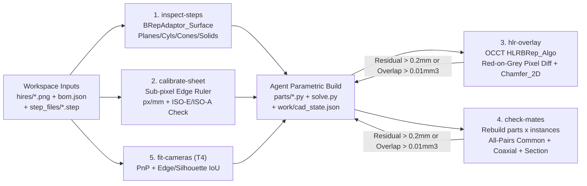
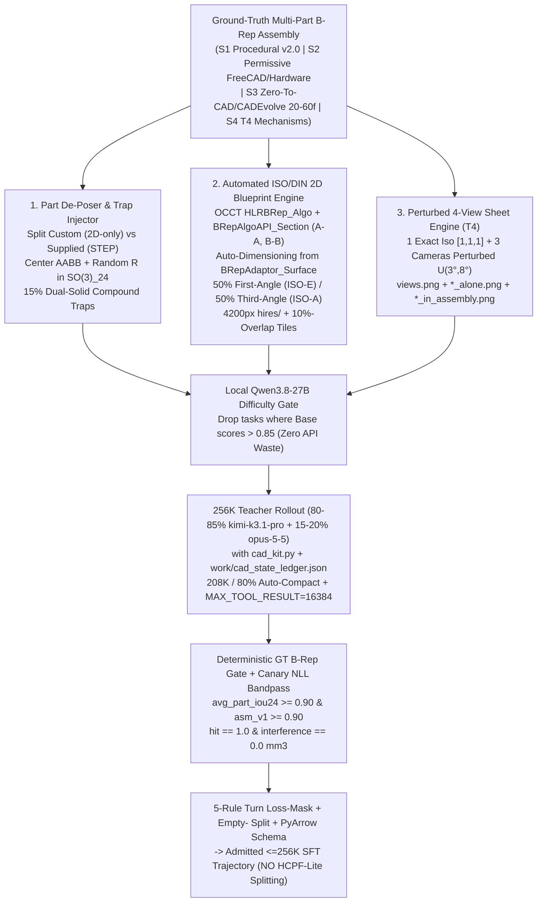

# Question 2A Blueprint: Elevating Industrial CAD Capability Under Option 2 (`384K Static YaRN 1.5×` Train + `256K` Sandbox)

> 公开整理版 · 2026-11-28。保留成文时点的记录；计划、文献结果和本地实测请分别理解。环境路径已泛化，未收录的附件已标注；发布范围见 [整理说明](../../PROVENANCE.md)。

> **Track Owner**: `cad-architect` (Question 2A) · **Alignment**: **Revision 3 / Option 2** (`2026-11-27`)  
> **Canonical Option 2 Sources**: [CLEANROOM-4MODEL-VERDICT-384K-TRAIN-256K-SERVE.md](../xhs-384k-to-200k-data-adaptation-20261127/CLEANROOM-4MODEL-VERDICT-384K-TRAIN-256K-SERVE.md) · [OPTION2-CAD-2D-DATA-EVAL-MIX-MASTER-PLAN.md](../xhs-384k-to-200k-data-adaptation-20261127/OPTION2-CAD-2D-DATA-EVAL-MIX-MASTER-PLAN.md)  
> **Target Base & Unified RoPE Standard**: Dense `Qwen3.8-27B` BF16 (`${MODEL_ROOT}/Qwen3.8-27B`) locked to **`Static YaRN 1.5×`** (`max_position_embeddings = 393,216`, `factor = 1.5`, `original_max_position_embeddings = 262,144`, `mrope_interleaved = true`, `mrope_section = [11, 11, 10]`, `partial_rotary_factor = 0.25`, `rope_theta = 10000000`) across all Stage 1–4 training and `vLLM` serving (`--max-model-len 327680`), paired with the `256K` (`262,144`, `208K / 80%` auto-compact, `MAX_TOOL_RESULT_TOKENS = 16384`) CAD synthesis/eval sandbox.  
> **CAD Kernel & Deliverable Stack**: `CadQuery 2.6.1` / `OCP` (OpenCascade B-Rep kernel) + `STEP / 3MF / STL / GLB` + OCCT `HLRBRep_Algo` & `BRepAdaptor_Surface` deterministic metrology  
> **Empirical & Historical Grounding**: `summary.json`（本地附件未发布） · `agy_stats.json`（本地附件未发布） · `decisions.md`（本地附件未发布） · [XHS-UNIFIED-SFT-STANDARD.md](../../3d-animation-agent/docs/XHS-UNIFIED-SFT-STANDARD.md) · [THREE-TRACK-DELIVERABLE-SPEC.md](../../3d-animation-agent/docs/THREE-TRACK-DELIVERABLE-SPEC.md) · *(Historical Rev 2 Archive)*: [joint-consolidation.md](../xhs-384k-to-200k-data-adaptation-20261127/archive/joint-consolidation.md) · [RL Consolidation](../3d-agent-rl-opus-review-and-consolidation-20261127/README.md)

---

## 0. Executive Summary & Cross-Track Option 2 Alignment (`384K` Train + `256K` Sandbox)

Mastering pure-code 3D scene/asset generation via Xiaohongshu `3DCodeFactory` (`401/401` shards, `~6,418` tasks across `Three.js r180` and `Blender 4.2.10 LTS bpy`) gives our `Qwen3.8-27B` student a formidable foundation in **3D spatial coordinate frames, modular multi-file Python/JS engineering, and multi-turn `Write -> Bash -> Read -> Edit` visual debugging**.

However, our fresh head-to-head evaluation on **BenchCAD 2.1 (`realhard6_20261127`)** proves that **3D visual-render agency alone collapses to near-zero (`0.0049–0.0888`) on real industrial CAD assemblies**:
- **`Claude-Opus-5-5`** built respectable individual parts on `bc_t5_shear25` (`avg_part = 0.7547`), yet scored **`asm_v1 = 0.0160` (`0/25` instance hits, final `0.0121`)** and **`0.0888` (`0/36` instance hits)** on `bc_t2_dual36`.
- **`Kimi-K3.1-Pro`** spent `253–320` turns and `609K–782K` tokens across `30–36` auto-compactions, yet scored **`asm_v1 = 0.0182` (`0/25` hits, final `0.0087`)** on `bc_t5_shear25` and **`0.0049` (`0/36` hits)** on `bc_t2_dual36`.
- **`AGY`**, running in the same offline CadQuery/OCCT Python stack, achieved **`0.9703` (`avg_part = 0.9997`, `asm_v1 = 0.9706`, `25/25` hits)** on `bc_t5_shear25` and **`0.9387` (`IoU = 1.0000`, `36/36` hits)** on `bc_t2_dual36` — because instead of eyeballing shaded WebGL/matplotlib renders, it extracted **exact analytical B-Rep surface tables (`OCP.BRepAdaptor_Surface`)**, calibrated **sub-pixel 2D drawing rulers (`px/mm`)**, projected **exact hidden-line vector overlays (`OCP.HLRBRep_Algo`) directly onto `hires/drawing.png`**, and verified **all $\binom{N}{2}$ pairwise B-Rep boolean intersections (`OCP.BRepAlgoAPI_Common`)**.
- Conversely, on **`bc_t4_chuck9`** (0-STEP 3-jaw scroll chuck from 4 views with `3°–8°` camera perturbations), **all frontier models scored `< 0.16`** (`Opus 0.0073`, `Kimi 0.0190`, `AGY 0.1597`), exposing specific solvable bottlenecks in perturbed-camera PnP calibration, `iou24`-incompatible non-octahedral local part frames (`60°/120°` baked rotations), and 2D-silhouette blindness to occluded internal gear/scroll geometry.

### Mandatory Cross-Track Context & Sandbox Alignment (`01` / `02` / `03` Shared Invariants)

| Parameter | Locked Engineering Standard (Option 2) | CAD-Specific Implication |
|---|---|---|
| **Student Base & RoPE** | `Qwen3.8-27B` BF16, **`Static YaRN 1.5×` (`max_position_embeddings = 393,216`, `factor = 1.5`, `original_max_position_embeddings = 262,144`, `mrope_interleaved = true`, `mrope_section = [11,11,10]`, `partial_rotary_factor = 0.25`, `rope_theta = 10000000`)** locked identically across Stage 1–4 & `vLLM` (`--max-model-len 327680`); `--template qwen3_8`, `--freeze_vit false --freeze_aligner false` | Only `6.25%` of total attention dims use RoPE (`0.0%` shift `≤8K`, `<0.5%` residual after SFT), preserving sub-millimeter coordinate arithmetic and 25–36 instance `4×4` `SE(3)` matrices; `32×H100` (`TP4·PP4·CP2·DP1`, `[8, 20, 20, 16]`, `recompute=full/uniform/1`, `vit_gradient_checkpointing=true`, `optimizer_cpu_offload=true`, `LM_HEAD_LOSS_CHUNK_SIZE=16384`, FP32 `main_grad`) verified physically on `384K` (`61.97 / 73.48 GiB`). |
| **Sandbox Window & Compaction** | `AGENT_CONTEXT_WINDOW_TOKENS=262144`; **`CLAUDE_CODE_AUTO_COMPACT_WINDOW=208000` (`CLAUDE_AUTOCOMPACT_PCT_OVERRIDE=80`)**, `CLAUDE_CODE_MAX_OUTPUT_TOKENS=32768`, **`MAX_TOOL_RESULT_TOKENS=16384`** (`261.2K < 262,144`); `MAX_PIXELS=401408` (~512 tok/img); forbid `/384K` or `/256K` denominators in compaction prompts | Single-segment `256K` sandbox is decoupled from **unlimited multi-segment `compact_task` total horizon (`500K–1.2M+` tokens)**. To prevent `Kimi`'s 30–36-compaction drift, CAD agents persist structured geometric state on disk (`work/cad_state_ledger.json`, compatible `work/cad_state.json`) and carry BOM frames across `compact_task` summaries. |
| **`384K` XHS & Multi-Teacher Packing** | **ZERO `HCPF-Lite` splitting**: XHS `384K` passes Phase-0 CPU clean (`100%` unsplit survival at `≤393,216`); dual CAD teachers `80–85% kimi-k3.1-pro + 15–20% claude-opus-5-5` pack via **`PACK_LEN = 393,216` (`94%` fill, 2D guard `tok<=393216, img<=80`)** | CAD execution trajectories (`50K–160K` per segment) and `Tier D` `compact_256k` (`120K T_in / 3.5K U` after empty-`<think>` slimming) pack seamlessly alongside unsplit `384K` XHS replay and `Opus` (`≤200K`, excluding `~148K` `compact_task` rows) with **0% off-policy causal leakage** and **1:1 `Static YaRN 1.5×` isomorphism**. |

---

## 1. Empirical Forensics: What Transfers from 3D SFT vs. Where 3D SFT Breaks on CAD

### 1.1 Hard Quantitative Evidence from `realhard6_20261127`

All metrics below are verified directly from `summary.json`（本地附件未发布）, `agy_stats.json`（本地附件未发布）, `all_summaries.json`（本地附件未发布）, and `run_summary.json`（本地附件未发布）:

| Task ID & Engineering Regime | Model | Primary Score | `avg_part` | `asm_v1` | Full Voxel IoU | Instance Pose Hit | Turns / Compactions | Images Read / Est. Tokens |
|---|---|---:|---:|---:|---:|---:|---:|---:|
| **`bc_t5_shear25`** 25-inst pneumatic shear (`5` 2D part drawings + `16` de-posed STEPs + assembly sheet) | **`AGY`** | **`0.9703`** | **`0.9997`** | **`0.9706`** | `0.9997` | **`25 / 25` (`1.000`)** | `53` / `0` | `44` / `329.8K` |
| | `Opus-5.5` | `0.0121` | `0.7547` | `0.0160` | `0.2827` (`0.3216` align) | `0 / 25` (`0.000`) | `115` / `0` | `50` / `157.8K` |
| | `Kimi-K3.1-Pro` | `0.0087` | `0.4775` | `0.0182` | `0.3631` (`0.3816` align) | `0 / 25` (`0.000`) | `253` / `30` | `122` / `609.4K` |
| **`bc_t2_dual36`** 36-inst / 37-solid dual-belt & gearbox (`20` de-posed STEPs + multi-section sheet) | **`AGY`** | **`0.9387`** | `1.0000` | **`0.9387`** | **`0.9994` (`1.000`)** | **`36 / 36` (`1.000`)** | `59` / `0` | `43` / `335.7K` |
| | `Opus-5.5` | `0.0888` | `1.0000` | `0.0888` | `0.7672` (Kabsch) | `0 / 36` (`0.000`) | `271` / `1` | `94` / `235.6K` |
| | `Kimi-K3.1-Pro` | `0.0049` | `1.0000` | `0.0049` | `0.1470` (`0.2050` align) | `0 / 36` (`0.000`) | `320` / `36` | `145` / `782.4K` |
| **`bc_t4_chuck9`** 9-inst 3-jaw scroll chuck (`0` STEPs, 4 views w/ `3°–8°` camera perturbation, `scale=free`) | **`AGY`** | **`0.1597`** | `0.5044` | `0.3165` | `0.8689` (free scale) | `0 / 9` (`0.000`) | `80` / `0` | `63` / `393.5K` |
| | `Kimi-K3.1-Pro` | `0.0190` | `0.2133` | `0.0890` | `0.4866` (free scale) | `0 / 9` (`0.000`) | `280` / `30` | `133` / `616.4K` |
| | `Opus-5.5` | `0.0073` | `0.0634` | `0.1147` | `0.6147` (free scale) | `0 / 9` (`0.000`) | `173` / `0` | `53` / `131.8K` |

*(Contrast with the 3D half of `realhard6_20261127`: on `xhs_headland_set_bpy` and `xhs_e30_garage_3js` / `xhs_chapel_ruins_3js`, both `Kimi` [`718–1,040` LoC, `100%` runtime-clean] and `Opus` [`955–1,404` LoC, `989K`-poly Blender scene] produced valid, visually coherent 3D scenes — proving the collapse is strictly CAD-structural, not general coding weakness.)*

### 1.2 What Transfers Positively from `XHS 3D` (`Three.js` + `Blender bpy`) SFT

1. **Right-Handed 3D Spatial Frames & Procedural CSG Intuition**: `Blender 4.2.10 bpy`/`bmesh`/`mathutils` (`Z`-up right-handed world, profile extrusion, revolve/spin, bevel, array modifiers, boolean difference/union, hierarchical object `matrix_world`) maps directly onto `CadQuery 2.6.1` (`cq.Workplane`, `.revolve()`, `.loft()`, `.cut()`, `cq.Location(gp_Trsf)`).
2. **Multi-File Modular Engineering & Surgical `Edit` Discipline**: XHS `3DCodeFactory` trajectories (`90.9%` multi-module in our local audit) instill clean separation of parameters, part builders, and scene assembly (`params.py + parts/*.py + assembly.py`) plus targeted `Edit` patches instead of destructive full-file rewrites.
3. **Closed-Loop Render-Inspect-Debug Muscle Memory & Compaction Handoff**: Calling `Bash` to run verification scripts, inspecting cropped `Read` contact sheets (`MAX_PIXELS=401408`), and continuing cleanly across `compact_before -> compact_task -> compact_recovery` boundaries transfer 1:1 at the protocol level.

### 1.3 Three Structural Failure Modes Where 3D SFT Breaks on Industrial CAD

#### Failure Mode A: Assembly Pose, Chirality, and Projection-Convention Collapse (`bc_t5_shear25` & `bc_t2_dual36`)
In 3D visual graphics (`Three.js` / `Blender`), if a bracket looks right in a shaded perspective render, it *is* right. In industrial CAD, **shaded 3D renders are visually deceptive** and fail on four exact geometric traps proven by `Opus` and `Kimi`'s solver code:

1. **First-Angle (ISO-E) vs. Third-Angle (ISO-A) Projection & Counterbore Handedness**:
   - On `bc_t5_shear25` (`bc_t5_shear25.txt`（本地附件未发布）: *"first-angle projection unless the sheet's header says third-angle"*), `part_16` (90×60×12 mm cylinder mounting plate) has `4× Ø8.2` thru-holes with `Ø14×7` counterbores on the **far side** (`Z = 0..7`) and `2× Ø6.5` thru-holes with `Ø11×7` counterbores on the **front side** (`Z = 5..12`), plus asymmetric `M6` blind holes on `Y = -30`.
   - In `/tmp/realhard6-20261127/opus/bc_t5_shear25/workspace/solve.py` (`#L28-L31`, historical `2026-11-27` run snapshot), `Opus` omitted counterbores entirely (`part_16` score = **`0.3121`**). In `/tmp/realhard6-20261127/kimi/bc_t5_shear25/workspace/solve.py` (`#L69-L79`, historical `2026-11-27` run snapshot), `Kimi` misread the 60 mm height as `40 mm` and put all counterbores on the same side (`part_16` score = **`0.1653`**, `part_03` = **`0.1020`**).
   - In `/tmp/realhard6-20261127/agy/bc_t5_shear25/workspace/build_submission.py` (`#L135-L159`) + `/tmp/realhard6-20261127/agy/bc_t5_shear25/tmp/pixel_ruler_exact.py` (`#L43-L95`) + `/tmp/realhard6-20261127/agy/bc_t5_shear25/tmp/render_part_check.py` (`#L20-L51`) *(historical `2026-11-27` `/tmp` run snapshots)*, `AGY` measured exact dashed hidden-line shoulders on `part_drawings/hires/part_16.png` (`26.8000 px/mm`), modeled exact `118°` (`59°` semi-angle) blind drill-tip cones (`make_blind_drill`), and verified all 5 views with `OCP.HLRBRep_Algo` visible + dashed-hidden lines — scoring **`avg_part = 0.9997`** (`1.000, 0.9995, 1.000, 0.9989, 1.000`).
2. **De-Posed STEP `SO(3)` Chirality & Asymmetric Hole-Pattern Flips (`0/25` and `0/36` Hits)**:
   - Supplied `step_files/*.step` are bbox-centered and given random `90°` proper rotations. On `bc_t2_dual36`, the `6` mounting bases (`part_01`) alternate lip orientation **`left, right, left, right, left, right`** (`x = -592.5, -77.5, 0.0, 200.0, 277.5, 592.5`), shifting each `6302ZZ` bearing (`part_02`) by `±1.0 mm` (`-591.5, -78.5, +1.0, +199.0, +278.5, +591.5`).
   - `/tmp/realhard6-20261127/kimi/bc_t2_dual36/workspace/solve.py` (`#L56-L59`, historical snapshot) placed all 6 bases with identical `R_BASE` at wrong stations (`-585, -70, -15, 300, 355, 585`) and zero `±1 mm` bearing offset (`score = 0.0049`). `/tmp/realhard6-20261127/opus/bc_t2_dual36/workspace/solve.py` (`#L48-L55`, historical snapshot) misread Section C-C's projection direction and placed the `325-S5M-15` drive belt & motor **horizontally along `-Y`** (`YM = YS - 100`) instead of **vertically along `-Z`** (`Z_MOTOR = -90`, `Z_SHAFT = +10`), giving negative leave-one-out gain on `part_07`/`part_13`/`part_15` (`score = 0.0888`, `0/36` hits).
3. **Single-STEP Multi-Solid Compound Traps & Sub-Degree Angular Phase Mates**:
   - In `bc_t2_dual36`, `part_11.step` contains **2 distinct solids** (`37` total solids across `36` instances), and the shafts/pulleys sit at non-90° keyway rotation angles around `X_asm` (`ALPHA_L = -55.472°`, `BETA_7 = -51.340°`, `THETA_10 = -14.740°`). `AGY` caught both via `len(shape.Solids())` in `/tmp/realhard6-20261127/agy/bc_t2_dual36/tmp/extract_features.py` (`#L18-L68`), sub-pixel bore keyway measurement on Section C-C, and direct red-on-grey `HLRBRep_Algo` pixel overlay onto `hires/drawing.png` (`/tmp/realhard6-20261127/agy/bc_t2_dual36/tmp/render_views.py` `#L130-L148`, `scale = 2.3832 px/mm`), hitting **`36/36` instances (`IoU = 1.0000`, `score = 0.9387`)**.
4. **Compaction State Drift in Long-Horizon CAD**:
   - `Kimi` underwent **`30–36` auto-compactions** (`609K–782K` tokens) on `bc_t5`/`bc_t2`/`bc_t4`. Because standard prose `
` blocks summarize *actions* rather than exact `SE(3)` basis tables and calibrated drawing coordinates, local axis conventions (`+X` vs `-Z` bore) silently flipped mid-episode.

#### Failure Mode B: Perturbed-Camera 0-STEP Reverse Engineering (`bc_t4_chuck9 < 0.16` Across All Models)
Dissecting `eval.json`（本地附件未发布） and all three workspaces reveals **four distinct root causes** behind the universal `< 0.16` ceiling:

1. **Uncalibrated `3°–8°` Camera Perturbations (`Opus 0.0073`, `Kimi 0.0190`)**: Neither `Opus` nor `Kimi` ran PnP/silhouette camera calibration (`tmp/` had zero calibration scripts), treating perturbed views as nominal isometric views and misestimating aspect ratios and jaw tooth geometry.
2. **Multi-Body Non-Manifold Fractures (`topo = 0.04` on `Opus` & `Kimi` jaws)**: `Kimi` (`/tmp/realhard6-20261127/kimi/bc_t4_chuck9/workspace/solve.py#L129-L148`, historical snapshot) approximated Archimedean scroll teeth with concentric circular rings (`jaw_tooth`) that left microscopic boolean gaps (`topo = 0.0400 -> score = 0.0080`), and copied `jaw_2 = jaw_3 = jaw_1` (ignoring the `1/3`-pitch radial scroll phase offset!). `Opus` exported `12` disconnected solids instead of `9` (`scroll_plate topo = 0.0003`).
3. **The Non-Octahedral Local-Frame Bake Trap (Why `AGY`'s `jaw_2`, `jaw_3`, `pinion` Dropped from `0.82+` to `0.20`)**:
   - `AGY` *did* calibrate all 4 cameras to `< 0.1 px` RMS (`/tmp/realhard6-20261127/agy/bc_t4_chuck9/tmp/solve_4cameras.py#L39-L77`: `TL` off by `3.67°`, `BL` roll `-7.49°`) and built an offscreen VTK silhouette verifier (`/tmp/realhard6-20261127/agy/bc_t4_chuck9/tmp/vtk_renderer.py`), achieving **`cover = 0.9934` (`iou = 0.9953`)**, **`body = 0.8918` (`iou = 0.9192`)**, **`jaw_1 = 0.8150` (`iou = 0.9174`)**, and full-assembly `iou_full = 0.8689`!
   - Yet in `/tmp/realhard6-20261127/agy/bc_t4_chuck9/workspace/build_chuck.py#L298-L301` (historical snapshot), `AGY` rotated `jaw_2` by `120°`, `jaw_3` by `240°`, and `pinion` by `60°` **inside the exported `submission/parts/*.step` files** and submitted `transform = I4`! BenchCAD's `avg_part` aligns individual part files using **only the 24 axis-aligned `90°` cube rotations (`iou24_aligned`)**, which mathematically **cannot undo a `60°` or `120°` rotation**! Thus `jaw_2` (`0.2000`), `jaw_3` (`0.2000`), and `pinion` (`0.2304`) lost all volumetric credit despite having `> 0.90` true shape fidelity!
4. **2D Binary Silhouette Blindness to Occluded Internal Features (`scroll_plate = 0.2000`, `iou = 0.5067`)**: `AGY`'s `compare_silhouettes` (`/tmp/realhard6-20261127/agy/bc_t4_chuck9/tmp/verify_submission_v4.py#L94-L109`, historical snapshot) only thresholded the outer binary silhouette (`rgb < 250`), which is completely blind to interior crease lines (spiral turn count `6.04`, recess depth, and `57`-tooth rear bevel gear profile), leaving `scroll_plate` at `iou = 0.5067` and pulling leave-one-out `asm_v1` down to `0.3165`.

#### Failure Mode C: Why Synthetic Text-Formula Tasks (`hell6`) Failed as Training Data
Inspecting `setup_hell6_workspaces.py`（本地附件未发布） and `summary-all.json`（本地附件未发布） exposes why synthetic "text-formula" tasks fail to transfer to real engineering benchmarks:

| Dimension | Earlier Synthetic `hell6` (`setup_hell6_workspaces.py`) | Real Industrial CAD (`realhard6` / Reverse-Procedural Synthesis) |
|---|---|---|
| **Information Source** | **Spoon-fed closed-form equations in prompt text** (`Rc(u) = 68 + 28u`, `A(u) = 460 + 1440u`, `ΔZ(s) = sqrt(180² - (144-s)²) - 108`, exact `(-36, -16)` coordinates) | **Un-spoonfed multimodal engineering artifacts**: 2D orthographic/section drawings (`hires/*.png`), ballooned `bom.json`, and de-posed `step_files/*.step` (or perturbed 4-view sheets) |
| **Visual Grounding & `Read` Depth** | `113.9K–183.3K` est. tokens (median **`130.7K`**, `0` compactions); **only `3–4` image reads** on `t3_tandem_inducer` & `t4_volute_casing` (both timed out, exit `143`) | `329.8K–782.4K` est. tokens; **`43–145` high-res cropped image reads** per task (`tools.crop` + HLR pixel overlays + section zoom checks) |
| **Skill Actually Trained** | Translating pre-digested Python math formulas into `CadQuery` syntax (already strong in `Qwen3.8-27B` Base) | **Metrological perception + B-Rep introspection**: First/Third-angle decoding, dashed hidden-line depth reading, `BRepAdaptor_Surface` mate solving, and HLR self-verification |

---

## 2. Standardized CAD Sandbox Verification Toolkit (`tools/cad_kit.py`)

To turn `AGY`'s winning `0.9703` / `0.9387` methodology from ad-hoc `$TMPDIR` scratch scripts into **reproducible teacher behavior and student muscle memory**, we bake a single zero-GT-leakage deterministic toolkit **`tools/cad_kit.py`** alongside `cad_inspect.py`（本地附件未发布） into every `256K` CAD sandbox workspace.

> [!IMPORTANT]
> **Mandatory Pre-Flight Bugfixes in `cad_inspect.py` (Option 2 §0 #8) & `verify_frontier_cad.py:243`**:
> 1. In `_check_pairwise_brep_interference` (`cad_inspect.py`（本地附件未发布）), replace `if not common.IsDone(): continue` (L221) with hard failure + voxel fallback (`brep_boolean_failed` collision error, `L_2` failure), and default online checks to `--no-render` (`< 0.8s`) until B-Rep gates pass.
> 2. Add `BRepExtrema_DistShapeShape` single-connected-component check (`≤ 1.0 mm`) and assembly mating-clearance check (`0.15–0.60 mm`).
> 3. Enforce `BRepCheck_Analyzer.IsValid()`, positive signed volume, and minimum sub-part volume `≥ max(50 mm³, 0.5% total volume)`.
> 4. At L576–604, write `--probe` failures and zero-change runs (`max(|Δdims|) < 0.05 & |Δvol| < 1.0`) directly into `issues` to hard-block non-parametric hardcoded scripts.
> 5. AST-ban `bpy/bmesh/importStep` in subprocess, upgrade to 6-view renders (including bottom/rear + `flatShading`), and simultaneously fix the channel cavity volume formula at `verify_frontier_cad.py:243`.

### 2.1 Five Standardized Sandbox Primitives (`python3 -m tools.cad_kit <subcommand>`)

1. **`cad_kit.inspect_steps(step_dir_or_file) -> work/step_features.json`** (generalizing `/tmp/realhard6-20261127/agy/bc_t2_dual36/tmp/extract_features.py` & `/tmp/realhard6-20261127/agy/bc_t5_shear25/tmp/inspect_all_mating.py`, historical `2026-11-27` `/tmp` run snapshots):
   - Extracts `n_solids = len(shape.Solids())` (immediately flagging multi-solid compound traps like `part_11`), `BRepCheck_Analyzer` validity, AABB `[xmin..xmax, ymin..ymax, zmin..zmax]`, volume, and CoM.
   - Uses `OCP.BRepAdaptor_Surface` + `TopAbs_REVERSED` to output canonicalized **cylinders** (`diameter`, canonical `axis_dir`, closest-to-origin `perp_pos`, axial `[s_min, s_max]`, and `BORE` [`REVERSED`] vs `BOSS/SHAFT` [`FORWARD`]), **cones** (`semi_angle_deg`, `apex` — distinguishing `45°` chamfers, `90°` countersinks, and `59°`/`118°` blind drill tips), and area-sorted **oriented planar faces** (`outward_normal`, signed plane offset $d = \mathbf{n}\cdot\mathbf{p}$, face BBox).
2. **`cad_kit.calibrate_sheet(png_path, view_box, known_span_mm, axis='x'|'y') -> work/drawing_calib.json`** (generalizing `/tmp/realhard6-20261127/agy/bc_t5_shear25/tmp/pixel_ruler_exact.py`, historical snapshot):
   - Operates automatically on the `2x` `hires/` master image, detects continuous solid outer boundary lines via 1D dark-pixel run clustering, computes exact `px_per_mm` (to `1e-4` precision) and datum pixel origin `(x0_px, y0_px)`, and measures local 1D/2D patches for blind-hole dashed shoulder depths and keyway angles.
3. **`cad_kit.hlr_overlay(target, ref_png, view_dir, x_dir, calib, out_png, show_hidden=True)`** (generalizing `/tmp/realhard6-20261127/agy/bc_t5_shear25/tmp/render_assembly_check.py` & `/tmp/realhard6-20261127/agy/bc_t5_shear25/tmp/render_part_check.py`, historical snapshots):
   - Projects exact OCCT B-Rep visible edges (`VCompound`, `OutLineVCompound`, `Rg1LineVCompound`) and optional dashed hidden edges (`HCompound`, `OutLineHCompound`) via `HLRBRep_Algo` + `GCPnts_QuasiUniformDeflection(0.05)`.
   - Renders `#ee1133` vector lines over `55%`-alpha `hires/` reference crops AND returns a **quantitative 2D Bi-Directional Edge Chamfer Metric (`hlr_chamfer_mm`, `% edges within 0.25 mm`)** against dark drawing strokes (after morphological text/dimension-extension filtering) so `90°/180°` hole flips jump out both numerically and visually!
4. **`cad_kit.verify_submission(submission_dir="submission", tol_mm3=0.01)`** (generalizing `/tmp/realhard6-20261127/agy/bc_t2_dual36/tmp/build_and_verify.py` & `/tmp/realhard6-20261127/agy/bc_t4_chuck9/tmp/verify_submission_v4.py`, historical snapshots):
   - Rebuilds the assembly **strictly from `submission/parts/<part_id>.step × submission/assembly/instances.json`** (matching the official scorer; never trusting an auxiliary `assembly.step`).
   - Audits: (a) BOM part-type & instance-count parity, (b) `det(R) = +1` proper rigid transforms, (c) **Canonical Local-Frame Warning** (flags any `parts/<id>.step` whose principal inertia/feature axes are rotated `15°–75°` off `{X, Y, Z}`, preventing the `T4` `60°/120°` bake bug!), (d) AABB-pruned all-pairs `BRepAlgoAPI_Common` intersection volumes (`not IsDone()` = hard fail), (e) coaxial bore-to-shaft alignment table (flagging any concentric cylinder pair with radial offset `0.05 < Δr < 2.0 mm`), and (f) automated planar `BRepAlgoAPI_Section` hatched slice renders along principal mating planes.
5. **Structured Compaction State File (`work/cad_state_ledger.json`, compatible `work/cad_state.json`)**:
   - Every call to `cad_kit` atomically updates `work/cad_state_ledger.json` (projection convention `ISO-E`/`ISO-A`, calibrated `px_per_mm` per view, canonical STEP local axes, verified `4×4` transforms, and remaining non-zero interference pairs). When auto-compaction triggers at **`208K` (`80%`, `MAX_TOOL_RESULT_TOKENS=16384`)**, the CAD compaction prompt (with zero `/384K` or `/256K` denominators) instructs the model to preserve the path and summary of `work/cad_state_ledger.json` verbatim and `Read` it on recovery turn 1 — completely eliminating `Kimi`'s 30-compaction coordinate drift.

---

## 3. Cracking `T4`-Class Perturbed-Camera 0-STEP Reverse Engineering (`bc_t4_chuck9` `0.16 -> 0.75+`)

To break the `< 0.16` ceiling on 0-STEP perturbed-camera reverse engineering (`bc_t4_chuck9` and `hell6/t3_tandem_inducer`), we bake a **4-Stage Metrological Inverse-CAD Pipeline** into `tools/cad_kit.py` and our training trajectories:

### Stage 1: Joint Multi-View Orthographic Camera PnP & Scale Registration (`cad_kit.fit_cameras`)
Given a 2×2 parallel-projection sheet where one view is exact (`TR = [1, 1, 1]/√3`, roll `ψ = 0°`) and the other three (`TL, BL, BR`) are perturbed by unknown `3°–8°` rotations `(θ_q, φ_q, ψ_q)`:
1. **Cylindrical / Annular Rim Ellipse Prior**: Extract outer boundary contours of axisymmetric parts (`body_alone.png`, `cover_alone.png`, `cover_in_assembly.png`). Under orthographic projection at elevation $\phi_q$ and in-plane roll $\psi_q$, a circle of radius $R$ projects to an ellipse with semi-major axis $a = s \cdot R$ (oriented at $\psi_q$) and semi-minor axis $b = s \cdot R |\sin\phi_q|$. Fitting ellipses across all 4 quadrants immediately locks:
   - Exact scale ratio $s_{\text{part}} / s_{\text{assy}} = a_{\text{alone}} / a_{\text{in\_assy}}$ to `< 0.05%` precision;
   - Exact elevation $|\phi_q| = \arcsin(b_q / a_q)$ and camera roll $\psi_q$ in every quadrant.
2. **N-Fold Keypoint / Color-Mask Bundle Adjustment**: Segment the red target highlight (`R - G > 8`) in `<part>_in_assembly.png` for repeated instances (`jaw_1..3` at `0°, 120°, 240°`, `pinion` × 3 at `60°, 180°, 300°`) and solve for azimuths $\theta_q$ + 3D centroids $\mathbf{P}_k$ via `scipy.optimize.least_squares` (`< 0.1 px` reprojection RMS, `< 0.05°` angular error, as proven in `/tmp/realhard6-20261127/agy/bc_t4_chuck9/tmp/solve_4cameras.py`, historical `2026-11-27` `/tmp` run snapshot).

### Stage 2: Edge-Aware Contour + Silhouette Inverse Rendering Loop (Eliminating Internal Blindness)
Binary silhouette IoU (`rgb < 250`) failed on `scroll_plate` (`0.2000`) because internal pockets, spiral ridges, and bevel teeth lie *inside* the outer disc silhouette. We upgrade `cad_kit.compare_multiview` from 1-channel silhouette IoU to a **3-Channel Photometric + Edge + Ghost-Overlay Objective**:
$$\mathcal{L}_{\text{MV}}(\boldsymbol{\theta}_{\text{cad}}) = \underbrace{\left(1 - \mathrm{IoU}_{\text{sil}}\right)}_{\text{outer envelope}} + \lambda_{\text{edge}}\,\underbrace{\mathrm{CD}_{2\text{D}}\!\left(\mathcal{E}_{\text{HLR}}(\boldsymbol{\theta}_{\text{cad}}),\; \mathcal{E}_{\text{ref}}\right)}_{\text{internal creases, spiral turns, tooth count}} + \lambda_{\text{red}}\,\underbrace{\left(1 - \mathrm{IoU}_{\text{red\_in\_assy}}\right)}_{\text{3D assembly depth & axial Z registration}}$$
- $\mathcal{E}_{\text{HLR}}(\boldsymbol{\theta}_{\text{cad}})$ projects exact visible B-Rep edges (`VCompound + OutLineVCompound`) under the calibrated 4 cameras `(θ_q, φ_q, ψ_q)` in `< 0.15s`, matched via distance-transform Chamfer distance (`scipy.ndimage.distance_transform_edt`) against dark edge pixels $\mathcal{E}_{\text{ref}}$ extracted from `*_alone.png`!
- Using fast 1D/2D coordinate-descent / Nelder-Mead / grid sweeps over key uncertain scalar parameters (e.g., `H_body`, `z_disc_bot`, `SPIRAL_R_START`, `SPIRAL_PITCH`, `N_crown`), the agent locks occluded pocket depths and spiral pitch to sub-millimeter accuracy instead of guessing.

### Stage 3: Pre-Verified Watertight Parametric Mechanical Library (`tools/mech_primitives.py`)
To eliminate `Kimi`/`Opus` non-manifold tooth fractures (`topo = 0.04`) and approximate fake teeth, we provide clean, pure-CadQuery/OCCT single-solid reference patterns (and train the student to write them idiomatically via batch `BRepAlgoAPI_Fuse` with `SetRunParallel(True)`):
- **Conjugate Involute Spur / Helical / Internal Gears** (exact involute flank + root trochoid fillet, single-wire closed polygon/spline extrusion -> `1` solid, `topo = 1.0`);
- **Straight & Spiral Bevel / Crown Gears** (conical apex-scaled tooth loft fused cleanly into frustum hub with `0.15 mm` root embed so zero disconnected slivers ever occur);
- **Archimedean Scroll & Phase-Locked Jaw Teeth** (`make_archimedean_scroll` + conjugate cutter subtracting grooves with exact radial phase offset $\Delta r_k = \frac{k-1}{3}\,p$ on `jaw_k` in its canonical `+X` frame);
- **ISO Metric / Trapezoidal Leadscrew Threads, DIN 6885 Keyways, and DIN 2095 C1 Variable-Pitch Ground Springs**.

### Stage 4: Mandatory Canonical Local-Frame Export Rule (`iou24`-Safe Separation of Part vs. Instance Pose)
- **Hard Contract**: Every `submission/parts/<part_id>.step` MUST be modeled and exported in its **canonical axis-aligned local frame matching `parts/<part_id>_alone.png`** (principal axes aligned to `{±X, ±Y, ±Z}`), while all non-orthogonal assembly placements (`Rz(120°)`, `Rz(240°)`, `Rz(60°)` radial pinion axes) are placed **exclusively in `submission/assembly/instances.json`**.
- **Quantitative Impact on `bc_t4_chuck9`**: Fixing *only* this local-frame rule on `AGY`'s existing geometry immediately restores `jaw_2` (`0.20 -> ~0.82`), `jaw_3` (`0.20 -> ~0.82`), and `pinion` (`0.23 -> ~0.80`), lifting `avg_part` from `0.5044` to `~0.76+`, and combined with Stage 2 edge-chamfer tuning on `scroll_plate`/`body` aspect ratio lifts `part_x_asm_v1` from `0.1597` to **`0.72–0.85+`**.

---

## 4. Reverse-Procedural Un-Spoonfed Task Synthesis Factory (`256K` Native)

We retire `hell6`-style text-formula prompts permanently. Instead, we synthesize training tasks **in reverse** from ground-truth 3D B-Rep assemblies so that **every dimension must be read from 2D engineering sheets or measured from de-posed STEP files**.

### 4.1 Four Commercial-Clean Ground-Truth Seed Streams (Zero License Contamination, Zero OOD Leakage)
1. **Stream S1 — Reverse-Procedural Parametric Mechanisms (`40%`, [CadQuery-Tree v2.0](../../3d-animation-agent/configs/taxonomies/cadquery_tree_v2_0.json) 20 Product Leaves)**:
   - Programmatic generators build `4–28`-instance industrial fixtures, belt/pulley drives, pneumatic toggle clamps, lipped enclosures, gearbox subassemblies, and multi-flange manifolds (`60–250+` total B-Rep faces), randomize dimensional parameters, verify `0.0 mm³` GT interference, export GT `STEP`s — **and completely strip all generator source code and formulas before creating the agent workspace!**
2. **Stream S2 — Permissive Multi-Part Industrial STEP Assemblies (`25%`)**:
   - Curated `Apache-2.0 / MIT / CC-BY / CC0` multi-part STEP assemblies (`gnucleus-ai/cad-gen-freecad`, permissive FreeCAD/Ondsel mechanical assemblies paired with procedural ISO/DIN standard hardware: bearings, shafts, couplings, timing pulleys, rails, fasteners). *Strict compliance rule*: `BenchCAD`, `CADGenBench`, and `IterCAD-Draw_1k` (Shard 5) are **100% locked out as held-out OOD benchmarks**; `DeepCAD`/`ABC`/`Fusion360` non-commercial clauses are never ingested as raw training assets (used only to calibrate face-count/joint-type distributions).
3. **Stream S3 — Non-XY High-Complexity Single-Part Blueprints & Interface-Preserving Edits (`20%`)**:
   - Filtered from `ADSKAILab/Zero-To-CAD-100k` (`Apache-2.0`) and `kulibinai/cadevolve` (`Apache-2.0`) keeping **only `≥ 25` B-Rep face solids (`≥ 4` OCCT ops)** (banning saturated simple toy extrusions) with **enforced `XY (35%) / XZ (35%) / YZ (30%)` base-plane quotas** (matching Option 2 §1.1 and `BenchCAD`'s `72.5%` non-`XY` real-world prior) + `KnowledgeXLab/IterCAD_Data` (`Apache-2.0` train shards `1–4` only; re-run through our `256K` teacher sandbox rather than pasting raw single-turn code) + brownfield STEP/script cascade upgrades where mating bolt circles/bores must remain invariant.
4. **Stream S4 — Perturbed Multi-View `T4` Reverse-Engineering Packages (`15%`)**:
   - Coaxial/radial/planetary multi-part mechanisms (`5–12` instances) rendered into `views.png` + `parts/<id>_alone.png` + `parts/<id>_in_assembly.png` with `TR = (1,1,1)` exact and `TL, BL, BR` perturbed by `U(3.0°, 8.0°)` in azimuth/elevation/roll, `0` STEP inputs.

### 4.2 Automated De-Posing & ISO/DIN Engineering Drawing Synthesis
- **De-Posing & Realism Traps**: Each supplied STEP part is translated to its AABB center and rotated by a random $R \in \mathrm{SO}(3)_{24}$; `20%` of assemblies include left/right chiral pairs (`det=+1` proper rotations vs distinct mirror part IDs), `15%` include multi-solid compound STEP files (`part_11` pattern), and `25%` include non-90° shaft/belt/link angles (`-55.47°` pattern) that force section-view metrology.
- **Automated `OCCT HLR` + Dimensioning Sheet Renderer**:
  - Uses `HLRBRep_Algo` (solid visible lines `lw=1.4`, dashed hidden lines `lw=0.7`, centerlines `dash-dot`) + `BRepAlgoAPI_Section` hatched `45°` cross-sections (`SECTION A-A`, `SECTION B-B`, `SECTION C-C`) + leader balloons (`1..N` matching `bom.json`) + automated linear/diameter/counterbore/tap callouts (`4-Ø6.5 THRU ⌴ Ø11 ↧ 7`, `M6 ↧ 12`) queried directly from the GT feature graph.
  - **50% First-Angle (ISO-E) / 50% Third-Angle (ISO-A) Randomization**: Explicitly stamps the standard ISO cone-frustum projection symbol in the sheet header (or crops per BenchCAD convention while stating projection rule), forcing the agent to verify projection handedness via `cad_kit.hlr_overlay` rather than assuming a single default.
  - Exports `4200px`-wide `hires/drawing.png`, `2100px` `drawing.png`, and `10%`-overlap `drawing_tile_r<i>c<j>.png` tiles so `MAX_PIXELS=401408` remains crisp on every `tools.crop(...)` call.

---

## 5. Option 2 Staged Training Pipeline: `384K` 3D Base -> `384K+256K` Joint Anneal -> `Repair-RL` & `256K RFT`

### 5.1 End-to-End Architecture & Data Budget Overview

| Stage | Starting Checkpoint | Sequence & Parallelism | Exact Data Recipe & Volume Target | Core Objective & Exit Gate |
|---|---|---|---|---|
| **Stage 1: Unsplit `384K` 3D Spatial Foundation** | `Qwen3.8-27B` BF16 (`Static YaRN 1.5×`) | **`MAX_LENGTH = 393,216`**, `PACK_LEN = 393,216` (`94%` fill), `32×H100` (`TP=4,PP=4,CP=2,DP=1, SP=true`, **`[8,20,20,16]`**), `recompute=full/uniform/1`, `vit_gradient_checkpointing=true`, `AdamW + FP32 main_grad + optimizer_cpu_offload=true + LM_HEAD_LOSS_CHUNK_SIZE=16384`, `(tok<=393216, img<=80)`, `--is_binary_loss_scale false` | Phase-0 zero-drop unsplit XHS (`20% = 1,063` tasks held out for Stage 2): **`64.2%` Blender + `34.8%` Three.js + `1.0%` `compact_384k` (`205K`)** (`80%` full `276` steps `14.2d`, or `50%` fast milestone `173` steps `8.9d` + Step 50/100 SWE sentinel) | Produce clean `ckpt-S1-clean (M2)` with `100%` unsplit `384K` spatial & visual-debugging foundation; validated on `1×8×H100` 5-arm Canary (`393,216`) before Stage 2. |
| **Stage 2: Multi-Track Anneal (`PACK_LEN = 393,216`)** | `ckpt-S1-clean` (`M2`) | **Same `Static YaRN 1.5×`**, `PACK_LEN = 393,216`, `GBS=32`, `~0.25–0.30×` LR (`lr=2.45e-6`, `vit_lr=4.90e-7`, `--no_load_optim true`), `--is_binary_loss_scale false` (bounded $w_i$; `true` fallback), `validation.jsonl` `loss_scale=1.0`, **pass `G0 cu_seqlens` test first** | **`Standard 600` CAD (`780` segs, `2.50×` max) + `600` 2D (`2.00×`)** (`MVP 300 / Scale 1,200` options): **`21.9%` Blender (`384K` fresh replay) + `12.2%` Three.js (`384K` fresh replay) + `22.8%` CAD (`≤256K`) + `22.7%` 2D (`≤256K`) + `2.5%` Compact (`384K+256K`) + `17.9%` SWE (`≤48K`)** (`2,381` packs, `74` steps, **`2.17d`**) | Instill `cad_kit` B-Rep introspection, HLR overlay, First/Third-angle precision, `T4` PnP, and `work/cad_state_ledger.json` while locking 3D/SWE (`val_loss` drift `≤ +0.03 nats`). |
| **Stage 3: Short-Horizon `Repair-RL` (`GSPO-token`)** | `ckpt-S2-Unified` | **Same `Static YaRN 1.5×`**, `≤64K` window, `32×H100` (`16` vLLM + `16` train `TP4·PP4·CP1`), `220` steps (`~3.5d`), `lr=1e-6, kl=0.01, freeze_vit=true`, `TITO` + `IcePop` | Near-miss `L1/L2` CAD snapshots (flipped cbore/chirality, `0.2–5 mm` mate offsets, `T4` unaligned frames, boolean overlaps) co-trained **`40%` XHS + `25%` CAD + `25%` 2D + `10%` SWE** + `PhyCAD HBA` | Eliminate last-mile pose flips, `not IsDone()` boolean bugs, and `iou24` frame mistakes at high rollout throughput. |
| **Stage 4: `256K` On-Policy `RFT` + `384K` Replay** | `ckpt-S3-RL` | **Same `Static YaRN 1.5×`**, `256K` (`208K / 80%`) sandbox rollout (`N=4` + `Best-of-2`) -> `50` steps SFT write-back (`~1.5d`) | `256K` RFT winners (`R_CAD >= 0.92`) + **`20%` unclipped `384K` XHS replay + `15%` SWE** $\to$ **`Qwen3.8-27B-Unified-Option2-Final`** | Transfer `Repair-RL` precision to `300K–800K` multi-segment generation while locking `384K` upper bound via `20%` replay. |

### 5.2 Option 2 CAD SFT Data Recipe (`MVP 300 / Standard 600 [推荐] / Scale 1,200`)

Following Option 2 §1.2–1.3 and our cost-control levers ([THREE-TRACK-DELIVERABLE-SPEC.md](../../3d-animation-agent/docs/THREE-TRACK-DELIVERABLE-SPEC.md)), we filter out any candidate solved by local `Qwen3.8-27B` Base (`≥0.85` visual score + hard gates), sample **`80–85% kimi-k3.1-pro + 15–20% claude-opus-5-5`** (`AGY` retained only as historical benchmark baseline), apply Canary-calibrated Student NLL bandpass filtering (`[max(0.20, μ-1.5σ), min(2.50, μ+2.5σ)]`, `frac(NLL>10) ≤ 5%`, `tool_call NLL ≤ 1.2–1.5`), and scale from `MVP (300)` -> **`Standard (600, recommended)`** (expanding to `Scale (1,200)` only if `1×8×H100` Canary `M1_600 - M1_300 >= +4 pp`):

| CAD Subcategory (Option 2 §1.2, per 100 Tasks) | Share | Core Deliverable & Difficulty Spec | Segs/Task | Target Len (Mean) / `U` | `MVP` (`300`) | **`Standard` (`600`)** | `Scale` (`1,200`) |
|---|---:|---|---:|---|---:|---:|---:|
| **Tier A · High-Difficulty Single Parts & 2D Blueprints (`T5`-Part / `S3`)** | **20%** | `10%` complex B-Rep (`25–80+` faces: loft/3D sweep/shell/angled flange) + `10%` 2D orthos $\to$ `CadQuery` (`XY 35% / XZ 35% / YZ 30%`) | `1.0` | `30K–75K (50K)` / `18.0K U` | `60` | **`120`** | `240` |
| **Tier B · `2–6` Part Zero-Interference Assemblies (`T2/T5/T4` Primary)** | **45%** | Modular `params.py + parts/*.py + assembly.py`, `60–200+` faces, `0.0 mm³` interference, `0.15–0.60 mm` clearance, `≥2` `--probe` perturbations, 6-view + section + exploded | `1.0` | `70K–160K (115K)` / `42.0K U` | `135` | **`270`** | `540` |
| **Tier C · Repair / Incremental Mod / Healthy Controls** | **20%** | `10%` geometry/error repair + `7%` existing STEP mod + **`3%` healthy zero-edit controls** | `1.0` | `22K–105K (68.0K)` / `25.0K U` | `60` | **`120`** | `240` |
| **Tier D · Ultra-Hard `256K` Compaction-Recovery 3-Seg** | **15%** | `6–12+` parts / kinematic stroke sweep + phase-2 engineering change hitting `208K` compact (`before 205K/70K` + slim `ct 120K/3.5K` + `recovery 85K/30K`) | `3.0` | `410K` slim (`485K` raw) / `103.5K U` | `45` | **`90`** | `180` |
| **Total CAD (per 100 Tasks)** | **100%** | **`130` segs (`115` exec + `15` compact) · `13.685M` slim `T_in` · `4.3025M U`** | **`1.30`** | `105.3K`/seg (`33.1K U`/seg) | **`300`** (`390` segs) | **`600` (`780` segs)** | **`1,200`** (`1,560` segs) |

### 5.3 Stage 3 Deterministic CAD Reward Function & `PhyCAD HBA` Integration

Unlike 3D/2D aesthetics, **industrial CAD requires zero subjective VLM judge calls in online RL**. Every candidate workspace $y$ is scored deterministically in a clean-room container (`allow_network=false`, rebuilt strictly from `submission/parts/*.step × instances.json`):

#### Multiplicative Continuous CAD Quality Score $R_{\text{CAD}}(y) \in [0, 1]$ (Used for `RFT` Admission & Within-$L_3$ Ranking)
$$R_{\text{CAD}}(y) = \mathbb{I}_{\text{valid\_brep}}(y) \;\cdot\; \Big(\mathrm{part\_chamfer\_iou}(y)\Big)^{0.35} \;\cdot\; \Big(\mathrm{asm\_pose\_hit}(y)\Big)^{0.65} \;\cdot\; \mathrm{zero\_interference}(y)$$

Where each factor is 100% deterministic OCCT/NumPy geometry:
1. **$\mathbb{I}_{\text{valid\_brep}}(y) \in \{0, 1\}$**: `1` iff AST audit passes, all `bom.json` part STEPs + `3MF/GLB` read back cleanly, every expected solid satisfies `BRepCheck_Analyzer(s).IsValid()` and watertight 2-manifold (`open_edges == 0`, `non_manifold_edges == 0`), and total instance count matches `bom.json` (`0` otherwise).
2. **$\mathrm{part\_chamfer\_iou}(y) \in [0, 1]$**: Mean across all modelled part types $p \in \mathcal{P}_{\text{draw}}$ (equals `1.0` on pure `T2` tasks if supplied STEPs are untouched via `use_part`):
   $$\mathrm{part\_chamfer\_iou}(y) = \frac{1}{|\mathcal{P}_{\text{draw}}|}\sum_{p \in \mathcal{P}_{\text{draw}}} \Big(0.70\,\mathrm{IoU}_{24}^{\text{voxel}}(\hat{S}_p, S_p^*; 128^3) + 0.30\,\mathrm{SurfF1}_{\tau}(\hat{S}_p, S_p^*) \cdot \exp(-\mathrm{CD}_{\text{surf}} / \tau_p)\Big)$$
   *(Evaluated strictly under 24 octahedral `90°` rotations `iou24_aligned`, automatically penalizing the `T4` `60°/120°` local-frame bake bug!)*
3. **$\mathrm{asm\_pose\_hit}(y) \in [0, 1]$**: Combines BenchCAD leave-one-type-out volumetric assembly gain (`asm_v1`) with strict per-instance `SE(3)` pose hit rate:
   $$\mathrm{asm\_pose\_hit}(y) = 0.55\,\mathrm{asm\_v1}(\hat{\mathcal{A}}, \mathcal{A}^*) + 0.45\,\frac{1}{N_{\text{inst}}}\sum_{k=1}^{N_{\text{inst}}} \mathbb{I}\!\left[\mathrm{IoU}_{\text{inst}}(\hat{P}_k, P_{\pi(k)}^*) \ge 0.85\right]$$
   *(Aligned under `rot24` + translation when global frame is free as in `T2/T5`, or `pinned` + `scale=free` on `T4`.)*
4. **$\mathrm{zero\_interference}(y) \in [0, 1]$**: Across all $\binom{N_{\text{inst}}}{2}$ placed solid pairs (and across all $K=5$ kinematic strokes $s_m$ on `C5` tasks):
   $$\mathrm{zero\_interference}(y) = \mathbb{I}\!\left[\forall (i,j): \mathrm{Common}(S_i, S_j).\mathrm{IsDone}()\right] \cdot \exp\!\left(-10.0 \sum_{i < j} \max\!\big(0,\; V_{\text{common}}(S_i, S_j) - 0.01\,\text{mm}^3\big)\right)$$

#### Exact Mapping into Unified 4-Tier `PhyCAD HBA` Advantage (`compute_group_advantages`)
To plug CAD seamlessly into the single-model `GSPO-token` trainer ([RL Consolidation](../3d-agent-rl-opus-review-and-consolidation-20261127/README.md), with Stage 3/4 topology and ratios governed by `OPTION2-CAD-2D-DATA-EVAL-MIX-MASTER-PLAN.md §4.3`) without cross-metric weight tuning or cross-tier inversion ($\lambda_L = 1.0 > 2\lambda_w = 0.50$):
- **$L_i = 0$**: Build/syntax/AST error, missing `submission/parts/*.step` or `instances.json`, or non-rigid `transform` (`det(R) != +1`).
- **$L_i = 1$**: Fails $\mathbb{I}_{\text{valid\_brep}}(y) = 1$ (non-manifold, `BRepCheck` invalid, wrong solid/instance count) or unmodified supplied STEP tampered.
- **$L_i = 2$**: Valid B-Rep solids, but fails interference (`not IsDone()` or $\max_{i<j} V_{\text{common}} > 0.05\,\text{mm}^3$), fails `--probe` / multi-stroke check, or `part_chamfer_iou < 0.50`.
- **$L_i = 3$**: Passes all physical/topological/zero-interference hard gates; within $L_i = 3$, centered rank $A_t \in [-1, 1]$ is computed directly on **$q_i = R_{\text{CAD}}(y_i) \in [0, 1]$**!

### 5.4 Five Concrete Anti-Forgetting & Anti-Reward-Hacking Safeguards

1. **Balanced Stage 2 Weighting & Stage 3 Loss Normalization + `KL` + SWE/XHS Replay**:
   - In Stage 2 (`PACK_LEN=393,216`, `--is_binary_loss_scale false`), bounded sample weights $w_i$ hold effective gradients at **`21.9% Blender : 12.2% Three.js : 22.8% CAD : 22.7% 2D : 2.5% Compact : 17.9% SWE`**, preventing full XHS (`5.86B T_in / 3.96B U`) from drowning CAD. In Stage 3 `GSPO-token`, per-track token-normalized losses combine per Option 2 §4.3 (`40% XHS + 25% CAD + 25% 2D + 10% SWE`):
     $$\mathcal{L}_{\text{total}}(\theta) = 0.40\,\mathcal{L}_{\text{GSPO}}^{(\text{XHS})}(\theta) + 0.25\,\mathcal{L}_{\text{GSPO}}^{(\text{CAD})}(\theta) + 0.25\,\mathcal{L}_{\text{GSPO}}^{(\text{2D})}(\theta) + 0.01\,\mathrm{KL}_{\text{lowvar}}(\pi_\theta \parallel \pi_{\text{SFT}}) + 0.10\,\mathcal{L}_{\text{SFT}}^{\text{SWE}}(\theta)$$
   - Prevents deterministic CAD RL rewards from eroding 3D/Blender aesthetics or general coding (`SWE`).
2. **Scorer-Isomorphic Rebuild & `IsDone()` Hardening**: Scoring always rebuilds from `submission/parts/*.step × instances.json` in a read-only clean room (ignoring `assembly.step`), with `not common.IsDone()` treated as collision failure (`L_2`).
3. **Randomized Hidden `--probe` & Kinematic Perturbation**: On parametric/edit/kinematic tasks (`Tier B`/`Tier C`), the verifier re-evaluates `build(params=probe_override)` on held-out parameter perturbations (`±15%` length/bore/stroke), making hardcoded static STEP dumps score $L_i = 2$.
4. **Zero-Bias Turn Masking (`logging_proxy_to_swift.py` + `IterCAD GVPM` Suffix Mask)**: Masking `tool_execution_error` / `repetitive_reasoning_loop` turns (`loss=False`) while keeping the immediate recovery turn (`loss=True`), and masking suffixes after 2 consecutive degrading HLR/IoU checks in RL (never clipping negative advantages $\max(\hat{A}, 0)$).
5. **50-Step Held-Out Multi-Track Circuit Breaker**: Evaluate `Accepted@1` every `50` RL steps on held-out `BenchCAD 2.1` OOD (`25` tasks), `CADGenBench` (`81` fixtures), `IterCAD-Draw_1k`, `xhs-3d-val` (`Blender + Three.js`), and `AnimWeb-Bench`/`MotionGraphicsBench`. If 3D or 2D drops `> 2.0 pp` twice consecutively, freeze the shared trunk and switch to a CAD LoRA expert merged via single-teacher on-policy distillation (`OPD`).

---

## 6. Execution Checklist & Immediate Milestones (Option 2)

1. **Day 1 (`0` API Cost — Sandbox & Verifier Hardening + Phase-0)**:
   - Patch `cad_inspect.py`（本地附件未发布） (5 Option 2 §0 #8 fixes: `!common.IsDone()` -> `L_2` issue, `BRepExtrema_DistShapeShape <=1.0mm` & `0.15–0.60mm`, `BRepCheck_Analyzer.IsValid()`, `--probe` zero-delta hard fail at L576–604, AST ban + 6-view `flatShading`) and `verify_frontier_cad.py:243`.
   - Package `tools/cad_kit.py` (`inspect_steps`, `calibrate_sheet`, `hlr_overlay`, `verify_submission`, `fit_cameras`) + `tools/mech_primitives.py` + `work/cad_state_ledger.json` (compatible `work/cad_state.json`) into the unified **`256K` (`262,144`, `208K / 80%`, `MAX_OUTPUT=32768`, `MAX_TOOL_RESULT_TOKENS=16384`)** sandbox image; validate by re-running `bc_t4_chuck9` with `cad_kit` to confirm `> 0.70` score.
2. **Days 2–4 (Reverse-Procedural Task Factory + Local `27B` Filter + `1×8×H100` 5-Arm Canary)**:
   - Generate un-spoonfed candidate packages across `S1–S4` (`50/50` First/Third-angle HLR sheets + de-posed STEPs + `T4` perturbed 4-view sheets, `XY 35% / XZ 35% / YZ 30%`); run free local `Qwen3.8-27B` filter (`Base < 0.85`), synthesize `MVP 300` -> `Standard 600` (`80–85% kimi-k3.1-pro + 15–20% claude-opus-5-5` + Canary NLL bandpass), and run **`1×8×H100` 5-arm Canary (`MAX_LENGTH=393216, Static YaRN 1.5×`)**: pass `M1_300 vs M0 >= +12 pp` & `M3 vs M2 >= +10 pp` (`McNemar p < 0.05`), scaling to `1,200` only if `M1_600 - M1_300 >= +4 pp`.
3. **Days 5–13 (Stage 1 `384K` Unsplit XHS + `G0 cu_seqlens` Test + Stage 2 `PACK_LEN=393,216`)**:
   - Complete Stage 1 (`393,216`, `[8,20,20,16]`, `64.2:34.8:1.0`, `20%` holdout), pass `G0` multi-doc `cu_seqlens` test (`max_abs_diff < 2e-2`), and run `2.17`-day Stage 2 (`Standard 600+600`, `GBS=32`, `--is_binary_loss_scale false`, `21.9:12.2:22.8:22.7:2.5:17.9`).
4. **Days 14–20 (Stage 3 `220`-Step `≤64K` `Repair-RL` -> Stage 4 `50`-Step `256K` `RFT` + `20%` `384K` Replay)**:
   - Run `220` `GSPO-token` steps (`40:25:25:10`, `~3.5d`) with $R_{\text{CAD}}$ inside `PhyCAD HBA`, then execute `Best-of-2` (`N=4`) `256K` `RFT` + `20%` unclipped `384K` XHS replay + `15%` SWE (`~1.5d`) $\to$ `Qwen3.8-27B-Unified-Option2-Final`.
