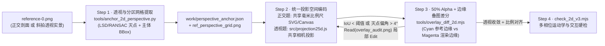
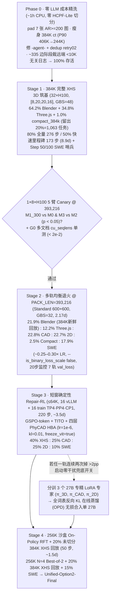

# 蓝图分册 03（Question 2B）：Option 2（384K 硬训 + 256K 沙盒）下的 2D 视觉/真机构跃迁与四阶段联合配比方案

> 公开整理版 · 2026-11-28。保留成文时点的记录；计划、文献结果和本地实测请分别理解。环境路径已泛化，未收录的附件已标注；发布范围见 [整理说明](../../PROVENANCE.md)。

> **所属总蓝图**：`distill-3d-to-2d-cad-blueprint-20261127` · **分册编号**：`03` · **对齐基准**：**Revision 3 / Option 2**（`2026-11-27`）  
> **权威定案源**：[CLEANROOM-4MODEL-VERDICT-384K-TRAIN-256K-SERVE.md](../xhs-384k-to-200k-data-adaptation-20261127/CLEANROOM-4MODEL-VERDICT-384K-TRAIN-256K-SERVE.md) · [OPTION2-CAD-2D-DATA-EVAL-MIX-MASTER-PLAN.md](../xhs-384k-to-200k-data-adaptation-20261127/OPTION2-CAD-2D-DATA-EVAL-MIX-MASTER-PLAN.md) · `decisions.md`（本地附件未发布） · [XHS-UNIFIED-SFT-STANDARD.md](../../3d-animation-agent/docs/XHS-UNIFIED-SFT-STANDARD.md) · *(历史 Rev 2 归档)*：[joint-consolidation.md](../xhs-384k-to-200k-data-adaptation-20261127/archive/joint-consolidation.md)  
> - **学生基座与统一 RoPE 坐标系**：Dense `Qwen3.8-27B` BF16（`${MODEL_ROOT}/Qwen3.8-27B`，`48` 层 `GatedDeltaNet` + `16` 层全注意力 + `27` 层 `ViT+Merger`），`qwen3_8` 模板，`--enable_thinking true --preserve_thinking true --freeze_vit false --freeze_aligner false`；Stage 1–4 训推与 `vLLM` 部署（`--max-model-len 327680`）**全链路严格锁定同一套 `Static YaRN 1.5×`**（`max_position_embeddings = 393,216`，`factor = 1.5`，`original_max_position_embeddings = 262,144`，`mrope_interleaved = true`，`mrope_section = [11, 11, 10]`，`partial_rotary_factor = 0.25`，`rope_theta = 10000000`）；`MAX_PIXELS = 401408`。  
> - **统一 `256K` 造数 / 评测 / 线上沙盒水位**：`AGENT_CONTEXT_WINDOW_TOKENS = 262144`、`CLAUDE_CODE_AUTO_COMPACT_WINDOW = 208000`（`CLAUDE_AUTOCOMPACT_PCT_OVERRIDE = 80`）、`CLAUDE_CODE_MAX_OUTPUT_TOKENS = 32768`、`MAX_TOOL_RESULT_TOKENS = 16384`（`208K + 16.4K + 4K + 32.8K = 261.2K < 262,144`）；经结构化 `compact_task`（禁写 `/384K` 或 `/256K` 绝对分母）与 `./work/anim2d_state_ledger.json` 无损续写，单题累计总推理视界达 `500K–1.2M+` tokens（历史实测 `run_summary.json`（本地附件未发布） `502K–782K`、`agy_stats.json`（本地附件未发布） `214K–393K`）。  
> - **存量 `384K` 零切分入训与多轨混包**：小红书 `3DCodeFactory`（`5,316` 任务 / `17,376` 条清洗后高密段）经 **Phase-0 CPU 零丢弃清洗（绝不做 `HCPF-Lite` 切分）** 原样入 `PACK_LEN = 393,216`（`94%` 填充，`(tok <= 393216, img <= 80)` 装箱守卫）；与 `256K` 沙盒新产 CAD/2D 轨迹（双教师 `80% kimi-k3.1-pro + 20% claude-opus-5-5`，`compact_256k` 瘦身 `≤125K`）在 `cu_seqlens` + `GatedDeltaNet` 状态重置下同锅拼包。

---

## 零、执行摘要：三大真实翻车现场的根因定性与系统破局总表

在前期 2D 与机械探针（[CANARY-12-AND-AGY-PROBE-REPORT-20261127.md](../../3d-animation-agent/docs/CANARY-12-AND-AGY-PROBE-REPORT-20261127.md)）中，人工逐帧复核暴露了**“评测器给接近满分，人眼一看严重翻车”**的三类结构性事故。本分册基于工作区真实代码与评测日志，给出从**三维先验降维赋能 → 256K 沙盒透视/运动学硬锚定 → 防刷分验证器升级 → 三轨课程与 `U` 账本配比**的完整工程方案：

| 用户亲查暴露的典型翻车案例 | 线上真实日志与源码实锤证据 | 本质病灶定性 | 本蓝图根治手段（确定性沙盒 + 3D 降维迁移） |
| --- | --- | --- | --- |
| **1. 地质博物馆玛瑙展柜与抛光台**<br>（`xhs_anchor_agate_2d`）<br>*斜拍参考图被画成“正面海报 + 歪斜台面 + 侧面抛光机”怪胎，却拿高分* | `judgement.json`（本地附件未发布）：`113` 轮、`153.8K` tok，VLM 裁判竟打出 **`s_vis = 1.00, mean = 0.910`**！源码 `exhibit.js`（本地附件未发布） 用 `fillRect` 画 0° 正面展柜 + `transform(1,-0.047,-0.68,0.57)` 硬扭地图卡；`workshop.js`（本地附件未发布） 在斜顶线下方贴 0° 正面展板，再叠四边不交汇歪台面与 2D 纯侧面砂轮机；且 `checked_labels = 0` 漏检全部 Canvas 文字 | **无统一 3D 相机投影矩阵导致 5 套局部坐标系杂糅** + **VLM 裁判按“物件存在清单”打分（Reward Hacking）** | ① 利用 3D 预训赋予的相机外参/灭点先验，在 2D 工程引入轻量共享投影层 `projection25d.js`（同一毫米级 3D 房间坐标投射全部墙柜/台面/机器椭圆）；<br>② 沙盒预置 `anchor_2d_perspective.py`（地平线/灭点/分区框提取）+ **`overlay_diff_2d.mjs`（与 `reference-0.png` 50% 半透明叠图 + Canny 边缘切线残差）**，灭点分裂直接判 `L1` 硬检淘汰 |
| **2. 复古铸铁双螺杆齿轮纸张压机**<br>（`xhs_anchor_press_cad` 及同类 2D 机械剖面）<br>*只抄静态外壳，齿轮竖改横、缺立柱垂直滑槽、螺杆与压辊假连接* | `canary12-detailed-metrics.json`（本地附件未发布） 与 `views_grid.png`（本地附件未发布） 对照 `reference.jpg`（本地附件未发布）：原图右侧双轴承座与正齿轮呈**上下垂直啮合**且机架开有**垂直导槽**供上压辊升降；生成件却画成左右水平双齿轮、实心侧墙无滑槽、顶丝悬死在横梁，仍靠静态 `0.0 mm³` 零干涉拿 **`0.960`** | **单姿态静态检验 + 像素帧差（`unique_stage_frames >= 3`）无法区分“焊死装饰壳”与“真实运动副传动链”** | 升级 **`check_2d_v3.mjs` 运动学与状态扰动硬检架**：① 强制暴露运动副拓扑 + `addInitScript` 拦截底层 Canvas 变换矩阵与 SVG `getCTM()` 防伪造；② 多相位（`t=0, 0.25T, 0.5T` + 2 个隐藏无理数随机时刻）与冻结时钟主动拨动输入件，硬断言**齿数比旋向 $\Delta\theta_B/\Delta\theta_A = -N_A/N_B$、导槽包络包含 $\mathrm{bbox}(\text{roller})\subset\mathrm{bbox}(\text{slot})$、铰链点欧氏闭合误差 $\le 0.5\text{px}$** |
| **3. 跨江四线轨交数字孪生拓扑等低上限看板**<br>（`anim2d_v2_11` 等）<br>*框线发光跑圆点玩具，约 `50K–120K` 即触顶，用户明确拒收* | `canary12-detailed-metrics.json`（本地附件未发布）：`anim2d_v2_11` 仅 `49` 轮、`120.0K` 上下文（`52.1K` 输出）即拿 **`1.000` 五维满分**，现已与 `anim2d_v2_09/10/12` 一并打入剔除黑名单 `pruned_low_difficulty_2d.jsonl`（本地附件未发布） | **拓扑连线+发光脉冲+常规图表缺乏空间几何与物理约束**，基座早已会写，挤占高难预算且拉偏评测均值 | **永久封杀框线拓扑与常规 KPI 图表看板**；重构为 **5 大高天花板 2D/2.5D 硬核题族**（实拍机械/钟表可动剖面、透视锁定博物馆/建筑交互展厅、多耦合光学/流体仪器、Awwwards 级多层遮罩视差剧场、存量坏透视/假机构外科返修），自然驱动 **`300K–700K` tokens 跨段深度精修** |

---

## 一、存量 2D 管线源码级尸检：为什么旧验收器与合成器会漏放坏样本？

对 `${WORKSPACE}/3d-animation-agent/scripts/` 与 `runs/xhs_v2_canary12_20261127/` 的实查定位了 4 个必须从架构层面修补的硬漏洞：

### 1.1 `xhs_anchor_agate_2d` 透视分裂与裁判刷分的像素/代码证据链

对比实景参考图 `reference.png`（本地附件未发布） 与第 113 轮交付帧 `kf_0.png`（本地附件未发布） 及其源码：
1. **五套局部投影在同一画布互殴**：
   - 实景参考图是标准的**左前向右上纵深斜拍两点透视**，展柜顶沿、三层灯架、底部斜面地图箱、右后展板与前景工作台严格收敛于同一视平线灭点。
   - 但在生成代码的 `exhibit.js`（本地附件未发布） 中，`roundRect(ctx, 26, 24, 926, 704, 3)` 与 `ctx.fillRect(48, 132, 799, 486)` 将左侧大展柜画成斜率为 `0.000` 的**纯 0° 正立面矩形**；紧接着第 6 行 `ctx.transform(1, -0.047, -0.68, 0.57, 232, 674)` 用手拍的 `-0.68` 水平错切矩阵硬塞进一张向右上方歪斜 ~50° 的地图卡。
   - 在右侧 `workshop.js`（本地附件未发布） 中，第 45 行刚画出斜率 `-0.048` 的透视吊顶线 `line(ctx, 960, 62, 1600, 31)`，第 47–48 行 `panel(ctx, 983, 86, 236, 298, ...)` 就直接用 `fillRect` 贴上两块 **0° 正面展板**；第 137 行 `polygon(ctx, [[968,458],[1420,417],[1548,528],[1051,598]])` 画出四条边互不收敛于同一灭点的歪四边形桌面，第 73–74 行又在歪桌面上平贴一个 `roundRect(ctx, -50, -29, 117, 59, 19)` 的**纯 2D 正侧面胶囊形抛光机**！
2. **现行“一刀切禁斜拍图”补丁只是退缩，且 Option 2 §0 已修正 `D03` 放行边界**：
   - 事故暴露后，`xhs_v2_synth.py`（本地附件未发布）（L304–305）曾加上 `"STRICTLY FORBID 3D oblique two-point/three-point perspective room photographs"`。这一权宜之计虽然挡住了合成器自造斜拍题，但**一旦线上真实用户上传一张实拍博物馆展厅、实验室仪器台或建筑剖面照片要求生成 2D/2.5D 互动网页（正如小红书官方评测题 `xhs-val-06-0df9c93c` 本身！），模型依然会瞬间重演正面/侧面拼贴崩溃**。真正的解法不是逃避透视参考图，而是用 3D 底座的空间投影能力正面攻克它。同时按 Option 2 §0 #7，在 `xhs_v2_synth.py:303` **重新放行高复杂多幕联动 `D03` 动态数据可视化**（仅拒掉静态 KPI 卡片/移动点地图）。
3. **`check_2d_v2.mjs` 视口文字审计存在 Canvas 盲区（已在 `check_2d_v3.mjs` 修复）**：
   - 历史版本 `check_2d_v2.mjs`（本地附件未发布） 仅查询 `svg text, [data-label], [data-callout], .callout, .hud-label, .annotation-label`，导致大量使用 Canvas `ctx.fillText` 与普通 HTML 标签排版的 `xhs_anchor_agate_2d` 在 `judgement.json`（本地附件未发布） 中 `checked_labels: 0`，碰撞检测形同虚设。

### 1.2 `check_2d_v2.mjs` 与交互截图器对“假机构外壳”的漏检机制（Option 2 §0 #5/#9 已立项封堵）

1. **像素哈希变化 ≠ 真实物理传动**：历史版 `check_2d_v2.mjs`（本地附件未发布） 仅断言 `uniqueStageHashes >= 3`（SVG 另加 `domSigs >= 3`）。只要画布上有 1 个孤立齿轮原地自转或几颗光斑闪烁，哪怕主动轮与从动轮齿数比完全胡写、双螺杆与压辊毫无位移耦合、滑块穿透实心机架无导槽，硬检照样 `ok: true`。
2. **交互探针与 `xhs_v2_produce.py` Option 2 §0 #5 硬修补**：历史 `xhs_v2_produce.py`（本地附件未发布） 的 `_capture_2d_sheets_and_interactions` 在 `baseT = 0.35 * duration` 触发一次按钮/滑块后截一张 `func_F01_after.png` 丢给 VLM 肉眼看。正如 [2026 同源 RL 31 坑手册](../visual-3d-agent-rl-pitfalls-and-lab-lessons-20261127/README.md)（坑 07 `LEGO-Anything` / `AeSlides`）实证：前沿 VLM 凭单张静态渲染图判断几何比例变形的 F1 仅 **`0.24`**、几何准确性判别一致率仅 **`45.8%`**。按 Option 2 §0 #5，`xhs_v2_produce.py` 必须同步落地：补齐 **`256K / 208K / 80%`** 环境变量、`max_export_tokens` 从 `196000` 提至 **`262144`**、**禁止同家族自评**（不能用 `kimi` 评 `kimi`）、裁判 `max_tokens >= 12000`、本地预置 `vendor/gsap/gsap.min.js` 且 2D 沙盒仅挂 `playwright-core` 隔离 `web2d_node_modules`（彻底拔掉 `three`）。

---

## 二、为什么先吃透 3D 能降维解锁顶级 2D？——原理迁移与 `256K` 沙盒透视锚定设计

纯前端/纯 2D 训练的模型之所以在复杂场景中频繁出现“正面展柜贴歪桌面、椭圆透视轴乱转、光影扁平杂乱”，根本原因是它把 2D 画布当成**无三维几何约束的平面色块拼贴板**。而先在小红书 `3DCodeFactory` 全量纯代码 3D 轨迹（`Blender 4.2.10 bpy` + `Three.js r180`）上打透 `Qwen3.8-27B`，能直接向 2D 注入四项不可替代的底层能力：

### 2.1 从 3D 到 2D 的四重空间与行为降维迁移

| 3D 训练习得的底层表征（来自 `3DCodeFactory`） | 在 3D 代码中的显式形态 | 降维注入 2D（`SVG` + `Canvas2D` + `Hybrid 2.5D`）的直接收益 | 本地/论文硬指标支撑 |
| --- | --- | --- | --- |
| **1. 统一相机外参与透视灭点守恒** | `THREE.PerspectiveCamera(fov, aspect)` + 世界坐标 $(X,Y,Z) \to (u,v,z_{\text{ndc}})$ | 模型天然理解同一场景所有平面共享唯一视平线 $\mathbf{l}_\infty$ 与主灭点 $(\mathbf{v}_x, \mathbf{v}_y, \mathbf{v}_z)$，通过 40 行共享投影函数即可把斜拍参考图还原为透视 100% 自洽的 2.5D 矢量场景 | `3DCodeFactory` SFT 使 `BlenderGym` 零样本空间摆放误差骤降 **`-94.5%`**（[arxiv-2611.28783](../arxiv-2611.28783/README.md)） |
| **2. 光源方向一致性与多层材质次表面表现** | Cycles / Three.js 主辅轮廓三点布光、粗糙度高光衰减、接触环境光遮蔽（AO） | 彻底告别 2D 平涂色块：主光源锥角、台面椭圆漫反射池、金属拉丝线性渐变法向与接地接触阴影（Contact Shadow）严格服从同一三维光矢 $\mathbf{L}$ | `3DCodeFactory` SFT 使零样本光照编辑误差直降 **`-82.4%`**，视觉精细度涨 **`+13.49`** |
| **3. 场景图父子刚体层级与局部关节变换** | `THREE.Group` / `bpy` 父子骨架链 $T_{\text{world}}^{(k)} = T_{\text{parent}} \cdot R(\theta_k) \cdot T_{\text{offset}}$ | 在 2D 连杆、双臂台灯、行星轮系与机械压机中自觉采用嵌套 `<g transform>` 或 `ctx.save()/translate()/rotate()` 树状传递，消灭支点漂移与零件脱节 | 消除 `MotionGraphicsBench` 最高频刚体支点（`rotate 49% / rigid 30% / pivot 29%`）漂移顽疾 |
| **4. 早期看图、局部裁切挑刺与外科 `Edit` 肌肉记忆** | 写初版 $\to$ 渲染 $\to$ `Read` 全局与特写截图 $\to$ 定位坐标残差 $\to$ 小步 `Edit` | 修复 `Qwen3.8-27B Base` 在 2D 多轮精修中 `50%` 超时或 `<0.6` 轮自满早停的缺陷，将看图找茬习惯无缝平移至 Playwright Contact Sheet 与半透明叠图审计 | 首次看图位置从轨迹 `30.5%` 大幅提前至 **`12.8%`**，看图频次提升 **`3.07×`**，报错率腰斩至 `4.3%` |

### 2.2 `256K` 2D 沙盒内的「透视与比例硬锚定」三件套（根治“正/侧面杂糅”）

参照小红书 3D 的参考视角对齐与 CAD 赛道的 OCCT HLR 线框叠图，我们在 `256K` 离线 2D 沙盒（`TOOLS.md` + `./tools/`）中预置**零网络依赖的透视锚定与 50% Alpha 叠图闭环**，无论是正交工程剖面还是 `xhs_anchor_agate_2d` 类斜拍实景图均可精确锁定：



#### （1）工具 1：参考图灭点、视平线与主分区包围盒提取器（`tools/anchor_2d_perspective.py`）
沙盒内基于已预装的 `numpy + scipy + Pillow`（或轻量 OpenCV/Sobel-Hough）对 `reference-0.png` 执行毫秒级几何解析，输出机读 `work/perspective_anchor.json` 与可视化辅助图 `work/ref_perspective_grid.png`：
1. **长直线段提取与三正交簇 RANSAC 灭点聚类**：检测长度 $\ge 0.06 W$ 的显著结构直线段，按倾角与交点聚类为竖直簇 $\mathcal{L}_z$ 及左右水平纵深簇 $\mathcal{L}_x, \mathcal{L}_y$，自动判定参考图投影模态 `projection_mode`：
   - 若 $|\mathcal{L}_x \cup \mathcal{L}_y|$ 中 $>85\%$ 线段水平（$|\theta| < 2.0^\circ$）：标为 **`orthographic_2d`**（纯正交平立剖面），锁定全局像素/毫米比例尺；
   - 若平行斜线簇无有限交点（交点距离 $> 8W$）：标为 **`axonometric_25d`**（等轴测/斜二测），输出主轴倾角 $(\alpha_x, \alpha_y)$；
   - 若存在显著有限灭点 $\mathbf{v}_1 = (u_1, v_1)$（及可选第二灭点 $\mathbf{v}_2 = (u_2, v_2)$）：标为 **`perspective_25d`**（如 `xhs_anchor_agate_2d`），输出归一化视平线高度 $y_h / H$、主灭点坐标、以及左墙面/右墙面/工作台面/地面的单应性平面锚点四边形。
2. **主视觉分区 `4×4` 归一化布局包络（Zone BBox Grid）**：通过显著性色块与边缘密度分割提取前 4–6 个核心主体区域（如左展柜 `[0.00, 0.02, 0.62, 0.94]`、下方地图箱 `[0.14, 0.62, 0.45, 0.88]`、右中抛光台 `[0.64, 0.38, 0.94, 0.68]`、右前岩芯盒 `[0.67, 0.65, 0.95, 0.98]`），从源头杜绝主体缩成玩具比例或左右比例失调。

#### （2）工具 2：轻量共享 2.5D 相机投影内核范式（`output/src/projection25d.js`）
针对 `projection_mode == "perspective_25d"` 或 `"axonometric_25d"` 的场景题，指导（并通过种子轨迹示范）Agent 严禁手写孤立 `fillRect` + 拍脑袋 `ctx.transform` 错切，而是定义一个 **40 行零依赖共享 3D$\to$2D 相机模块**，将所有墙柜、海报、台面、砂轮圆柱与岩芯统一建模在同一房间右手系 $(X, Y, Z) \in \mathbb{R}^3$ 中再投影绘制：

```javascript
// output/src/projection25d.js — 3D 先验降维驱动 2D Canvas/SVG 的统一透视投影内核
export function createSharedCamera({ eye, target, up = [0, 1, 0], fovDeg = 38, width = 1600, height = 900 }) {
  const norm = v => { const l = Math.hypot(...v) || 1; return v.map(x => x / l); };
  const sub = (a, b) => [a[0] - b[0], a[1] - b[1], a[2] - b[2]];
  const cross = (a, b) => [a[1]*b[2] - a[2]*b[1], a[2]*b[0] - a[0]*b[2], a[0]*b[1] - a[1]*b[0]];
  const dot = (a, b) => a[0]*b[0] + a[1]*b[1] + a[2]*b[2];

  const fwd = norm(sub(target, eye));
  const right = norm(cross(fwd, up));
  const camUp = cross(right, fwd);
  const f = (0.5 * height) / Math.tan((fovDeg * Math.PI) / 360);

  function project([X, Y, Z]) {
    const d = sub([X, Y, Z], eye);
    const zc = Math.max(0.05, dot(d, fwd));
    return [width * 0.5 + (dot(d, right) / zc) * f, height * 0.5 - (dot(d, camUp) / zc) * f, zc];
  }
  // 将任意 3D 平面局部坐标 (u, v) 精确映射为 2D 透视四边形或椭圆采样点，100% 共享灭点！
  const projectLoop = pts3d => pts3d.map(p => project(p).slice(0, 2));
  const projectDisk = (center, axisU, axisV, r, segs = 48) =>
    Array.from({ length: segs }, (_, i) => {
      const a = (i / segs) * Math.PI * 2, c = Math.cos(a) * r, s = Math.sin(a) * r;
      return project([
        center[0] + axisU[0]*c + axisV[0]*s,
        center[1] + axisU[1]*c + axisV[1]*s,
        center[2] + axisU[2]*c + axisV[2]*s,
      ]).slice(0, 2);
    });
  return { project, projectLoop, projectDisk };
}
```

> **为什么这 30 行代码彻底终结了 `xhs_anchor_agate_2d` 式翻车？**  
> 当左侧背光展柜、下方斜面地图灯箱、右后展板、中景工作台、卧式抛光机圆柱外壳（沿轴向若干 `projectDisk` 截面求包络）和前景木质岩芯盒全部通过同一个 `cam.project([X, Y, Z])` 投射到 `Canvas2D / SVG` 时，**所有平行墙面边、柜沿边和桌面边在数学上 100% 交汇于完全相同的左右灭点，砂轮圆盘的长短轴透视压缩比与轴线倾角自动正交耦合**，物理上不可能再出现“0° 正面海报紧贴歪斜平行四边形桌面与纯侧面机器”的透视分裂！

#### （3）工具 3：`reference-0.png` 50% 半透明叠图与边缘切线差分器（`tools/overlay_diff_2d.mjs`）
完全对标小红书 3D 视角比对与 CAD 的 OCCT HLR 叠图，Agent 在首版构图完成后执行：
```bash
node tools/overlay_diff_2d.mjs --html output/index.html --ref reference-0.png --out work/overlay_audit.png
```
该脚本将舞台在 `t = 0`（不含底部额外播放条 HUD 的纯舞台区域）渲染为与 `reference-0.png` 同分辨率图像，一次性拼出 `2×2` 高信息密度诊断单图 `work/overlay_audit.png`（严格适配 `MAX_PIXELS = 401408`，单次 `Read` 仅耗 `~512` 视觉 tokens）并输出 JSON 指标：
1. **左上格 · `50% Alpha Blend`**：`0.5 * I_ref + 0.5 * I_render(t=0)`，主柜体、台面与机器的比例错位或角度歪斜一眼暴露；
2. **右上格 · `Cyan-Magenta Sobel Edge Overlay`**：参考图结构边缘染青色（Cyan），渲染舞台结构边缘染品红（Magenta），重合处呈亮白色，灭点发散处直接张开成明显喇叭口；
3. **左下格 · `Zone Silhouette Occupancy Diff`**：按 `perspective_anchor.json` 分区框计算前景占据率残差 `zone_iou`；
4. **右下格 · `Vanishing-Line Orientation Histogram`**：对比参考图与渲染图在 $8$ 个角度桶（$`run_summary.json`（本地附件未发布） 运行中，`Kimi` 在超长任务上因 Claude Code 未知模型回退至 `200K`（实际 `141K–174K` 触发压缩）叠加海量原尺寸截图触发了 `15–36` 次纯散文压缩，证明了自动压缩能支撑 `502K–782K` 总推理长度，但也暴露出纯散文递归摘要极易抹除精确几何不变量。为此，我们与分册 `01` / `02` 100% 统一：锁定代理端 `262,144` 窗口（**`CLAUDE_CODE_AUTO_COMPACT_WINDOW = 208000` / `80%`、`CLAUDE_CODE_MAX_OUTPUT_TOKENS = 32768`、`MAX_TOOL_RESULT_TOKENS = 16384`**，压缩提示词**严禁写死 `/384K` 或 `/256K` 绝对分母**，并钉死首轮 `USER REQUEST + I_ref`），由沙盒校验脚本实时维护持久化文件 **`./work/anim2d_state_ledger.json`**，并在 9 节 `<summary>` 第 6 节原样嵌入以下四块机读状态锚点（随 `compact_recovery` 无损移交，将单题压缩次数压至 **`1–3` 次**且零参数漂移）：
1. **`[PERSPECTIVE_ANCHOR]`**：`projection_mode`、共享相机参数 `{eye, target, fovDeg}` 或正交比例尺 `px_per_mm`、各主分区像素包围盒 `zone_bboxes` 及最近一次 `overlay_diff_2d` 的 `edge_orient_cosine`；
2. **`[KINEMATIC_TOPOLOGY]`**：所有运动构件 ID、父节点、旋转中心 `(cx, cy)` 或 3D 轴线、齿轮齿数/节圆半径 `(N, r)`、导槽行程上下界 `[s_min, s_max]` 与周期相位方程 $\theta_i(t, \mathbf{u})$；
3. **`[MODULE_&_DOM_CONTRACT]`**：`output/src/*.js` 各文件导出签名、`window.renderAt(t)` / `window.__getSceneState()` / `window.__getKinematicState()` 字段与交互控件选择器映射；
4. **`[VERIFIER_OPEN_ISSUES]`**：上一轮 `check_2d_v3.mjs` 未清零的具体几何/运动学残差项与已验证通过（严禁回退破坏）的不变量清单。

---

## 三、升级 2D 沙盒验证器（`check_2d_v3.mjs`）与提示词契约：彻底绞杀刷分与假机构

为根除“只画静态皮壳骗高分”与“VLM 裁判数物件放水”，我们在保留并修补 `check_2d_v2.mjs` 全部确定性时空检查基础上，落地 **Option 2 §0 #9 六项硬修补 + 五大运动学与状态扰动硬闸**，构建 **`scripts/check_2d_v3.mjs`**：
- **Option 2 §0 #9 六项前置硬堵漏**：(a) **删除 `data-allow-clip` (v2 L297) 与 `data-allow-overlap` (v2 L505) 两处作弊后门**；(b) 将 SHA-256 改为非 HUD 区域真实运动门禁（**`MAD ≥ 1.5`、变化像素面积 `≥ 1.5%`、6 帧两两最小 `SSIM ≤ 0.985`**，封死 1 像素闪烁假动画）；(c) 将 `renderer === 'svg'` 改为 **`stageInfo.hasSvg`**（堵住 `hybrid` 跳过 SVG 审计漏洞）；(d) 主渲染升至 **`1280×720`** 并双视口（`1280×720` + `1440×900`）全时间点检查全部文本/SVG 重叠率 **`≤ 10%`**（原 45% 过松）与 `overflow:hidden` / `scrollWidth` 截断；(e) 校验 **`window.__SCENE_READY__`**、**`window.__2D_STATE__`**（兼容 `__getSceneState()`）及 **`ffprobe`** 解码 MP4；(f) **硬封禁 `three`/`THREE`/`OrbitControls`/`WebGLRenderer`/`getContext('webgl'|'webgl2')`**（跨轨污染率 `= 0.0%`）。

### 3.1 Playwright 运动学与状态扰动硬检架（`check_2d_v3.mjs` 五大新增硬闸）

所有硬检均在**临时干净只读副本目录**冷启动运行（防篡改测试器与缓存残留，对齐 [31 坑手册](../visual-3d-agent-rl-pitfalls-and-lab-lessons-20261127/README.md) 坑 19），单次全套耗时 `< 6 秒`，未过者直接判 `$L_0 \sim L_2$` 硬淘汰，**消耗 `0` VLM Judge Token**：

#### 硬闸 1：底层渲染矩阵反作弊交叉核验（防模型虚报状态 JSON）
要求所有含机械/光学/流体/关节运动的 2D 工程暴露 `window.__getKinematicState()`，返回结构化节点表：
```json
{
  "t": 2.0,
  "params": { "crank_rpm": 30, "screw_turn": 1.5 },
  "joints": [
    { "id": "gear_drive", "kind": "gear", "pivot": [420, 380], "angle_rad": 3.1416, "teeth": 18, "pitch_r": 36, "meshes_with": ["gear_driven"] },
    { "id": "gear_driven", "kind": "gear", "pivot": [420, 492], "angle_rad": -1.6830, "teeth": 34, "pitch_r": 68, "meshes_with": ["gear_drive"] },
    { "id": "upper_roller", "kind": "slider_in_slot", "pos": [420, 318.5], "bbox": [310, 298.5, 530, 338.5], "slot_id": "frame_vertical_slot", "slot_bbox": [404, 260, 436, 370], "driven_by": "twin_leadscrew", "lead_px_per_rev": 16.0 }
  ]
}
```
**防伪造铁律（`page.addInitScript` 底层钩子）**：模型绝不能靠在 `__getKinematicState()` 里写一套假数学公式、而画布上画死图来骗检！`check_2d_v3.mjs` 在页面加载前通过 `page.addInitScript` 透明挂载两路底层探针：
- **SVG 路径**：直接读取真实 DOM 节点的 `el.getCTM()` 与 `el.getBBox()`，解算实际屏幕旋转角 $\hat{\theta} = \operatorname{atan2}(b, a)$ 与平移中心 $(\hat{e}, \hat{f})$，与 `__getKinematicState()` 申报值逐项比对（偏差 $> 1.5\text{px}$ 或 $> 1.5^\circ$ 立即判 `kinematic_telemetry_spoofed`）；
- **Canvas 2D 路径**：自动包装 `CanvasRenderingContext2D.prototype.{translate, rotate, transform, setTransform, arc, stroke, fill, fillText}`，记录每帧 `renderAt(t)` 内真实发生的带旋转/平移矩阵的绘制调用簇质心与角度演进；若申报关节角度变化 $\Delta\theta > 10^\circ$ 而对应区域像素光流/变换矩阵无同步旋转，立即判 `canvas_fake_kinematics`！

#### 硬闸 2：多时刻 + 隐藏随机无理数时间戳运动学定律断言
在公开锚点 `t = 0, 0.25T, 0.5T, 0.75T` 之外，每次评测动态抽取 **2 个隐藏无理数比例时刻** $t_{r1} = (\phi - 1)T \approx 0.61803T$、$t_{r2} = (\sqrt{2}-1)T \approx 0.41421T$（彻底封死针对固定时间点硬编码分支），对整个机构图执行四条物理守恒断言：
1. **齿轮副啮合比、旋向与轴线方位定律**（直接根治纸张压机“竖改横/假转”）：
   - 外啮合正齿轮副 $(A, B)$ 必须满足角位移比守恒与反向旋转（内齿圈同向）：
     $$\left|\frac{\Delta\theta_B(t_2, t_1)}{\Delta\theta_A(t_2, t_1)} - \left(-\frac{N_A}{N_B}\right)\right| \le 0.015, \qquad \big|\|\mathbf{c}_A - \mathbf{c}_B\|_2 - (r_A + r_B)\big| \le 2.0\text{ px}$$
   - 若题目/参考图规定垂直传动链（如压机立柱上下齿轮组），验证器核验连心线方向角 $|\operatorname{atan2}(y_B-y_A, x_B-x_A) \pm 90^\circ| \le 12^\circ$，横排摆设直接判 `gear_axis_orientation_mismatch`！
2. **丝杠螺母 / 齿轮齿条与导槽包络约束定律**（直接根治压辊“无垂直滑槽悬空/焊死”）：
   - 对每个 `slider_in_slot` 构件，断言线位移与驱动角严格满足导程关系 $\Delta s = \frac{\text{lead}}{2\pi}\Delta\theta_{\text{screw}}$（误差 $\le 2\%$），全周期或全行程有效冲程 $|\max_t s(t) - \min_t s(t)| \ge s_{\min\_\text{required}}$（严禁微颤 $<1\text{px}$ 糊弄）；
   - **导槽实体存在与包含检查**：画布/DOM 中必须真实绘制导槽腔体 `slot_id`，且在全部采样时刻滑块轴承座的导轨配合区满足 $\mathrm{bbox}(\text{bearing\_block}, t) \subset \mathrm{bbox}(\text{slot\_channel})$，滑块越出导槽边界或缺失导槽结构立判 `missing_or_violated_guide_slot`！
3. **平面连杆/多节支点铰接欧氏闭合定律**：
   - 对四连杆、曲柄滑块、多节摇臂灯（`p0 -> p1 -> p2 -> p3`）等铰接链，在全部 6 个测试时刻验证各刚体杆长恒定 $|\ell_k(t) - \ell_k(0)| \le 0.5\text{px}$ 且共享铰接销钉两端点零脱节 $\|\mathbf{p}_{k,\text{end}}(t) - \mathbf{p}_{k+1,\text{start}}(t)\|_2 \le 0.5\text{px}$。
4. **零悬空孤立废件检查（Zero Detached Floating Parts）**：
   - 对全部可见动态几何组构建连通支承图（接地机架 `ground` $\to$ 固定支座/导槽 $\to$ 旋转/滑动副 $\to$ 末端执行器），任何与 `ground` 不连通且非粒子/光束特效的刚体部件立即判 `detached_floating_part`！

#### 硬闸 3：冻结时钟下的主动输入扰动因果探针（Active State-Perturbation Probe）
调用 Playwright `await page.clock.install()` **彻底冻结时间轴于 $t = t_{\text{hold}}$**（切断自动播放时间流干扰），对每个交互控件（如压机手轮转角滑块 `#screw-wheel`、发动机转速 `#rpm`、透镜折射率 `#ior-slider`、抛光台开关）执行三点扫描 $u \in \{u_{\min}, u_{\text{mid}}, u_{\max}\}$ 并重调 `renderAt(t_hold)`：
- **因果联动断言**：纯舞台 ROI（剔除 HUD 控制面板区域）的像素差分 $\mathrm{MAD}(I(u_{\min}), I(u_{\max})) \ge 1.8$，且下游从动件（如压辊高度 $y_{\text{roller}}$、折射焦点位置 $x_{\text{focus}}$、气门升程）发生单调非零物理响应 $|\Delta y_{\text{driven}}| > \epsilon_{\min}$；若只改按钮颜色或只动输入手柄而从动件纹丝不动，立判 `dead_transmission_chain`！
- **精确可逆复位断言**：触发 `#reset`（或将控件拨回初始默认值）后，舞台像素哈希与 `__getKinematicState()` 必须与扰动前基线 `100%` 一致。

#### 硬闸 4：透视灭点一致性门禁（Perspective Coherence Gate）
对带实景/透视参考图的任务，自动比对 `work/perspective_anchor.json` 与 `t=0` 渲染帧：若参考图为 `perspective_25d`（存在有限灭点），而渲染舞台主结构区域检出面积占比 $> 20\%$ 的 `0°` 正交巨型矩形框与斜向多边形并存（即复现 `xhs_anchor_agate_2d` 病征），直接抛出硬失败码 `contradictory_front_oblique_perspective_mashup` 短路拒收。

#### 硬闸 5：全量 HTML + Canvas `fillText` 防碰撞与防 CSS 截断作弊审计
修补 `check_2d_v2.mjs` 第 501 行盲区与 [31 坑手册](../visual-3d-agent-rl-pitfalls-and-lab-lessons-20261127/README.md) 坑 02/03：
- 通过 `addInitScript` 拦截全部 `ctx.fillText(str, x, y)`，结合 `ctx.measureText(str)` 与 `ctx.getTransform()` 计算真实屏幕包围盒，与全部可见 HTML/SVG 文本节点合并做 `1280×720` & `1440×900` 双视口全时间点两两碰撞检测（**重叠加紧至 `≤ 10%`，删除 `data-allow-overlap` 后门**，把 `xhs_anchor_agate_2d` 的 `checked_labels` 从 `0` 恢复到真实 `38+` 项全覆盖）；
- 测排版溢出前临时剥离非舞台裁剪节点的 `overflow: hidden` / `min-height` 裸测 `scrollWidth / scrollHeight`（**删除 `data-allow-clip` 后门**）；
- 测留白均衡前施加 `k = 21` 高斯模糊防背景噪点刷分，并限制纯 `<text>`/`fillText` 字牌面积占比防止“写字代替画图”。

### 3.2 提示词契约与怀疑论多模态裁判升级

1. **极简上限四段式提示词（`XHS_V3_WEB2D_WRAPPER` + 工作区 `TOOLS.md`）**：
   - 继承 [XHS-TASK-AND-RUBRIC-SPEC.md](../../3d-animation-agent/docs/XHS-TASK-AND-RUBRIC-SPEC.md) 四段式解耦哲学：题面不塞命令行菜谱，`ordinary` 画像 `50%` 题面隐藏死板 `#dom-id` 让模型自主设计优雅交互 UI；
   - 在工作区 `TOOLS.md` 中明确写出三大自检武器：`anchor_2d_perspective.py`（先定透视/正交基准）、`overlay_diff_2d.mjs`（50% 半透明叠图查比例与灭点）、`check_2d_v3.mjs`（查齿轮比/导槽行程/全视口零碰撞），引导模型形成**“定相机/机构数学模型 $\to$ 模块化编码 $\to$ 50% 叠图纠透视 $\to$ 运动学探针验真传动 $\to$ 局部放大打磨光影材质”**的深度长程习惯。
2. **多模态 VLM 裁判反刷分加固（`judge_2d_attempt_v3`）**：
   - **强制喂入 `overlay_audit.png`**：不再只让裁判各自单看参考图和渲染图“凭印象脑补比例”，而是把 `50% Alpha Blend + 青品边缘差分图` 作为 `Image 1` 直接呈堂证供，任何透视错位与比例失调在裁判视野中无处遁形；
   - **强制配置 `25%–30%` 负向排雷条款（Absence / Pitfall Criteria，防坑 06）**：每道题的 `R_vis / R_spec` 中固定包含负向一票否决锚点（① 严禁正面/侧面多套透视混拼；② 严禁无导槽悬空滑块或不成比例假齿轮；③ 严禁照抄参考图 AI 乱码假字）；
   - **先推理后打分 + 禁同族自评 + 微差正反双序复核（防坑 21）**：**严格禁止同家族自评**（不能用 `kimi` 评 `kimi`），裁判 `max_tokens >= 12000`（原 `8192` 已提至 `>= 12000`），JSON 强制先输出逐部件测量 `"reasoning"` 再给 `{0, 0.5, 1}`，Best-of-2 分差 `< 0.08` 时跑正反双序交换位置盲评定胜负。

### 3.3 高天花板 2D 任务分类谱（Option 2 §2.2 · `MVP 300 / Standard 600 [推荐] / Scale 1,200`）

彻底废除旧树中 `~50K–120K` 即可交卷的静态 KPI 卡片与移动点拓扑看板，将自产 2D 算力 **100% 集中投向必须依赖精确数学建模、统一透视投影与多轮视觉精修的 5 大高天花板子类别**（与 `OPTION2-CAD-2D-DATA-EVAL-MIX-MASTER-PLAN.md` §2.2 完全对齐：总构成 `35% Tier A [80K/32K] + 45% Tier B [155K/58K] + 20% Tier C [256K 压缩三联段]`；子类别 1–4 内含 **`15%` 深度视觉修复与 `5%` 健康对照组**；`256K compact_task` 经历史空 `<think>` 瘦身压至 `125K T_in / 4.0K U`；每 `100` 题产出 **`140` 段 [`120` 执行 + `20` 压缩] · `18.675M` 瘦身 `T_in` · `6.090M U`**）：

| Option 2 2D 内部子类别 | 分类树与技术栈聚焦（对应 `H1–H5` 高难形态） | 题数占比 | `MVP` (`300`) | **`Standard` (`600`, 推荐)** | `Scale` (`1,200`) |
|---|---|---:|---:|---:|---:|
| **1. 原理讲解 / 机械科普 / UI 交互演练** | `D02`（物理/数学/机械/生物实验室）+ `D04L04` UI 交互流（SVG+Hybrid） | **25%** | 75 | **150** | 300 |
| **2. SVG 角色骨骼绑定 / 动态图形 / 叙事网页** | `D01`（品牌/发布/叙事画廊）+ `D04L01–03`（`clip-path`、刚体枢轴、GSAP 时间轴） | **25%** | 75 | **150** | 300 |
| **3. Canvas 2D 物理模拟 / 粒子 / 视差故事** | `D05`（可复现随机种子 Canvas 物理、视差场景、音画交互） | **18%** | 54 | **108** | 216 |
| **4. 联动动态数据可视化 / Scrollytelling** | `D03` 多幕联动 SVG/Canvas 数据叙事（`xhs_v2_synth.py:303` 放行，严拒静态 KPI 卡片与移动点地图） | **12%** | 36 | **72** | 144 |
| **5. `256K` 压缩续写（多幕大工程 / 增量重构）** | 多里程碑演进与深度修版，真实撞穿 **`208K`** 自动压缩（`before 210K/72K` + 瘦身 `ct 125K/4K` + `recovery 110K/42K`，`3` 段/题） | **20%** | 60 | **120** | 240 |
| **2D 合计（每 `100` 题）** | **`140` 段（`120` 执行 + `20` 压缩）· `18.675M` 瘦身 `T_in` · `6.090M` `U`** | **100%** | **300 题** (`420` 段) | **600 题** (`840` 段) | **1,200 题** (`1,680` 段) |

> **永久剔除黑名单（`0%` 配额）**：① 地铁/轨交/航线/微服务/网关节点连线发光脉冲拓扑图（如已剔除的 `anim2d_v2_11`、`anim2d_v2_12`）；② 顶部 4 张 KPI 数字卡 + 右侧常规折线/柱状图大屏（如 `anim2d_v2_09`、`anim2d_v2_10`）；③ 白底/黑底孤立单图标、单摆小球或无物理耦合的纯粒子背景。`MotionGraphicsBench`、`AnimWeb-Bench`、`Webdev-Bench` **`0%` 入训，永久保留作外部 OOD 评测**。

---

## 四、Option 2 跨模态课程演进与四阶段精确混合配比（`Stage 1 -> Stage 2 -> Stage 3 -> Stage 4`）

### 4.1 跨赛道空间表征正迁移机理：为什么三者合训是 `1 + 1 + 1 > 3` 而非互相拉扯？

在全链路统一 **`Static YaRN 1.5×`（`393,216`）**、统一 **`256K`（`262,144`）** 造数/评测沙盒、统一 Claude Code 六工具协议（`Read / Write / Edit / Bash / Glob / Grep`）与显式 `delivery_contract` 元数据隔离下，三条纯代码赛道构成严密互补的**三维空间认知闭环**：
- **`3D (Blender bpy + Three.js)` $\longrightarrow$ 赋能 `2D` 与 `CAD`**：提供世界坐标系 $(X,Y,Z)$ 空间想象力、相机透视投影矩阵（根治 2D 斜拍透视分裂）、多光源材质层次以及百轮级“渲染看图 $\to$ 局部 `Edit`”长程耐力；
- **`CAD (CadQuery 2.6.1 / OCCT B-Rep)` $\longrightarrow$ 赋能 `2D` 与 `3D`**：`BenchCAD` 实测 `72.5%` 工业件在 `YZ (40%) / XZ (32.5%)` 非 XY 平面起草，且强迫模型精算毫米级孔轴公差、渐开线齿形、下伸止口与 `0.0 mm³` 布尔零干涉——这种**严苛解析几何与运动副配合纪律**直接迁移到 2D 机械剖面的齿轮啮合/导槽间隙计算以及 3D 硬表面机械建模；
- **`2D (SVG + Canvas2D + 2.5D)` $\longrightarrow$ 反哺 `3D` 与 `CAD`**：锤炼亚像素级 2D 贝塞尔曲线造型、正交/剖面投影读图能力（直接辅助 CAD 逆向解读工程三视图与 HLR 叠图！）以及零遮挡 UI 控件排版（提升 Three.js 交互面板质感）。

### 4.2 为什么混合配比必须采用统一 PyArrow Schema 与有界样本权重 $w_i$？

经 [empirical_audit_200k_ledger.json](../xhs-384k-to-200k-data-adaptation-20261127/archive/empirical_audit_200k_ledger.json)（历史一手法器分词统计）与 [three-track-data-factory-strategy](../three-track-data-factory-strategy-20261126/README.md) 实测：
- 一条小红书 3D 执行段含可训 `<think> + tool_call` 中位数高达 **`255,260` tokens**（占全段 `69.1%`）；
- 一条高难跨段 2D 轨迹（`D01–D05`）有效可训输出 `U` 约为 **`110K–240K` tokens**；
- 一条高难多零件装配/逆向 CAD 轨迹有效可训输出 `U` 约为 **`45K–120K` tokens**（早期简单单件仅 `~5.8K`）。
若粗暴按“样本条数 1:1:1”混洗，3D 将在梯度步数与有效 Token 上吞噬 CAD 达 `3×–5×`；反之若对少量短轨迹过度重复上采样，则会过拟合记住固定题面（[31 坑手册](../visual-3d-agent-rl-pitfalls-and-lab-lessons-20261127/README.md) 坑 15）。因此按 Option 2 §0 与 §4.2 严格锁定：
1. **统一 PyArrow 范式与 `ms-swift 4.5.2` 双修补**：`{"id", "channel", "images", "messages": [{"role", "content", "loss", "loss_scale"}]}`（**无顶层 `tools` 键**，7 个 channel：`xhs_blender, xhs_threejs, cad_exec, anim2d_exec, compact_384k, compact_256k, swe_anchor`）；将所有空 `<think>` 拆分为 `{"loss": False, "loss_scale": 0.0}` + 正文 `{"loss": True, "loss_scale": w_ch}`；`validation.jsonl` 强制设 `loss_scale = 1.0` 确保 `val_loss_{channel}` 无偏。
2. **`PACK_LEN = 393,216`（`94%` 填充 = `369.62K`/包）+ 有界样本权重 $w_i$**：启用 `--is_binary_loss_scale false` 与 $w_i = \text{clip}(\alpha_{\text{track}} \cdot (65\text{K}/\max(U_i, 2048))^{0.25},\ 0.55,\ 2.55)$（$\mathbb{E}_U[w_i]=1.00$；`--is_binary_loss_scale true` 仅作 Raw U% 回退），并将 Stage 2 小数据集重复倍率封顶 **`≤ 3.0×`**（`Standard 600+600` 下 CAD `2.50×`、2D `2.00×`、XHS 全新回放 `1.00×`）。

### 4.3 Option 2 四阶段渐进课程、算力账本与精确混合比总表

硬件基线对齐团队实装资源：**SFT / RFT 使用 4 机 `32 × H100 80GB`**（`TP=4, PP=4, CP=2, DP=1, SP=true`，非对称层切分 **`[8, 20, 20, 16]`**，`recompute=full/uniform/1`，`vit_gradient_checkpointing=true`，`AdamW + FP32 main_grad + optimizer_cpu_offload=true + LM_HEAD_LOSS_CHUNK_SIZE=16384`，`2D (tok<=393216, img<=80)` 守卫；严禁 `FP8 / tp_comm_overlap / VPP=2 / recompute_num_layers=2 / Muon`）；**Stage 3 在线 `Repair-RL` 使用 `32 × H100` 分半（`16` 卡 vLLM + `16` 卡训练 `TP4·PP4·CP1`）+ 独立 CPU/Headless Chromium/OCCT 沙盒池**。



#### Option 2 四阶段精确 Token 预算、轨迹规模与配比明细表（与 `OPTION2` 表 4A/4B 100% 咬合）

| 训练阶段与目标产物 | 物理窗口与核心超参 | 数据构成与 **有效梯度精确配比** | 轨迹 / 段规模与总 Token 账本 | 预计耗时与关键防退化机制 |
| --- | --- | --- | --- | --- |
| **Stage 1 · `384K` XHS 3D 纯正筑基**<br>（`Qwen3.8-27B` $\to$ `ckpt-S1-clean / M2`） | **`Static YaRN 1.5×` (`393,216`)**<br>`PACK_LEN=393216`, `[8,20,20,16]`<br>`GBS = 48`, `125 tok/s/gpu`<br>`freeze_vit=false, freeze_aligner=false` | • **`64.2%`** XHS Blender（`384K` 不切分，$w_i=0.99$）<br>• **`34.8%`** XHS Three.js（`384K` 不切分，$w_i=0.99$）<br>• **`1.0%`** `compact_384k`（瘦身 `205K`，$w_i=2.49$）<br>*(另留出 `20% = 1,063` 独立任务给 Stage 2)* | • **`80%` 全量**：`4,253` 任务 / `15,001` 段（`4,910.1M T_in / 3,181.5M U`）$\to$ `13,284` 包 / **`276` 步**；<br>• **`50%` 快速里程碑**：`2,658` 任务 / `9,388` 段（`3,071.4M T_in / 1,988.6M U`）$\to$ `8,309` 包 / **`173` 步** | • **`14.2 天`（`80%`）/ `8.9 天`（`50%`）**；<br>• `step 50` 与 `step 100` 跑 `LiveCodeBench + SWE-50` 哨兵：若较 Base 跌 `> 2.0 pp` 即刻分叉补入 `3,000` 条 SWE（仅 `+5.3` 步 / `+6.5h`） |
| **Stage 2 · 多轨均衡退火**<br>（`ckpt-S1-clean` $\to$ `ckpt-S2-Unified`）<br>*先过 `1×8×H100` 5 臂 Canary 与 `G0` 单测* | **同份 `Static YaRN 1.5×` (`393,216`)**<br>`~0.25–0.30×` LR (`lr=2.45e-6`, `vit_lr=4.90e-7`)<br>`GBS = 32` (`--no_load_optim true`, `--is_binary_loss_scale false`) | **Standard (`600+600`, 推荐)**：<br>• **`21.9%`** Blender (`384K` 新鲜回放, `1.00×`)<br>• **`12.2%`** Three.js (`384K` 新鲜回放, `1.00×`)<br>• **`22.8%`** CAD (`≤256K`, `2.50×`)<br>• **`22.7%`** 2D (`≤256K`, `2.00×`)<br>• **`2.5%`** Compact (`384K+256K`, `1.65×`)<br>• **`17.9%`** 通用/SWE (`≤48K`, `1.00×`) | • **Standard (`600+600`)**：`5,951` 任务 / `9,120` 有效段（`880.25M T_in / 383.38M U`）$\to$ `2,381` 包 / **`74` 步**；<br>• 备选：`MVP (300+300)` `1,489` 包 / `46` 步（`1.35 天`）；`Scale (1,200+1,200, GBS=48)` `3,474` 包 / `72` 步（`3.08 天`） | • **`52.1 小时（2.17 天）`**（`32×H100`）；<br>• 重复倍率严格封顶 `≤ 3.0×`；每 `20` 步在 `loss_scale=1.0` 验证集监控 7 条 `val_loss_{channel}`（连续 2 次上升或 XHS/SWE 漂移 `> +0.03 nats` 熔断） |
| **Stage 3 · 短窗确定性验证 `Repair-RL`**<br>（`ckpt-S2` $\to$ `ckpt-S3-RL`） | **同份 `Static YaRN 1.5×`**<br>**`≤64K` 返修窗**<br>`GSPO-token` + **`TITO`** + `IcePop`<br>`lr=1e-6`, `low_var_kl` $\beta = 0.01$, `freeze_vit=true` | • **`40%`** XHS 3D 修复 RL<br>• **`25%`** CAD 修复 RL<br>• **`25%`** 2D 修复 RL<br>• **`10%`** 通用 SWE 锚点 | `16` 卡 vLLM + `16` 卡训练（`TP4·PP4·CP1`），从 `ckpt-S2` 自采 `L1–L3` 瑕疵工作区快照起步，跑 **`220` 步** | • **`~3.5 天`（`32×H100` 分半）**；<br>• 四层 `PhyCAD HBA` 居中秩公式（$\lambda_L=1.0 > 2\times 0.25$ 严格保序）+ **冻结教师 `Visual Anchor`**；<br>• 50 步熔断若任一轨掉 `> 2 pp` 则切单域 LoRA + `OPD` 合模 |
| **Stage 4 · `256K` 沙盒 `RFT` + `384K` 回放**<br>（`ckpt-S3-RL` $\to$ `Qwen3.8-27B-Unified-Option2-Final`） | **同份 `Static YaRN 1.5×`**<br>`256K` 沙盒采样 (`N=4`) + `Best-of-2` 蒸馏 | • `256K` 沙盒 RFT 胜出全长轨迹<br>• **`20%`** 全新未切分 `384K` XHS 3D 回放<br>• **`15%`** 通用 SWE 防遗忘锚点 | 在 `256K / 208K (80%)` 沙盒采样 `N=4` 过硬检 + 跨家族 `Best-of-2`，配 `20%` `384K` 长回放跑 **`50` 步** | • **`~1.5 天`（`32×H100`）**；<br>• 在保持 `256K` 沙盒长程修复闭环的同时，靠 `20%` 未切分 `384K` 回放永久锁死 `384K` 上限能力 |

---

## 五、分步落地执行清单与预注册 Go / No-Go 硬门禁（Option 2）

严格遵循“先硬检反例包验真、再 8 卡 Canary 因果证明、最后 32 卡放量合训”的工程纪律，杜绝带着漏筛验收器烧一分钱教师 API 或 GPU 算力：

| 顺序 | 工程动作与交付脚本（全部在 `3d-animation-agent/` 内闭环） | 预注册硬验收 Go / No-Go 门禁（不过严禁进下一步） |
| --- | --- | --- |
| **Gate 1 · 2D 透视锚定与 `check_2d_v3.mjs` 反例包验真**<br>（`Day 1`，纯本地 CPU/Chromium，`$0` API） | 1. 落地 `tools/anchor_2d_perspective.py`、`tools/overlay_diff_2d.mjs`、`src/projection25d.js` 参考实现与 `scripts/check_2d_v3.mjs`（含 Option 2 §0 #9 6 处漏洞修补：删除 `data-allow-clip`/`data-allow-overlap`、非 HUD `MAD >= 1.5` & 变化面积 `>= 1.5%` & `SSIM <= 0.985`、`stageInfo.hasSvg`、`1280×720`+`1440×900` 重叠 `<= 10%`、`__SCENE_READY__`/`__2D_STATE__`/`ffprobe`、硬禁 `three/THREE/WebGLRenderer`）；<br>2. 构建 **10 对 Gold / Counterexample 正反例回归包**（纳入 `xhs_anchor_agate_2d` 原始透视杂糅产物、水平双齿轮无垂直滑槽压机 2D 剖面、虚报 `__getKinematicState` 死画布、`overflow: hidden` 截断溢出页、纯 HUD 动假舞台）。 | • **反例猎杀率 `10 / 10 (100%)`**：`xhs_anchor_agate_2d` 旧产物必须被 `overlay_diff_2d` + `check_2d_v3` 自动打出 `contradictory_front_oblique_perspective_mashup` 且 `checked_labels >= 30`；假齿轮/无滑槽压机必须被打出 `gear_axis_orientation_mismatch` + `missing_or_violated_guide_slot`；<br>• **真品零误伤率 `10 / 10 (100%)`**：`anim2d_v2_07`（DOHC 四冲程发动机）与用 `projection25d.js` 重建的透视对齐版玛瑙展厅 `100%` 绿灯通过。 |
| **Gate 2 · `256K` Canary 造数与 `1×8×H100` 5 臂因果验证**<br>（`Day 2–4`，`256K / 208K (80%)` 沙盒 + `1×8×H100`） | 1. 修补 `xhs_v2_produce.py`（`max_export_tokens=262144`、禁同族自评、`max_tokens>=12000`、隔离 `web2d_node_modules`）与 `xhs_v2_synth.py:303`（放行 `D03`）；按 `80% kimi-k3.1-pro + 20% claude-opus-5-5` 生产 `MVP 300` -> `Standard 600` 2D 样本（+ `Anim2D-Eval-72` 与 Canary NLL 带通校准）；<br>2. 跑 **`1×8×H100` 5 臂 Canary（`MAX_LENGTH=393216, TP=4, PP=1, CP=2, Static YaRN 1.5×`, `~42–48h`）**：对比 `M0`、`M1_2d_{100,300,[600]}`、`M2`、`M3_lora`。 | • 单域 `M1_300 vs M0`：2D 端到端 `Pass@1 >= +15 pp`（`McNemar p < 0.05`）、VLM 盲胜 `>= 65%`、`>= 4/5` 域正收益；<br>• 叠加 `M3 vs M2`：2D **`>= +12 pp`**（`McNemar p < 0.05`）、`MotionGraphicsBench >= +8 pp`、`AnimWeb >= 60%` 胜率、**跨轨污染 `0.0%`**、SWE `>= -1.5 pp`；<br>• 仅当 `M1_600 - M1_300 >= +2–5 pp`（2D）/ `>= +4 pp`（CAD）时才扩产至 `Scale 1,200`。 |
| **Gate 3 · Stage 1 `384K` 底座与 `G0` 多文档 `cu_seqlens` 单测**<br>（`Day 5–13`，`32×H100`） | 1. 跑 Stage 1（`393,216`、`[8,20,20,16]`、`PACK_LEN=393,216`、`80%` 全量 `276` 步或 `50%` 快速里程碑 `173` 步 `8.9 天`），并在 `step 50/100` 跑 SWE 哨兵；<br>2. Stage 2 开跑前强制通过 **`G0` 4 轨混包 `cu_seqlens` 隔离单测**（`120K` CAD + `140K` 2D + `80K` XHS + `32K` SWE = `372K <= 393,216`）。 | • `ckpt-S1-clean (M2)` 在 `xhs-val` 与 `realhard` 3D 显著涨点且通用 SWE 哨兵无显著掉点；<br>• `G0` 单测 `max_abs_diff(per_token_ce) < 2e-2` 且 channel 聚合误差 `< 5e-3`（100% 证实 GDN 与 mRoPE 跨文档零串味）。 |
| **Gate 4 · 全量 Stage 2 (`Standard 600+600`) + Stage 3 (`Repair-RL`) + Stage 4 (`256K RFT`) 终验**<br>（`Day 14–20`） | 完成 `2.17 天` Stage 2 多轨均衡退火（`74` 步、`GBS=32`、`--is_binary_loss_scale false`、每 20 步监控 7 轨 `val_loss`）、`220` 步 `≤64K` Stage 3 `Repair-RL`（`~3.5 天`，`40:25:25:10`）及 `50` 步 Stage 4 `256K` 沙盒 `RFT` + `20%` `384K` XHS 回放 + `15%` SWE（`~1.5 天`）$\to$ `Qwen3.8-27B-Unified-Option2-Final`。 | • 主报三轨独立 **`Accepted@1（3D 动画）`、`Accepted@1（3D 打印 CAD）`、`Accepted@1（2D 动画）`** 全面超越 Stage 1/2 且 95% 置信下界非劣；<br>• OOD 标尺（`BenchCAD`、`AnimWeb-Bench`、`MotionGraphicsBench`）刷新；联合 `256K` 压缩存活 `>= 12/16 (75%)`、健康零改 `10/10 (100%)`、XHS 3D 点估计 `>= -2.0 pp`（`val_loss` 漂移 `<= +0.03 nats`）、跨轨污染 `0.0%`、`ModelForge` 请求失败率 `< 1%`。 |
