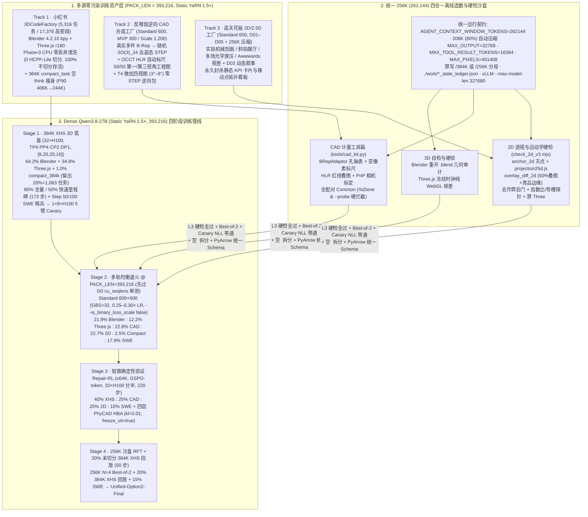

# 从 3D 纯代码底座迈向工业 CAD 与高精 2D 交互：384K 硬训（Static YaRN 1.5×）+ 统一 256K 沙盒与四阶段渐进蒸馏总蓝图

> 公开整理版 · 2026-11-28。保留成文时点的记录；计划、文献结果和本地实测请分别理解。环境路径已泛化，未收录的附件已标注；发布范围见 [整理说明](../../PROVENANCE.md)。

> **状态**：**Revision 3 / Option 2 对齐版**（`2026-11-27`，严格遵循 [CLEANROOM-4MODEL-VERDICT-384K-TRAIN-256K-SERVE.md](../xhs-384k-to-200k-data-adaptation-20261127/CLEANROOM-4MODEL-VERDICT-384K-TRAIN-256K-SERVE.md) 与 [OPTION2-CAD-2D-DATA-EVAL-MIX-MASTER-PLAN.md](../xhs-384k-to-200k-data-adaptation-20261127/OPTION2-CAD-2D-DATA-EVAL-MIX-MASTER-PLAN.md)）  
> **目标学生基座与统一 RoPE 坐标系**：Dense **`Qwen3.8-27B`** BF16（`${MODEL_ROOT}/Qwen3.8-27B`，`48` 层 `GatedDeltaNet` + `16` 层全注意力 + `27` 层 `ViT+Aligner`），全链路（Stage 1–4 训推与 `vLLM` 部署）**严格锁定同一套 `Static YaRN 1.5×`**（`max_position_embeddings = 393,216`，`factor = 1.5`，`original_max_position_embeddings = 262,144`，`mrope_interleaved = true`，`mrope_section = [11, 11, 10]`，`partial_rotary_factor = 0.25`，`rope_theta = 10000000`）。**绝不切分小红书 `384K` 黄金数据，推理时绝不剥离 `rope_scaling` 或改用 Dynamic YaRN**。  
> **统一造数 / 评测 / 线上沙盒水位**：`AGENT_CONTEXT_WINDOW_TOKENS = 262144` · `CLAUDE_CODE_AUTO_COMPACT_WINDOW = 208000`（`CLAUDE_AUTOCOMPACT_PCT_OVERRIDE = 80`）· `CLAUDE_CODE_MAX_OUTPUT_TOKENS = 32768` · `MAX_TOOL_RESULT_TOKENS = 16384` · `vLLM --max-model-len 327680`（或 `393216` 防突发垫）。  
> **核心覆盖赛道**：**Track 1 · 3D 纯代码场景/资产**（`Blender 4.2.10 LTS bpy` + `Three.js r180`） $\longrightarrow$ **Track 2 · 工业参数化 CAD 与精密装配**（`CadQuery 2.6.1 / OCCT B-Rep`） + **Track 3 · 高天花板 2D/2.5D 多文件交互动画**（`Canvas2D + SVG + GSAP`）  
> **跨轨审计结论**：全套专册已完成 Revision 3 / Option 2 对齐，所有早期 Rev 1/Rev 2 引用均已指向 `../xhs-384k-to-200k-data-adaptation-20261127/archive/` 并附规范链接。

---

## 分册导航与一手实证锚点索引

| 蓝图文档 | 核心议题与工程边界 | 关键实证数据源（100% 落盘可查） |
| :--- | :--- | :--- |
| **[00 · 总蓝图（本文档）](README.md)** | 顶层架构拍板、Option 2 跨轨参数锁死表、实测尸检总表、四阶段混训配比与门禁路线图 | [CLEANROOM 裁决](../xhs-384k-to-200k-data-adaptation-20261127/CLEANROOM-4MODEL-VERDICT-384K-TRAIN-256K-SERVE.md) · [OPTION2 总蓝图](../xhs-384k-to-200k-data-adaptation-20261127/OPTION2-CAD-2D-DATA-EVAL-MIX-MASTER-PLAN.md) · `decisions.md`（本地附件未发布） · [XHS-UNIFIED-SFT-STANDARD.md](../../3d-animation-agent/docs/XHS-UNIFIED-SFT-STANDARD.md) · [STANDARD-PARAMS.md](../../3d-animation-agent/docs/STANDARD-PARAMS.md) · [THREE-TRACK-DELIVERABLE-SPEC.md](../../3d-animation-agent/docs/THREE-TRACK-DELIVERABLE-SPEC.md) |
| **[01 · 384K 硬训与 256K 沙盒上下文规范](01-sandbox-context-spec.md)** | **Question 1**：`Train Long (384K Static YaRN 1.5×, 零 HCPF-Lite 切分) + Synthesize & Serve Short (256K 沙盒, 208K/80% 自动压缩, 16384 工具输出上限)`、单段窗口与百万 Token 总视界解耦、多教师路由与 Phase-0 零丢弃清洗 | [CLEANROOM 裁决](../xhs-384k-to-200k-data-adaptation-20261127/CLEANROOM-4MODEL-VERDICT-384K-TRAIN-256K-SERVE.md) · [OPTION2 总蓝图](../xhs-384k-to-200k-data-adaptation-20261127/OPTION2-CAD-2D-DATA-EVAL-MIX-MASTER-PLAN.md) · *(历史归档)* [joint-consolidation.md](../xhs-384k-to-200k-data-adaptation-20261127/archive/joint-consolidation.md) · [empirical_audit_200k_ledger.json](../xhs-384k-to-200k-data-adaptation-20261127/archive/empirical_audit_200k_ledger.json) · [exp1_gpu1_verified_results.json](../xhs-384k-to-200k-data-adaptation-20261127/archive/a100-experiments/exp1_gpu1_verified_results.json) · `agy_stats.json`（本地附件未发布） |
| **[02 · 工业 CAD 能力跃迁与逆向造数方案](02-cad-capability-plan.md)** | **Question 2A**：`realhard6` 装配崩盘与 `AGY` `0.9703/0.9387` 破局机理、`tools/cad_kit.py`（B-Rep 内省 + OCCT HLR 像素叠图）、`T4` 微扰相机 PnP 逆向、反喂饭逆向合成（`MVP 300 / Standard 600 / Scale 1,200`）与纯几何 RL | `summary.json`（本地附件未发布） · `eval.json`（本地附件未发布） · `cad_inspect.py`（本地附件未发布） · `summary-all.json`（本地附件未发布） |
| **[03 · 2D 视觉/真机构跃迁与四阶段混训配比方案](03-2d-capability-and-mixing-plan.md)** | **Question 2B**：三大真实翻车案源码尸检、3D 相机先验降维赋能（`projection25d.js` + `overlay_diff_2d.mjs`）、`check_2d_v3.mjs` 防伪运动学探针、`Standard 600 (D01–D05 + 256K)` 高难题谱与 Option 2 四阶段配比 | [CANARY-12-REPORT.md](../../3d-animation-agent/docs/CANARY-12-AND-AGY-PROBE-REPORT-20261127.md) · `judgement.json`（本地附件未发布） · `check_2d_v3.mjs`（本地附件未发布） · [RL Consolidation](../3d-agent-rl-opus-review-and-consolidation-20261127/README.md) |

---

## 零、执行摘要：两大核心战略问题的终局定案

### 问题 1：已有小红书 `384K` 3D 高质量数据并向 2D、CAD 扩展时，造数与评测沙盒应使用多大上下文窗口？为什么？

> [!IMPORTANT]
> **Option 2 核心裁决（`Train Long, Synthesize & Serve Short`）：全链路（Stage 1–4 训推与 `vLLM` 部署）严格锁定同一套 `Qwen3.8-27B` `Static YaRN 1.5×`（`max_position_embeddings = 393,216`）——`32×H100` 零切分直接硬训完整 `384K` 小红书数据（彻底废除会导致 Off-Policy Causal Leakage 的 `HCPF-Lite` 切分与 `200K` 中间窗口）；同时将新合成 CAD/2D 数据、评测基准、Stage 3 修复 RL 与线上 `vLLM` 服务锁定在 `256K`（`262,144`）沙盒，配 `208K`（`80%`）自动压缩水位 + `32768` 最大输出 + `16384` 单次工具截断 + 赛道结构化状态账本（`state_ledger.json`），将「单段活跃窗口（`256K`）」与「单题多段总推理视界（`500K–2.05M+` tokens）」彻底解耦。**

1. **`Static YaRN 1.5×` 零精度税数学证明与 `32×H100` `384K` 物理实测**：`Qwen3.8-27B` 中 **`48/64`（`75%`）`GatedDeltaNet` 层完全不用 RoPE**，剩余 `16` 层全注意力又有 `75%` 维度是 `NoPE`，全网仅 **`6.25%` 维度使用 RoPE**；在 `Static YaRN 1.5×` 下，`≤8K` 高频对（局部代码语法与图内空间坐标）偏移严格 `0.0%`，全网仅 **`3.32%`** 头维度插值，等效注意力温度偏移 `+2.07%`，全参 SFT 后在 `≤256K` 残余差异 `<0.5%` 噪声级。开启 `gdn_v3_plugin.py` 分块 LM-Head CE（`LM_HEAD_LOSS_CHUNK_SIZE=16384` + FP32 `main_grad`，相对误差 `2.10e-5`）+ `recompute=full/uniform/1` + `vit_gradient_checkpointing=true` + `optimizer_cpu_offload=true` + 非对称切层 `[8, 20, 20, 16]` 后，`start-full-32g-s3-v1` Step 1 已于 `32×H100` 物理跑通完整 `384K`（`applied=True, loss=1.0625, grad_norm=1.5135, peak_alloc=61.97 GiB, peak_reserved=73.48 GiB`）。`vLLM` 部署（`TP>=2`）原封不动复用同一份 `Static YaRN 1.5×` `config.json` 与 `--max-model-len 327680`（PagedAttention 稳态多占 `0` 字节 KV，兼作防突发缓冲垫，严禁剥离 `rope_scaling` 或改用 Dynamic YaRN）。
2. **单段 `256K` 沙盒绝不封顶总推理深度，结构化交接根治多轮压缩失忆**：小红书官方历史运行 `xhs_headland_set_bpy` 用 **`4` 次压缩跑通 `2,050,241` tokens（`713` 轮）**，我方历史 `realhard6` 中 `Kimi-K3.1-Pro` 在受限窗口内跑通 **`502K–782K` tokens**，`AGY` 斩获 BenchCAD `T5`（`0.9703`）与 `T2`（`0.9387`）总开销仅 **`329.8K–335.7K` tokens**。针对 `Kimi` 在 `realhard6` 触发 `30–36` 次散文压缩耗去 `65%–79%` 时间并丢失手性坐标的实测病灶，通过 **① 代理层注册 `262,144` 解除 Claude Code 未知模型 `200K`（`145K` 触发）暗钳、② `208K / 80%` 自动压缩 + `MAX_TOOL_RESULT_TOKENS=16384` + `MAX_PIXELS=401408` 拼图限流、③ 压缩提示词严禁写死 `/384K` 或 `/256K` 绝对分母（防 Context Anxiety）、④ 持久化 `./work/{cad,anim2d,scene3d}_state_ledger.json` 原样钉入 `
` 第 6 节**，将单题压缩压至 **`1–3` 次**且零几何漂移。
3. **存量 `384K` 零切分 Phase-0 清洗与多教师同锅混训**：彻底废除 Rev 2 `HCPF-Lite@256K` 切分（防止 `200K–384K` 区间丢失前文代码/视口导致的 Off-Policy Causal Leakage）。改用 **Phase-0 CPU 零丢弃精洗（约 1h CPU）**：① 补齐 `7` 张 `AR ≥ 200` 异常图 letterbox pad（救回 `12` 条段）；② `384K compact_task` 历史空 `<think>` 瘦身（`P90 406K → 244K`，挽救直播白丢的 `37.8%` 压缩样本）；③ 修正 `"-main-agent-"` → `"-agent-"` 剔除漏网 `8` 条子代理段 + 去重 `retry02`；④ 仅对 `~335` 条（`1.93%`）`393K–402K` 轻微超限段裁剪远端 `<10K` 无关 `loss=False` 刷屏日志，实现 **`100%` 不切分存活**。全轨统一采用 `PACK_LEN=393216`（`94%` 填充 = `369.62K`/包）与 `2D (tok<=393216, img<=80)` 装箱守卫；上游 `200K` 硬封顶的 `claude-opus-5-5`（`15–20%` 配比，与 `80–85% kimi-k3.1-pro` 组成双教师）执行段直接混拼入 `PACK_LEN=393216`（仅剔除其 `~148K` 早触发 `compact_task` 行，使 `compact_256k` 严格锁定 `208K` 水位）。

---

### 问题 2：吃透 3D 后，如何系统把工业 CAD 与高精 2D 能力拉到 SOTA 并实现三轨正迁移？

1. **工业 CAD 破局（从“肉眼看渲染图猜装配”升级为“OCCT 解析内省 + HLR 工程图红线像素叠图 + 反喂饭逆向造数”）**：
   - `realhard6` 实测揭穿核心断层：`Opus-5.5`（`T5` 单件 `0.7547` $\to$ 装配 **`0.0160`**, `0/25` 命中）与 `Kimi`（`T2` 单件 `1.0000` $\to$ 装配 **`0.0049`**, `0/36` 命中）因靠肉眼看 3D 着色图无法分辨第一/第三视角沉头孔正反与 `90°/180°` 手性翻转而全军覆没；`AGY` 凭 **`BRepAdaptor_Surface` 提取精确孔轴参数 + `HLRBRep_Algo` 将隐藏线/轮廓线红线叠绘回 `hires/drawing.png` + 全配对 `BRepAlgoAPI_Common` 布尔验干涉** 斩获 **`0.9703`（`25/25`）** 与 **`0.9387`（`36/36`）**。
   - 我们将 `AGY` 的制胜工具链标准化预装为沙盒内置 **`tools/cad_kit.py`**，按 Option 2 §0 封堵 `cad_inspect.py` 5 处硬漏洞（L221 `!common.IsDone()` 硬判失败 + 体素兜底、`BRepExtrema_DistShapeShape <=1.0mm` 单连通与 `0.15–0.60mm` 配合间隙、`BRepCheck_Analyzer.IsValid()` + 子件最小体积、L576–604 `--probe` 零变化硬写入 `issues` 拦截非参数化硬编码、AST 禁 `bpy/bmesh/importStep` + 6 视角 `flatShading`，同步修复 `verify_frontier_cad.py:243`），补齐 **4 阶段微扰相机 PnP + 边缘 Chamfer 逆向管线 + 正交局部系导出铁律**，并落地**反喂饭逆向合成工厂（`MVP 300 / Standard 600 [推荐] / Scale 1,200`，受 `1×8×H100` 5 臂 Canary 边际增益门控）**。
2. **2D 视觉与真机构破局（用 3D 透视相机先验终结“正侧面杂糅”，用底层矩阵反作弊运动学硬检绞杀“假齿轮死壳”）**：
   - 针对用户亲查抓出的三大顽疾（`xhs_anchor_agate_2d` `0.910` 假阳性、`复古铸铁双螺杆齿轮纸张压机` `0.960` 假阳性、`anim2d_v2_11` 发光拓扑玩具 `1.000`），在 `256K` 2D 沙盒部署**透视锚定三件套（`anchor_2d_perspective.py` + `projection25d.js` + `overlay_diff_2d.mjs`）**与 **`check_2d_v3.mjs`（含 Option 2 §0 #9 6 处漏洞修补：删除 `data-allow-clip`/`data-allow-overlap` 后门、非 HUD `MAD >= 1.5` & 变化面积 `>= 1.5%` & 6 帧最小 `SSIM <= 0.985`、`stageInfo.hasSvg`、`1280×720`+`1440×900` 重叠 `<=10%`、`window.__SCENE_READY__`/`__2D_STATE__`/`ffprobe`、硬禁 `three/THREE/WebGLRenderer/getContext('webgl'|'webgl2')`）**；同时按 `xhs_v2_synth.py:303` 重新放行高复杂多幕联动 `D03` 动态数据可视化，保持 `0%` 静态 KPI/移动点拓扑看板禁令，聚焦 **`Standard 600`（`MVP 300 / Scale 1,200`）高难 2D 题族**。
3. **Option 2 四阶段渐进课程与精确配比**：
   - 统一 PyArrow 范式（无顶层 `tools` 键，空 `<think>` 拆分为 `loss=False,loss_scale=0.0` + 正文 `loss=True,loss_scale=w_ch`，`validation.jsonl` `loss_scale=1.0`，`--is_binary_loss_scale false` 有界 `w_i` 配 `true` 回退）：**`Stage 1`（`384K` 未切分 XHS，`GBS=48`，留出 `20% = 1,063` 任务：`64.2%` Blender + `34.8%` Three.js + `1.0%` `compact_384k` + Step 50/100 SWE 哨兵） $\longrightarrow$ `1×8×H100` 5 臂 Canary 因果验证 $\longrightarrow$ `Stage 2`（`Standard 600+600`，`~0.25–0.30×` LR，`GBS=32`：`21.9%` Blender + `12.2%` Three.js + `22.8%` CAD + `22.7%` 2D + `2.5%` Compact + `17.9%` SWE，先过 `G0` 多文档 `cu_seqlens` 单测） $\longrightarrow$ `Stage 3`（`≤64K` `Repair-RL` `GSPO-token`：`40%` XHS + `25%` CAD + `25%` 2D + `10%` SWE） $\longrightarrow$ `Stage 4`（`256K` On-Policy `RFT` + `20%` 未切分 `384K` XHS 回放 + `15%` SWE $\to$ `Qwen3.8-27B-Unified-Option2-Final`）**。

---

## 一、全局统一系统架构图（Option 2 · `384K` Train + `256K` Sandbox · 4-Stage Curriculum）

---

## 二、上下文架构终审裁决（Option 2：`384K` 硬训 + `256K` 沙盒/服务锁死表）

### 2.1 三种候选架构对比（`CLEANROOM` 无尘室裁决与 `32×H100` 实测）

| 核心评估维度 | Option 1 · 全 `384K`（训+造数+服务全扩 384K） | 🏆 **Option 2 · `384K` 硬训（`Static YaRN 1.5×`）+ `256K` 沙盒/服务（定版）** | Option 3（Rev 2 历史归档）· 切分入原生 `256K`（`HCPF-Lite@256K`, YaRN OFF） |
| :--- | :---: | :---: | :---: |
| **`Qwen3.8-27B` RoPE 与精度** | 全链路 `Static YaRN 1.5×` | **全链路同一 `Static YaRN 1.5×`（仅 `6.25%` 维度用 RoPE，`3.32%` 插值，`≤8K` `0.0%` 偏移，全参 SFT 后 `≤256K` 差异 `<0.5%`）** | 历史上曾以“保原生 `262,144`”切分轨迹（详细归档数据见 `archive/`） |
| **XHS `384K` 因果完整性** | `100%` 不切分 | **`100%` 零切分存活**（Phase-0 仅 pad `7` 张 `AR≥200` 图、瘦身 `384K ct`、对 `~335` 边际段裁远端 `<10K` 无关日志） | 需把 `80.9%`（`586/724`）执行段切分，造成 **`200K–384K` 区间 Off-Policy Causal Leakage** |
| **新造数/评测沙盒活跃水位** | `~325K–340K`（Context Rot `4–6 pp` 掉点） | **`256K`（`262,144`），`208K / 80%` 自动压缩 + `32768` 输出 + `16384` 工具截断**（`261.2K < 262,144`） | 历史 Rev 2 曾设为 `220000 / 85%`（`64K` 输出 `190000`） |
| **`32×H100` 放开 ViT 物理可行性** | `PACK_LEN=393216` | **`TP4·PP4·CP2·DP1, [8,20,20,16]` + 分块 CE `16384` + FP32 `main_grad` + `2D (tok<=393216, img<=80)`**，Step 1 实测 `61.97 / 73.48 GiB` | 历史 `[10, 19, 19, 16]` @ `262,144` |
| **线上 `vLLM` 与 RL 并发效率** | `+125%` Prefill FLOPs，`+50%` KV，造数慢一倍 | **最佳甜点**：沙盒稳态 `≤208K–256K`（全注意力开销比 `384K` 低 `2.25×`、KV 省 `33%`），`vLLM --max-model-len 327680` 稳态多占 `0` 字节 KV 兼作防突发缓冲垫 | 同沙盒开销，但无法零切分复用 `384K` XHS 原始轨迹 |

### 2.2 全赛道强制锁死的上下文、沙盒与多教师路由契约（Option 2）

1. **全链路锁死参数**（分册 `01`、`02`、`03` 与 `OPTION2` 总蓝图 100% 一致）：
   - **学生模型与 `Static YaRN 1.5×`**：`${MODEL_ROOT}/Qwen3.8-27B` · `max_position_embeddings = 393,216` · `rope_scaling = {"rope_type": "yarn", "factor": 1.5, "original_max_position_embeddings": 262144, "mrope_interleaved": true, "mrope_section": [11, 11, 10], "partial_rotary_factor": 0.25, "rope_theta": 10000000}` · `--template qwen3_8` · `--enable_thinking true --preserve_thinking true --freeze_vit false --freeze_aligner false`。**全阶段及推理严禁剥离 `rope_scaling` 或改用 Dynamic YaRN**。
   - **`32×H100` 拓扑与显存防线**：`TP=4, PP=4, CP=2, DP=1, SP=true`，非对称切层 **`[8, 20, 20, 16]`**，`recompute=full/uniform/1`，`vit_gradient_checkpointing=true`，`AdamW (β=0.9/0.95, wd=0.1, clip=1.0)` + **FP32 `main_grad`** + `optimizer_cpu_offload=true` + `LM_HEAD_LOSS_CHUNK_SIZE=16384` + `2D (tok<=393216, img<=80)` 装箱守卫。**严禁**：`FP8`、`tp_comm_overlap`、`VPP=2`、`recompute_num_layers=2`、`Muon`。
   - **在线沙盒与 `vLLM` 同构环境变量**：`AGENT_CONTEXT_WINDOW_TOKENS=262144` · **`CLAUDE_CODE_AUTO_COMPACT_WINDOW=208000`** · **`CLAUDE_AUTOCOMPACT_PCT_OVERRIDE=80`** · `CLAUDE_CODE_MAX_OUTPUT_TOKENS=32768` · **`MAX_TOOL_RESULT_TOKENS=16384`** · `MAX_PIXELS=401408` · 压缩提示词严禁含 `/384K` 或 `/256K` 绝对分母；`vLLM`（`TP>=2`）复用同份 `Static YaRN 1.5×` `config.json` 启动 **`--max-model-len 327680`（或 `393216` 防突发垫）`--enable-prefix-caching --mamba-cache-mode align`**。
2. **异构窗口双教师零浪费路由法则**：
   - **`kimi-k3.1-pro`（`80–85%` 主力）**：锁定在 `256K / 208K (80%)` 沙盒，**必在 `logging_proxy` 模型注册表中将 `kimi-k3.1-pro` 显式声明为 `262,144`**（修复 `realhard6` 中 Claude Code 未知模型回退 `200,000` 导致过早压缩的 Bug）；历史 `AGY` `330K–393.5K` 冠军轨迹在 Option 2 下可直接进 `PACK_LEN=393216` 无需切分。
   - **`claude-opus-5-5`（`15–20%` 辅配，上游硬上限 `200,000`）**：强制 `xhs_v2_produce.py` 跨家族互评（严禁同家族 `kimi` 自评）与 `max_export_tokens=262144`；`Opus` 执行段（`91K–190K`）直接进入 `PACK_LEN=393216`（`cu_seqlens` + GDN $S_t=0$ 隔离，`94%` 填充），但**剔除 `Opus` 在 `~148K` 触发的 `compact_task` 行**，确保 `compact_256k` 严格锁定 `208K` 水位。

---

## 三、一线实测尸检总表：从 3D 迁移到 CAD 与 2D 的真实断层及确定性根治方案

所有诊断均源自本地真实评测产物（`realhard6_eval_20261127` 18 份完整运行与 `Canary-12` 人工逐帧复核），绝无纸面臆测：

| 赛道与典型实测现场 | 线上真实得分与翻车指标（核自磁盘 JSON / 源码） | 为什么纯 3D 视觉经验在此失效？（精确根因） | 本蓝图落地的确定性工程根治手段 |
| :--- | :--- | :--- | :--- |
| **CAD 装配姿态与手性崩盘** `bc_t5_shear25`（25 实例气动剪切） `bc_t2_dual36`（36 实例双皮带总装） | • **`Opus-5.5`**：`T5` 单件 `0.7547` $\to$ 装配 **`0.0160`**（总分 `0.0121`, **`0/25` 命中**）；`T2` 总分 **`0.0888`**（**`0/36` 命中**，电机/皮带按 `-Y` 横放而非 `-Z` 竖放） • **`Kimi-K3.1`**：`T5` **`0.0087`**（`0/25`，`30` 次压缩）；`T2` **`0.0049`**（`0/36`，`36` 次压缩耗 `73.4%` 时间，6 底座漏交替翻转） • **`AGY` 对照**：`T5` **`0.9703` (`25/25`)** · `T2` **`0.9387` (`36/36`)** | 3D 渲染图遵循“看着像就对”，而工业装配存在 **① 第一视角（ISO-E）vs 第三视角（ISO-A）沉头孔正反歧义、② 去姿态 STEP 随机 `90°` 旋转手性陷阱、③ 单文件多实体陷阱（`part_11` 含 2 实体）、④ 30 次散文压缩抹除 `SE(3)` 矩阵** | 沙盒内置 **`tools/cad_kit.py`** 四大原语： 1. `inspect_steps`（`BRepAdaptor_Surface` 提取孔/轴/锥角/平面法向与实体数）； 2. `calibrate_sheet`（`hires/` 亚像素标尺 `px/mm`）； 3. **`hlr_overlay`**（`HLRBRep_Algo` 红线叠绘回工程图 + 2D 双向边缘 Chamfer 残差）； 4. `verify_submission`（修补 `cad_inspect.py:221` `!IsDone()` 漏洞 + 全配对布尔求交）+ **`work/cad_state_ledger.json`** 跨压缩持久化 |
| **CAD 零 STEP 微扰多视图逆向** `bc_t4_chuck9`（三爪自定心卡盘，`3°–8°` 相机微扰，0 STEP） | 全模型 `< 0.16`：`Opus` **`0.0073`** · `Kimi` **`0.0190`**（非流形断齿 `topo=0.04`） · `AGY` **`0.1597`**（虽标定相机达 `<0.1px` 且总装 `IoU=0.8689`，但 `jaw_2,3` 仅 `0.2000`、`pinion` `0.2304`、`scroll_plate` `0.2000`） | ① 未标定微扰相机直接当标准等轴测硬量；② 二值外轮廓 IoU 对内部阿基米德涡卷圈数/锥齿数完全致盲；③ **局部系烘焙陷阱**：把 `60°/120°` 装配旋转直接烤进 `parts/*.step`，而评测器 `iou24_aligned` 仅搜 24 种 `90°` 旋转！ | 1. `cad_kit.fit_cameras`（椭圆长短轴 + N 重对称色块 PnP 联合标定 `<0.05°`）； 2. **三通道逆向目标**（外轮廓 IoU + 内部 `HLR` 可见折痕边缘距离场 Chamfer + 总装高亮重投影）； 3. `tools/mech_primitives.py` 水密渐开线/锥齿轮/涡卷单实体模板； 4. **强制正交局部系导出守卫**（非正交角度只准进 `instances.json`，仅此一项即可将 `AGY` `T4` 拉升至 `0.72–0.85+`） |
| **CAD 合成题面喂公式失效** `hell6` 早期自造题 | 中位仅 `130.7K` tok（`0` 压缩），`t3/t4` 全程仅看图 `3–4` 次并超时（`exit 143`） | 题干直接喂死闭式数学方程 `Rc(u)=68+28u`，只测 Python 翻译语法，零工程读图与测量训练 | 全面废除文本公式题，落地 **`S1–S4` 反喂饭逆向合成工厂**：从真实水密多件 B-Rep 总成出发剥离源码、打乱 STEP 姿态、自动渲染 50/50 第一/第三视角带尺寸工程图，倒逼读图测量 |
| **2D 斜拍透视分裂与裁判被刷分** `xhs_anchor_agate_2d`（地质博物馆玛瑙背光展柜与抛光台） | `113` 轮、`153.8K` tok，`exhibit.js` 画 `0°` 正面展柜 + `-0.68` 错切地图，`workshop.js` 画 `0°` 正面展板 + 四边不交汇歪桌面 + 纯侧面砂轮机，`checked_labels=0`，却拿 **`s_vis=1.00, mean=0.910`**！ | 把 2D 画布当无三维几何约束的平面拼贴板（5 套局部坐标系互殴），且 VLM 裁判仅按“物件存在清单”打勾给分 | 发挥 3D 底座相机投影优势，部署 **2D 透视锚定三件套**： 1. `anchor_2d_perspective.py`（RANSAC 灭点/视平线 + 主分区 BBox 提取）； 2. **`src/projection25d.js`**（40 行共享右手系 3D$\to$2D 投影内核，100% 锁死全场景唯一灭点与椭圆长短轴）； 3. **`overlay_diff_2d.mjs`**（与 `reference-0.png` 50% 半透明叠图 + 青品边缘方向直方图，正斜混拼直接判 `L1` 淘汰，叠图直喂裁判） |
| **2D/CAD 静态外壳冒充真机构** `复古铸铁双螺杆齿轮纸张压机` | 垂直双齿轮被画成水平并列、机架侧墙无垂直滑槽、螺杆与压辊无真实传动耦合，靠单态 `0.0 mm³` 与 `uniqueStageFrames>=3` 拿 **`0.960`** | 静态快照与单纯像素哈希变化无法区分“1 个孤立齿轮空转的死壳”与“满足齿数比和导槽约束的物理传动链” | 落地 **`check_2d_v3.mjs` 运动学与状态扰动硬检架**： 1. `page.addInitScript` 透明拦截 SVG `getCTM()` 与 Canvas 变换矩阵/光流，交叉核验 `__getKinematicState()` 防虚报； 2. 公开时刻 + **2 个隐藏无理数时刻** + `page.clock.install()` 冻结时钟拨动输入件，硬断言**齿数比旋向 $\Delta\theta_B/\Delta\theta_A=-N_A/N_B$、连心线方位角、导槽包络包含 $\mathrm{bbox}(\text{roller})\subset\mathrm{bbox}(\text{slot})$ 与铰链 `<0.5px` 闭合** |
| **2D 框线发光看板低上限玩具** `anim2d_v2_11`（跨江四线轨交拓扑） | 仅 `49` 轮、`120.0K` tok 即拿 **`1.000` 大满贯**，基座早已饱和，用户明确拒收 | 节点连线发光脉冲与常规折线柱状图缺乏空间透视与连续物理约束 | 将 `anim2d_v2_09/10/11/12` 类静态 KPI/拓扑看板永久打入 **`0%` 黑名单**，按 `xhs_v2_synth.py:303` 放行多幕联动 `D03` 动态数据叙事，主力聚焦 **`Standard 600`（`MVP 300 / Scale 1,200`）** 硬核 2D 题族 |

---

## 四、统一 `256K` 四合一离线沙盒与确定性验收栈对照表

三轨共享完全相同的 `Claude Code` 六工具协议（`Read / Write / Edit / Bash / Glob / Grep`）、`allow_network = false` 离线安全边界与 `MAX_PIXELS = 401408` 多模态载荷纪律（`AGENT_CONTEXT_WINDOW_TOKENS=262144, CLAUDE_CODE_AUTO_COMPACT_WINDOW=208000, PCT=80, MAX_OUTPUT=32768, MAX_TOOL_RESULT_TOKENS=16384`），仅通过顶层 `delivery_contract` 与工作区 `TOOLS.md` 路由轨专属确定性武器：

| 沙盒架构层 | Track 1 · 3D 场景与连续动画（`Blender bpy` + `Three.js`） | Track 2 · 工业参数化 CAD 与装配（`CadQuery 2.6.1 / OCCT`） | Track 3 · 高精 2D/2.5D 交互动画（`Canvas2D + SVG + GSAP`） |
| :--- | :--- | :--- | :--- |
| **标准多文件交付结构** | • Blender：`output/{scene.blend, scene.glb, build_scene.py, README.md, final.png}` • Three.js：`output/{index.html, src/*.js, vendor/three/, final.png}` | `output/{src/{params.py, parts/*.py, assembly.py}, exports/*.{step,3mf,stl,glb}}`（BenchCAD 兼容 `submission/{parts/*.step, assembly/instances.json}`） | `output/{index.html, css/styles.css, src/{main,projection25d,kinematics,render,ui}.js, vendor/gsap.min.js, preview.mp4}` |
| **沙盒预置自检/叠图利器（写入 `TOOLS.md`）** | `verify_realhard6.py`（重开 `.blend` 审计网格/材质/灯光）+ `verify_xhs_output.cjs`（冻结时钟多视角截图） | **`tools/cad_kit.py`**（`inspect_steps` + `calibrate_sheet` + **`hlr_overlay` 工程图红线像素叠图** + `fit_cameras`）+ `mech_primitives.py` | **`anchor_2d_perspective.py`**（灭点/BBox）+ **`overlay_diff_2d.mjs`（50% 半透明 + 青品边缘差分图）** + `export_2d_mp4.mjs`（仅挂 `playwright-core` 彻底拔除 `three`） |
| **确定性硬门禁（`L0–L3`，失败消耗 `0` VLM Token）** | • `L0`：缺产物/加载崩 • `L1`：控制台报错/外链/空网格 • `L2`：冻结时钟后纯 `<canvas>` `orbit` 或交互控件无像素响应 • `L3`：全过送多视角视觉盲评 | • `L0`：AST 违禁（禁 `bpy/bmesh/importStep`）/STEP 回读失败/`det(R)!=+1` • `L1`：非水密 2-流形/`BRepCheck_Analyzer.IsValid()` 失败/实体或最小子件体积不符/篡改外购件 • `L2`：**全配对 `Common` 干涉/`!common.IsDone()` 硬败/`BRepExtrema_DistShapeShape <=1.0mm` & `0.15–0.60mm` 配合间隙** / `--probe` 零变化硬拦截 / 非正交局部系烘焙 • `L3`：纯几何连续分 $R_{\text{CAD}}$ | • `L0`：缺入口或 `window.renderAt(t)`/`__SCENE_READY__`/`__2D_STATE__`/`ffprobe` • `L1`：硬禁 `three/THREE/WebGLRenderer`/`stageInfo.hasSvg`/透视正斜混拼/`getCTM` 虚报 • `L2`：**已删 `data-allow-clip`/`data-allow-overlap` 后门**；非 HUD `MAD >= 1.5` & 变化面积 `>= 1.5%` & `SSIM <= 0.985`；齿数比/导槽/铰链闭合违例；`1280×720`+`1440×900` 重叠 `<=10%` • `L3`：全过连同 `overlay_audit.png` 送审 |
| **跨压缩持久化状态账本（钉入 `
` 第 6 节）** | `./work/scene3d_state_ledger.json` （Collection 顶点数、对齐 `I_ref` 相机外参、控件绑定表） | `./work/cad_state_ledger.json`（兼容 `cad_state.json`） （ISO-E/ISO-A 投影制式、`px/mm` 标尺、各件局部主轴、已锁 `4×4` $T_i \in SE(3)$ 与零干涉表） | `./work/anim2d_state_ledger.json` （`projection_mode` 与共享相机/灭点、分区框、构件齿数/导程拓扑图、`renderAt` 状态哈希） |

---

## 五、Option 2 四阶段渐进课程、统一 PyArrow Schema 与混合配比总表

### 5.1 为什么必须采用统一 PyArrow Schema 与有界样本梯度权重 $w_i$？
实盘分词审计表明：单条 XHS 3D 执行段可训 `<think> + tool_call` 中位数达 **`255.3K` tokens**，高难跨段 2D 单题可训 `U` 约 **`110K–240K` tokens**，工业 CAD 装配/逆向单题可训 `U` 约 **`45K–120K` tokens**。若按条数 `1:1:1` 混排，3D 将在有效梯度上吞噬 CAD 达 `3×–5×`。按 Option 2 §0 与 §4.2 强制锁定：
1. **统一 PyArrow 范式与 `ms-swift 4.5.2` 双坑修补**：全轨统一为 `{"id", "channel", "images", "messages": [{"role", "content", "loss", "loss_scale"}]}`（7 个 channel：`xhs_blender, xhs_threejs, cad_exec, anim2d_exec, compact_384k, compact_256k, swe_anchor`；**无顶层 `tools` 键**）；把空 `<think>` 明确拆为 `{"loss": False, "loss_scale": 0.0}` + 正文 `{"loss": True, "loss_scale": w_ch}` 以防绕过 `IgnoreEmptyThinkLossScale`；`validation.jsonl` 强制 `loss_scale = 1.0` 确保 `val_loss_{channel}` 无偏。
2. **`PACK_LEN = 393,216`（`94%` 填充 = `369.62K`/包）与有界梯度权重 $w_i$**：启用 `--is_binary_loss_scale false` 与 $w_i = \text{clip}(\alpha_{\text{track}} \cdot (65\text{K}/\max(U_i, 2048))^{0.25},\ 0.55,\ 2.55)$（$\mathbb{E}_U[w_i]=1.00$；`--is_binary_loss_scale true` 仅作 Raw U% 回退），Stage 2 小数据集重复倍率严格封顶 **`≤ 3.0×`**（`Standard 600+600` 下 CAD `2.50×`、2D `2.00×`、XHS 全新回放 `1.00×`）。

### 5.2 Option 2 四阶段训练总账本（`Stage 1 -> Stage 2 -> Stage 3 -> Stage 4`）

| 阶段 | 启动权重与硬件拓扑 | 窗口与核心超参 | **精确有效梯度配比（与 Option 2 表 4A/4B 对齐）** | 数据规模与核心验收目标 |
| :--- | :--- | :--- | :--- | :--- |
| **Stage 1 · `384K` 完整 XHS 3D 筑基** | `${MODEL_ROOT}/Qwen3.8-27B` `32×H100` (`TP4·PP4·CP2·DP1`, `[8,20,20,16]`) | **`Static YaRN 1.5×` (`393,216`)** `GBS=48`, `125 tok/s/gpu` `freeze_vit=false, freeze_aligner=false` | **`64.2%` Blender (`384K`) + `34.8%` Three.js (`384K`) + `1.0%` `compact_384k` (`205K`)**（`w_i`: `0.99 / 0.99 / 2.49`） | • 留出 `20% = 1,063` 任务给 Stage 2 做新鲜回放； • **`80%`（`4,253` 任务 / `15,001` 段 / `4,910.1M T_in` / `3,181.5M U`）**：`13,284` 包 / `276` 步 / `14.2 天`； • **`50%` 快速里程碑（`2,658` 任务 / `9,388` 段）**：`8,309` 包 / `173` 步 / `8.9 天` + Step 50/100 SWE 哨兵（若跌 `>2.0 pp` 即刻补 `3,000` SWE） |
| **Stage 2 · 多轨均衡退火** *(先跑 `1×8×H100` 5 臂 Canary 与 `G0 cu_seqlens` 单测)* | `ckpt-S1-clean` (`M2`) `32×H100` 同构 `PACK_LEN=393,216` | **`Static YaRN 1.5×` (`393,216`)** `~0.25–0.30×` LR (`lr=2.45e-6`, `vit_lr=4.90e-7`), `GBS=32` (`--no_load_optim true`, `--is_binary_loss_scale false`) | **Standard (`600+600`, 推荐)**：**`21.9%` Blender (`384K` 新鲜回放) : `12.2%` Three.js (`384K` 新鲜回放) : `22.8%` CAD (`≤256K`) : `22.7%` 2D (`≤256K`) : `2.5%` Compact (`384K+256K`) : `17.9%` SWE (`≤48K`)** | • **`Standard`**（`5,951` 任务 / `9,120` 有效段 / `880.25M T_in` / `383.38M U`）：`2,381` 包 / `74` 步 / **`2.17 天`**； • 备选档位：`MVP (300+300)` `1,489` 包 / `46` 步 / `1.35 天`；`Scale (1,200+1,200, GBS=48)` `3,474` 包 / `72` 步 / `3.08 天`； • 每 `20` 步在 `loss_scale=1.0` 验证集监控 7 条 `val_loss_{channel}`（熔断阈值 `> +0.03 nats`） |
| **Stage 3 · 短窗确定性 `Repair-RL`** | `ckpt-S2-Unified` `16` 卡 vLLM + `16` 卡训练 (`TP4·PP4·CP1`) | **`≤64K` 返修窗** `GSPO-token` + `TITO` + `IcePop` `lr=1e-6, kl=0.01, freeze_vit=true`, `220` 步 | **`40%` XHS + `25%` CAD + `25%` 2D + `10%` SWE** + 四层 `PhyCAD HBA` | • 耗时 **`~3.5 天`**； • 在保持 `Static YaRN 1.5×` 下专治 CAD 手性翻转/干涉与 2D 透视/齿数比错 |
| **Stage 4 · `256K` 在策略 `RFT` + `384K` 回放** | `ckpt-S3-RL` `32×H100` `PACK_LEN=393,216` | **同份 `Static YaRN 1.5×`** `256K` 沙盒采样 `N=4` + `Best-of-2` (`50` 步) | **`256K` 沙盒 RFT 胜出轨迹 + `20%` 未切分 `384K` XHS 回放 + `15%` SWE** | • 耗时 **`~1.5 天`**； • 收官 **`Qwen3.8-27B-Unified-Option2-Final`**，用 `20%` 长回放永久锁死 `384K` 上限能力 |

### 5.3 Stage 3 全系统唯一四层保序奖励与损失骨架（`PhyCAD HBA`）

三轨共用同一套严格跨层保序（层间步长 $\lambda_L = 1.0 > 2\lambda_w = 0.50$，杜绝局部视觉分倒挂越过物理/几何硬错误）且精确零均值的组相对优势公式，并按 Option 2 §4.3 锁定 `40% XHS : 25% CAD : 25% 2D : 10% SWE` 损失权重：
$$A_i = \frac{\big(L_i - \bar{L}\big) + 0.25\,A_t(q_i)}{\max(\sigma_{\text{raw}},\, 0.50)}, \qquad \mathcal{L}_{\text{total}}(\theta) = 0.40\,\mathcal{L}_{\text{GSPO}}^{(\text{XHS})}(\theta) + 0.25\,\mathcal{L}_{\text{GSPO}}^{(\text{CAD})}(\theta) + 0.25\,\mathcal{L}_{\text{GSPO}}^{(\text{2D})}(\theta) + 0.01\,\mathrm{KL}_{\text{lowvar}}(\pi_\theta \parallel \pi_{\text{SFT}}) + 0.10\,\mathcal{L}_{\text{SFT}}^{\text{SWE}}(\theta)$$
- **CAD 层内连续质量分 $q_i = R_{\text{CAD}}(y_i)$（100% 确定性 OCCT 几何，在线 `0` VLM 调用）**：
  $$R_{\text{CAD}}(y) = \mathbb{I}_{\text{valid\_brep}}(y) \cdot \big(\mathrm{part\_chamfer\_iou}_{24}(y)\big)^{0.35} \cdot \big(\mathrm{asm\_pose\_hit}(y)\big)^{0.65} \cdot \mathrm{zero\_interference}(y)$$
- **3D / 2D 层内连续质量分 $q_i$（仅对通过全部 `L0–L2` 硬检的 $L_i=3$ 样本调用异族非同源 VLM 裁判）**：
  $$q_i = \mathrm{clip}\!\Big(\overline{R}_{\text{rubric}}(y_i) - \kappa\big[a^{\text{ref}} - a_i - 0.10\big]_+,\; 0,\; 1\Big)$$
  其中冻结视觉锚点扣分项防止模型“为凑交互功能把精美场景改成简陋方块”，2D 评审强制附带 `overlay_audit.png` 与 `25%–30%` 负向一票否决条款。
- **跨轨负迁移熔断安全阀**：每 `50` 步在留出集独立监控三轨 `Accepted@1`（绝不用均值掩盖单轨退化）；一旦任一轨相对 Stage 2 连续两次掉点 `> 2.0 pp`，立即冻结共享主干转为三轨独立 LoRA 专家，最后经单师/多师全词表反向 KL 在线蒸馏（`OPD`）无损合回单一 `Qwen3.8-27B`。

---

## 六、门禁驱动落地路线图（Pre-Registered Go / No-Go Gates）

| 时间窗口 | 关键交付动作 | 硬性 Go / No-Go 准入门禁（未过严禁烧下一阶段算力/API） |
| :--- | :--- | :--- |
| **Day 1 · 零 API 漏洞封堵与 Phase-0 精洗** （`$0` API，本地 CPU / 单卡） | 1. 落地 Option 2 §0 10 类硬修补：`ms-swift` 空 `<think>` 拆分 + `validation.jsonl` `loss_scale=1.0`、统一 PyArrow Schema、`logging_proxy_to_swift.py` `--keep-compact-tasks`、`xhs_v2_produce.py`（`208K/80%`、`max_export_tokens=262144`、禁同族自评、`max_tokens>=12000`）、`convert_native_to_xhs_ready.py`、`xhs_v2_synth.py:303` 放行 `D03`、`cad_inspect.py` 5 处修补 + `verify_frontier_cad.py:243`、`check_2d_v3.mjs` 6 处修补； 2. 约 1h CPU 跑完 XHS `384K` Phase-0 零丢弃清洗（pad 7 张 `AR≥200` 图、瘦身 `384K ct`、修正 `"-agent-"`、仅对 `~335` 边际段裁远端 `<10K` 无关日志）并在 `gdn_v3_plugin.py` 补 `(tok<=393216, img<=80)` 守卫。 | • **反例猎杀率 `100%`**：`xhs_anchor_agate_2d` 旧产物必报 `contradictory_front_oblique_perspective_mashup`（`checked_labels >= 30`），假齿轮无滑槽压机必报 `gear_axis_orientation_mismatch` + `missing_or_violated_guide_slot`； • **XHS `384K` 存活率 `= 100%`**，且 `cad_kit.py` 重测 `bc_t4_chuck9` 跃升至 **`> 0.70`**。 |
| **Days 2–4 · `Standard 600+600` 造数与 `1×8×H100` 5 臂 Canary** | 1. 在 `256K / 208K (80%) / 16384` 沙盒按 `Base-27B` 免费筛难 + 双教师（`80–85% kimi + 15–20% opus-5-5`）生产 `Standard 600` CAD + `600` 2D（先跑 `MVP 300` 探针验证）； 2. 跑 `1×8×H100` 5 臂 Canary（`MAX_LENGTH=393216, TP=4, PP=1, CP=2, Static YaRN 1.5×`, `~42–48h`）：`M0`, `M1_{100,300,[600]}`, `M2`, `M3_lora`。 | • 单域 `M1_300 vs M0`：`CAD >= +12 pp`、`2D >= +15 pp`（`McNemar p < 0.05`）； • 叠加 `M3 vs M2`：`CAD >= +10 pp` 且 `2D >= +12 pp`（`McNemar p < 0.05`）、`0.0%` 跨轨污染、SWE `>= -1.5 pp`； • 仅当 `M1_600 - M1_300 >= +4 pp (CAD) / +2–5 pp (2D)` 时才扩至 `Scale 1,200`。 |
| **Days 5–13 · Stage 1 (`384K` XHS) + `G0` 单测** | 1. 跑 `32×H100` Stage 1（`[8,20,20,16]`、`PACK_LEN=393216`、`80%` 全量 `276` 步或 `50%` 快速里程碑 `173` 步，`8.9 天`），Step 50/100 跑 SWE 哨兵； 2. Stage 2 开跑前必过 **`G0` 4 轨混包 `cu_seqlens` 隔离单测**（`max_abs_diff < 2e-2`）。 | • `M2 / ckpt-S1-clean` 稳定收敛，`val_loss` 单调降； • `G0` 逐 token 交叉熵误差 `< 2e-2` 且 channel 聚合误差 `< 5e-3`。 |
| **Days 14–20 · Stage 2 (`Standard`) + Stage 3 (`Repair-RL`) + Stage 4 (`256K RFT`)** | 1. 完成 `2.17 天` Stage 2 多轨均衡退火（`74` 步，`GBS=32`，`--is_binary_loss_scale false`，每 20 步监控 7 轨 `val_loss`）； 2. 跑完 `220` 步 `≤64K` `Repair-RL`（`~3.5 天`，`40:25:25:10`）； 3. 跑完 `50` 步 `256K` 沙盒 `RFT` + `20%` `384K` XHS 回放 + `15%` SWE（`~1.5 天`）$\to$ `Qwen3.8-27B-Unified-Option2-Final`。 | • 主报三轨独立 **`Accepted@1（3D / CAD / 2D）`** 刷新 SOTA； • OOD 标尺（`BenchCAD 2.1`、`CADGenBench`、`IterCAD-Draw_1k`、`AnimWeb-Bench`、`MotionGraphicsBench`）全面达标，`256K` 压缩存活率 `>= 12/16 (75%)`，健康零改 `10/10 (100%)`，`384K` 上限能力零遗忘。 |
