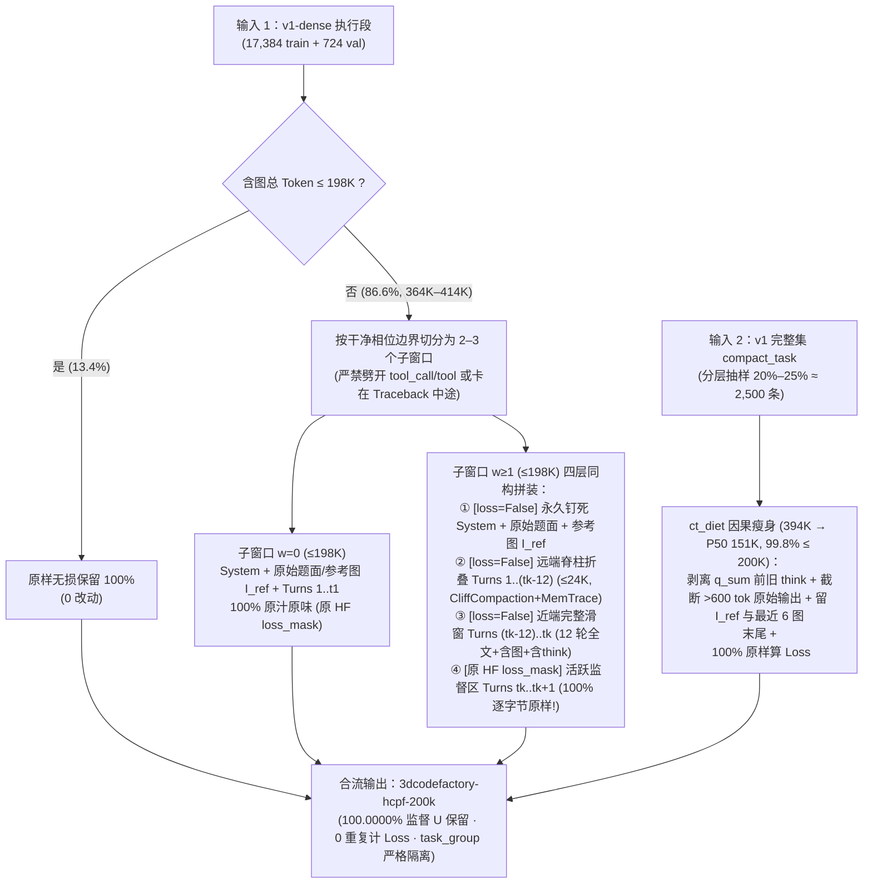

# 小红书 `3DCodeFactory`（384K YaRN）超长多模态轨迹适配 `≤200K` 训练窗口深度调研与改造方案

> 公开整理版 · 2026-11-27。保留成文时点的记录；计划、文献结果和本地实测请分别理解。 环境路径已泛化，未收录的附件已标注；发布范围见 [整理说明](../../PROVENANCE.md)。

> **调研日期**：2026-11-27  
> **针对数据**：
> - 高密度主力集（18,108 段 / 5,532 独立任务）：`${SHARED_DATA}/code2video/training/data/3dcodefactory-paper-s3-v1-dense`
> - 原始完整集（29,795 段，含 11,686 条 `compact_task`）：`${SHARED_DATA}/code2video/training/data/3dcodefactory-paper-s3-v1`  
> **目标基座与硬件约束**：Dense `Qwen3.8-27B`（原生 `max_position_embeddings = 262,144`），4 机 `32×80GB` 集群稳定训练上限 **`~200K`（`196,608` [192K] – `204,800` [200K]）**。  
> **本目录配套附件**：[2026 H2 上下文折叠与长轨迹 SFT 文献精读专题](2026h2-compaction-literature-deep-dive.md) · [真实分词解剖与 `HCPF-200K` 模拟账本 JSON](empirical_audit_200k_ledger.json)  
> **关联文档**：[3DCodeFactory 精读](../arxiv-2611.28783/README.md) · [27B 并行与显存实测](../3d-agent-training-efficiency-packing-parallelism-20261124/README.md) · [2026 H2 大厂博客调研](../frontier-labs-agentic-rl-blogs-2026h2/README.md) · [CompactionRL 精读](../arxiv-2607.05378/README.md) · [RECAP 精读](../arxiv-2611.31258/README.md)

---

## 一、执行摘要（先给核心结论）

1. **为什么不能直接靠“压缩图片 + 删旧工具输出”单轮硬塞进 200K？——真实分词器解剖推翻直觉假设**
   - 我们用 `${MODEL_ROOT}/Qwen3.8-27B` 真实分词器对已落盘的 `v1-dense`（724 验证段 $\to$ 17,384 训练段）和 `v1`（含 468 验证 `compact_task` $\to$ 11,686 训练段）做了逐消息组件实测：
   - 在已压至 `512` 视觉 token/图后，单条执行段均长 **`343.3K`（P50 = `380.5K`，P90 = `394.5K`）**，**能直接放进 `≤200K` 的比例仅为 `13.4%`（`97 / 724`）**，其中起步段 **`compact_before` 为 `0 / 254 (0.0%)`**、摘要段 **`compact_task` 为 `0 / 468 (0.0%)`**！
   - 更关键的是：**环境文本观测 `tool_obs_txt`（`18.2%`, 62.5K）+ 视觉 `vis_512`（`5.3%`, 18.1K）合计仅占 `23.5%`**；真正的体积大头是**必须保留监督的模型自身输出 `asst_think_train`（`45.6%`, P50=`168.3K`）+ `asst_tc_train`（`23.5%`, P50=`87.0K`），合计高达 `69.1%`（P50 = `255.3K` > `200K`！）**。
   - 实测即便把旧工具输出和旧渲染图做激进裁剪（不拆段），中位长度仍达 **`302.7K`（仅 `16.7%` 落入 `192K`）**。因此：**不改写教师原生 `<think>`、不丢弃精修收尾轮的前提下，数学上（抽屉原理）必须将单条 `384K` 段无损拆分为 `~2.6` 条 `≤200K` 子段（整条 `1.09M` 轨迹从 `~3` 段变为 `~6–7` 子段）**。

2. **2026 下半年最新研究证实：`200K` 压缩/折叠窗口不仅不是退而求其次，反而优于裸跑超长全窗口！**
   - **`Kimi K3`（`arXiv:2607.24653`, 2026-07/08）**：即便在原生 **1M 上下文**旗舰上，**在 `200K–300K` 触发上下文压缩在 `BrowseComp` 上反超不压缩直跑 1M（`91.2%` vs `90.4%`）**，因为消除了中后程过期探索造成的 Context Rot（注意力稀释）。
   - **`CompactionRL`（`arXiv:2607.05378`, 2026-07, 智谱 `GLM-5.2` 管线）**：同预算下 **`80K × 4` 可训压缩段（`66.4%`）反超 `160K` 无压缩长窗训练 `+3.6 pp`（`62.8%`）**，且训出模型跨 `32K / 64K / 80K` 窗口平滑泛化。
   - **`CliffCompaction`（`arXiv:2609.26779`, 2026-09, CMU Tim Dettmers 组）**：在 `Claude Code` 上用规则截断 + **“绝不递归压缩旧摘要（Never compact a compaction）”**，在 `Terminal-Bench 2.1` 与百万 token `KernelBench`（400 步 `3.58×` 加速）上**全面击败 `200K` 裸上下文与传统递归摘要**。
   - **更重要的 RoPE 红利**：`Qwen3.8-27B` **原生 `max_position_embeddings = 262,144`（256K，`rope_type="default"`）**！小红书之所以开 `YaRN factor=1.5` 是因为 `384K > 256K`。我方窗口定在 **`200K`（`< 262K`）** 时，**直接回退使用原生 256K 基座（关掉 YaRN 1.5×）**，彻底消除 YaRN 波长压缩带来的 3D/代码局部位置分辨率损失！

3. **收敛最优改造方案：`HCPF-200K`（分层因果前缀折叠 + 干净相位切分 + `ct_diet` 摘要段瘦身）**
   - **零 API 成本、零 CoT 改写、`100.0000%` 保留全部有效监督 Token `U`、`0` 条超 `200K`**；
   - 在真实 `v1-dense` 验证集全量模拟中：`17,384` 训练段拆分为 **`~45,045` 条 `≤198K` 子段（膨胀比仅 `2.59×`，`0` 条 4+ 碎裂）**，经 `binpack@204800` 打包后为 **`41,275` packs = `859` 步（`GBS=48`）**——相比论文 `384K` 的 `765` 步仅多 **`+12.3%`（`+94` 步）**！
   - 同时从 `v1` 完整集中用 **`ct_diet`** 无损抢救 `20%–25%`（约 `2,500` 条）`compact_task` 摘要段（中位从 **`394.1K` 直降至 `151.1K`，`99.8% ≤ 200K`**），让模型原生掌握 `~180K` 撞窗时的 9 节 `
` 交接能力。

---

## 二、真实数据解剖与 384K 显存卡点根因（基于已落盘 `v1-dense` & `v1` 实测）

### 2.1 为什么 4 机 32 卡在 `384K` 全参 SFT 下仍然压力巨大，而 `200K` 是黄金甜点？
核查今日 `phase2-3dcodefactory-paper-s3-384k/smoke-384k*` 崩溃日志、`Qwen3.8-27B/config.json` 与 `gdn_v3_plugin.py`，定位到四重物理与源码瓶颈：
1. **源码级隐蔽卡点（`gdn_v3_plugin.py:213`）**：分块交叉熵补丁 `_patch_chunked_lm_head_loss` 写了条件 `not self.output_layer.weight.requires_grad`——**仅在冻结 `output_layer`（LoRA）时生效，全参 SFT（`--tuner_type full`）下自动失效**！在 `S=393,216, V=248,320, TP=4, CP=2` 下，末级流水线单次前反向需物化 `[196608, 62080]` BF16 logits，瞬时尖峰高达 **`22.7 GiB`**（对应 `train-node0.log` 中 `Tried to allocate 14.90 GiB` OOM）。
2. **`Qwen3.8-27B` 架构并行度硬约束**：16 层全注意力仅 **`num_key_value_heads = 4`**，48 层 GDN 为 `linear_num_key_heads = 16`；且在 `mcore-bridge 1.6.2` 中开启 `binpack`（变长 `cu_seqlens`）叠加高维 `CP > 2` 时，`GatedDeltaNet` 会退化为逐子样本 Python 循环 `all-to-all` 通信。
3. **`PP Stage 0` 视觉编码器无序列并行分摊**：`384K` 单包最多塞入 **`66–148` 张 `1024px` 视口图**，27 层 ViT + Aligner 激活集中在 `PP0`（对应 `smoke-384k-57-38-fvit` 即使冻死 ViT 仍在 `77.7 GiB` 处因差 `1.86 GiB` OOM）。
4. **切到 `max_length = 204,800`（`200K`）或 `196,608`（`192K`）后的质变**：
   - 全注意力二次项工作区缩小 **`~3.7×`**，单包最大图片数自然压回 **`20–35` 张**，单卡序列激活与 `lm_head` 尖峰直接腰斩（再补齐全参分块 CE 补丁可再省 `~11 GiB`），4 机 `32×80GB`（如 `TP=4, PP=2, CP=2, DP=2` 或零 CP 循环的 `TP=4, PP=4, VPP=2, CP=1, DP=2`）可留出 **`18–25 GiB`/卡** 充裕安全垫！

### 2.2 已落盘小红书数据的精确 Token 账本（`Qwen3.8-27B` 分词器实测）

对 `3dcodefactory-paper-s3-v1-dense/validation.swift.jsonl`（`724` 段）与 `3dcodefactory-paper-s3-v1/validation.swift.jsonl`（含 `468` 条 `compact_task`）全量实测：

| 数据子集 | 验证集段数（对应全量训练段） | 含图总长 P50 / P90 / Max（`@512 tok/图`） | 直接 `≤192K` 留存率 | 直接 `≤200K` 留存率 | 核心结构特征 |
| --- | ---: | --- | ---: | ---: | --- |
| `main`（一镜到底未压缩） | `2`（训 `110`） | `386,037` / `386,037` / `386,037` | `0.0%` | `0.0%` | 全程近满 384K 自然收尾 |
| `compact_before`（首段起步） | `254`（训 `6,056`） | `385,837` / `396,451` / `404,579` | **`0.0%` (`0/254`)** | **`0.0%` (`0/254`)** | 撞 384K 窗才触发首次压缩，**全军覆没** |
| `compact_recovery`（续修段） | `468`（训 `11,218`） | `363,917` / `393,351` / `414,506` | `20.3%` (`95/468`) | `20.7%` (`97/468`) | 仅末段短收尾 `<200K`，中段续修仍顶满 384K |
| **`v1-dense` 合计** | **`724`（训 `17,384`）** | **`380,480` / `394,477` / `414,506`** | **`13.1%`** | **`13.4%`** | **直接按长度过滤会丢掉 `86.6%` 数据与 `100%` 从零起步段！** |
| `v1` 中 `compact_task`（摘要段） | `468`（训 `11,686`） | `394,075` / `406,106` / `424,391` | **`0.0%` (`0/468`)** | **`0.0%` (`0/468`)** | 前 `383K` 全 `loss=False`，仅末尾 `~11K` `
` 算 Loss |

进一步对 `120` 条代表性执行段（60 Blender + 60 Three.js）做**逐组件 Token 占比拆解**：

| 上下文组成部分 | 平均 Token 数 | P50 / P90 Token 数 | 占总长比例 | 在 `ms-swift` 中的 `loss` 属性 |
| --- | ---: | --- | ---: | --- |
| `system + <tools>` 工具定义 | `15,878` | `15,313` / `16,929` | `4.6%` | `loss=False`（上下文锚点） |
| `messages[1]` 初始需求 / 前序摘要 | `4,196` | `5,255` / `7,323` | `1.2%` | `loss=False`（上下文锚点） |
| **可训助手 `<think>` (`asst_think_train`)** | **`156,409`** | **`168,256` / `224,243`** | **`45.6%`** | **`loss=True`（核心推理监督，禁删改）** |
| **可训助手 `tool_call`+正文 (`asst_tc_train`)** | **`80,602`** | **`87,004` / `124,054`** | **`23.5%`** | **`loss=True`（核心代码/动作监督，禁删改）** |
| 被掩码坏轮 (`asst_think_mask + tc_mask`) | `3,101` | `539` / `10,398` | `0.9%` | `loss=False`（5 类坏轮掩码） |
| 环境工具返回文本 (`tool_obs_txt`) | `62,481` | `65,417` / `99,627` | `18.2%` | `loss=False`（`Bash` 占 `76.6%`、`Read` 占 `22.2%`） |
| 内嵌视口截图 (`vis_512`) | `18,144` | `17,476` / `31,354` | `5.3%` | `loss=False`（中位 39 张渲染图） |

---

## 三、2026 下半年（`2026.06–2026.11`）前沿文献与大厂经验深度横评

围绕「**如何把超越训练窗口的长程多模态/代码轨迹无损装进有界上下文（`128K–200K`）且保证训推一致**」，2026 下半年学术界与一线实验室（Kimi、智谱、DeepSeek、Qwen、Anthropic、OpenAI、CMU、EPFL/ETH）发表了密集的硬核实证，我们核验并提炼出 **6 条核心定律与 5 个致命深坑**：

### 3.1 2026 H2 代表性工作与定量硬指标总表（全部经 arXiv ID 核验）

| 发表时间 | 论文 / 报告（arXiv ID） | 机构 | 核心机制 | 关键定量结论（消融硬数字） | 对我方 `384K → 200K` 改造的直接指导 |
| :---: | :--- | :--- | :--- | :--- | :--- |
| `2026-11` | **`RECAP`** (`2611.31258`) | EPFL & ETH | 最小化压缩前后未来动作 KL 失真 $D_{\mathrm{KL}}(\pi(\cdot\mid h_t)\|\pi(\cdot\mid\tilde{h}_t))$ | `32K×4` 较普通压缩增 **`+4.6 pp`** (`BrowseComp`) / **`+4.3 pp`** (`SWE`)；跨 `16K×8` 仍反超 `128K` 无压缩模型 | 若离线合成中段摘要，可用后继真实动作在压缩前后的 **NLL 差** 做零幻觉筛选 |
| `2026-11` | **`WebCatalyst`** (`2611.05151`) | 同济等 | 锁定初始 **Visual Anchor** 防多轮视觉漂移 | `Cookie-Bench` `68.8→75.3`，`WebGen-Bench` `48.8→56.9` 超 Opus 4.7 | 每次切分必须将 **Turn-0 参考图 $I_{\mathrm{ref}}$ + 原始题面** 永久钉死在段首 |
| `2026-10` | **`AutoCompact`** (`2610.02163`) | SMU / NTU / Harvard | 在**子阶段完成边界**主动压缩而非按死板字数切断；按前缀重写点切分为单调段 | `SWE-bench Verified` **`30.4% → 39.6% (+9.2 pp)`**；`256K` 无溢出下主动压缩仍赢满窗 | `384K` 拆 `200K` 严禁在 `Traceback` 排错中途一刀切，**必须在成功渲染/工具返回干净相位点切分** |
| `2026-10` | **`MemTrace`** (`2610.04838`) | 编码记忆系统 | 用带溯源的 **Memory Anchors** 替代已被后续 `Edit` 覆盖失效的旧文件读取 | `DeepSWE` Pass@1 **`35.4% → 56.6% (+21.2 pp)`**，`SWE-Milestone` **`+17.8`** | 远端 `loss=False` 历史中被后续重写覆盖的旧 `Write/Read` 大段源码应折叠为溯源锚点，防旧代码干扰 |
| `2026-10` | **`3DCodeEdit`** (`2610.38231`) | 2,592 题 Blender 编辑 | 8 轮多模态视觉审查文本反馈循环 | 单轮 `~65%` $\to$ 多轮视觉文本诊断 **`85.6%`** | 旧轮次的几何缺陷信息已编码进助手的文字诊断中，远端旧渲染图可安全归档为占位符 |
| `2026-09` | **`CliffCompaction`** (`2609.26779`) | CMU (Tim Dettmers) & Bosch | **只截断不改写 + 绝不递归压缩旧摘要（每次从原始日志重建）** | 省 **`50%`** 成本，`Terminal-Bench 2.1` 达 **`76.69%`** 超 200K 全窗；`KernelBench` 400 步 **`3.58×`** 加速 | **头号工程准则**：构造 `w≥1` 子段前缀时用确定性规则裁剪，不调 LLM 改写，也不对旧摘要做二次摘要 |
| `2026-09` | **`PAIR`** (`2609.36526`) | 反事实续写压缩 | 在同一状态对比压缩/未压缩的反事实续写（测 197 个切点） | 证明严重退化高度集中在少数丢掉关键工作态的坏切点；修复模板省 `12%–19%` token 且 `Pass^3` 最优 | 切分处保留最近 **`K=12` 轮逐字完整上下文** 可彻底熨平切点局部状态丢失 |
| `2026-09` | **`DAG-SFT`** (`2609.18417`) | ACL Findings | 轮级依赖 DAG 离线裁剪无出度死胡同轮；对比无摘要滑窗硬切 | **无摘要滑窗删前文导致 SFT 掉点 `-4.0 pp`**（模型被迫幻觉未见变量）；保留依赖链反涨 **`+1.7 pp`**、省 `48%` token | **严禁使用 `prepare_3dcodefactory_swift.py` 旧版无重叠/无历史脊柱的硬切窗（Mode B）！** |
| `2026-09` | **`ActObs`** (`2609.20715`) | UMD & AWS AI | 研究环境观测 token 是否参与 SFT loss ($\lambda$) | $\lambda=1$ 虽利好后续 RL `pass@16` (`+3.4 pp`)，但**损害纯 SFT 直接 `pass@1` 精度** | SFT 阶段对折叠前缀、占位符与工具返回严格保持 **`loss=False` ($\lambda=0$)** |
| `2026-08` | **`The Compaction Cliff`** (`2608.22752`) | Univ. of Passau | 评测 20 套生产 Agent（含 Claude Code `/compact`）多轮递归摘要 | 1 次摘要仅保住 **`53%`** 硬约束，**5 次压缩后暴跌至 `10%`**！提出 **Knowledge Triage** 硬钉死规则 | 当轨迹从 3 段拆为 6–7 段时，绝不能靠连续摘要传话，**原始需求规格书与交付契约必须在每段段首逐字钉死** |
| `2026-08` | **`Compaction Theory`** (`2608.01326`) | Harvard (Mitzenmacher 等) | 通信复杂度博弈证明 + 实测 Anthropic Compaction API | 自由散文摘要在大状态集合查询上退化近随机猜测，**结构化账本/索引显著胜出** | 远端历史折叠必须保留**结构化文件路径、命令与状态条目**，而非散文概括 |
| `2026-08` | **`Qwen3.8-Next`** (`2608.30320`) | Alibaba Qwen | `3:1 GDN + QSA` 架构与预训练/后训练背离分析 | 丢失精确 RoPE 相位会在长程后训练触发 **Endless Generation（不吐 EOS 死循环）** | `200K` 训练直接用 `Qwen3.8-27B` **原生 `262K` RoPE（不开 YaRN 1.5×）**，且严禁制造无收尾残片 |
| `2026-07` | **`CompactionRL`** (`2607.05378`) | 清华 & 智谱 (`GLM-5.2`) | 联合训练执行段+摘要段 + **全批次有效可训 Token 级归一化** | 去掉全局 Token 归一化改用段平均直接**暴跌 `-6.4 pp`**；屏蔽 `
` loss **暴跌 `-7.8 pp`** | 拆成更多子段后，必须开启 `--calculate_per_token_loss true` 且每轮 `loss=True` 严格只计 1 次，并保留轻量 `compact_task` 监督 |
| `2026-07` | **`ScaleCUA`** (`2607.11185`) | 清华 THUDM | **Visual Context Segmentation**：分段滑窗保留最近 $K$ 张截图 + 完整文本历史 | 消除单序列删旧图导致早期可训轮“失明”的因果陷阱，训练提速 **`2.83×`**，`OSWorld` `68.7%` | 在子段内部：**`loss=True` 活跃区保留 100% 原始截图**，仅对 `loss=False` 远端前缀归档旧渲染图！ |
| `2026-07` | **`Kimi K3`** (`2607.24653`) | Moonshot AI | 1M 上下文旗舰在 `200K–300K` 主动压缩评测 + 跨轮保留 `reasoning_content` | **`200K–300K` 压缩 (`91.2%`) 反超 1M 不压缩 (`90.4%`)**；3D/WebGL 净胜 Opus 4.8 `+59.1%` | 活跃窗口内 **100% 保留原生 `<think>`**，推理端在 `~185K` 触发自动压缩完全不输 384K |
| `2026-06` | **`DeNovoSWE`** (`2606.10728`) | 人大等（XHS 原文引文 `[36]`） | 用 **`128K` SFT 窗口**训练 `256K / 500 轮` 从零建仓轨迹 + 屏蔽报错/heredoc 轮 | `Qwen3-30B-A3B` 从零建仓 **`5.8% → 47.2%`**，`Qwen3.5-35B-A3B` `43.8% → 50.0%` | 直接验证了用 `<200K` SFT 窗口承接超长教师从零构建工程轨迹的可行性 |
| `2026-06` | **`SelfCompact`** (`2606.23525`) | JHU & Apple | 元认知准则：子模块收敛才压缩，排错推导中途抑制压缩 | 比固定比例阈值硬切高 **`+5 ~ +9 pp`**，省 `30%–70%` token | 作为我方离线子段切点选择器准则 |

### 3.2 必须避开的五大错误改法（反面教材清单）
1. **❌ 反面改法 1：只筛 `≤200K` 样本入训** $\to$ 丢失 `100%` `compact_before`（模型永远没见过怎么从空目录搭建 3D 工程）和 `86.6%` 总数据。
2. **❌ 反面改法 2：保留前 `200K` 硬截断丢尾部（`slice_record_prefix`）** $\to$ 丢失 `94%` 自然 EOS 与后半程多视角打磨（`3DCodeFactory` Table S8 证明多轮后程精修独占 `+11.75` 分，我方 `9B-mix` 实测已踩过无 EOS 超时坑）。
3. **❌ 反面改法 3：无重叠硬切窗（即旧脚本 `--window-chars` Mode B：`[System + User] + [Turns 50..90]`）** $\to$ **孤立状态幻觉（`DAG-SFT` 实测 `-4.0 pp`）**：第 50 轮直接调用 `Edit` 修改第 12 轮创建的文件和行号，中间毫无历史交代，逼着 27B 学习“未 `Read` 先盲猜行号幻觉”。
4. **❌ 反面改法 4：在单条打包序列里直接删掉旧 `<image>` 或改写 `loss=True` 的 `<think>`** $\to$ **因果失明陷阱（`ScaleCUA 2607.11185`）**：若在单序列中把第 10 轮的图片删掉而第 11 轮 `loss=True`，第 11 轮就成了“闭眼点评不存在的渲染图”；改写 `<think>` 则导致学生 NLL 恶化 `+49.8%`。
5. **❌ 反面改法 5：用小模型对多段连续做递归自由文本摘要** $\to$ 触发 **`Compaction Cliff`（`2608.22752`：5 轮后硬约束仅剩 `10%`）** 与 **Failure Masking（`+15%` 死胡同打转）**。

---

## 四、核心改造方案设计：`HCPF-200K`（分层因果前缀折叠 + 相位切分 + `ct_diet`）

针对已下载就绪的两个标准目录（主力 `3dcodefactory-paper-s3-v1-dense` 与完整 `3dcodefactory-paper-s3-v1`），我们设计**零 API 成本、100% 确定性可复现、完全遵守 `2026-11-27`「最小侵入、原汁原味」红线**的双轨改造管线 **`HCPF-200K`**（目标 `max_length = 204,800` [200K]，单段安全上限 `198,000`；若设 `192K = 196,608` 则单段安全上限设为 `190,000`）：

### 4.1 轨道一：`v1-dense` 执行段改造细则（四层因果上下文结构）

对任意超过 `198,000` tokens 的执行段（已将每个 `(assistant + tool_calls + tool_responses)` 绑定为不可劈开的原子步 $z_i$）：

1. **干净相位切点选择（对齐 `AutoCompact 2610.02163` + `SelfCompact 2606.23525`）**：
   - 在预算窗口后 `30%` 区间（如累计到 `165K–198K`）向前回溯，优先选择满足 **`loss == True` 且紧随的工具返回不含运行时异常（无 `Traceback / SyntaxError / ReferenceError / [error]`）** 的原子步末端作为切点 $t_k$。
   - **实测验证**：在 `v1-dense` 全部 `724` 条验证段的 `1,152` 次切分中，**`1,152 / 1,152 (100.0%)` 全部命中干净相位切点**，零次在排错中途腰斩！

2. **子窗口 $w \ge 1$ 的四层无幻觉拼装协议**：
   - **第 1 层 · 永久钉死首轮契约锚点（Sacred Turn-0 Pinning，`~18K–22K` tok，`loss=False`）**：
     - 保留 `messages[0]`（`system` + `<tools>`）与 `messages[1]`（初始 `USER REQUEST` + **原始参考图 `I_ref`**；若原段本就是 `compact_recovery` 且 `messages[1]` 是前序 `Summary`，保留该 `Summary` 并在顶部确保原始任务目标与交付路径在场，彻底免疫 `Compaction Cliff` 规则遗忘）。
   - **第 2 层 · 远端历史脊柱确定性折叠（`CliffCompaction` + `MemTrace` + `ScaleCUA`，上限 `≤24K` tok，`loss=False`）**：
     - 作用范围：仅限早于活跃区 12 轮以前的远端历史轮次 $z_1, \dots, z_{t_k - 13}$；**零 LLM 重写、零散文摘要**，纯确定性转换：
       1. 剥离远端 `loss=False` 轮次的内部 `<think>...</think>`（保留助手正文结论）；
       2. 将远端历史视口截图 `<image>` 替换为纯文本标记 `[Historical viewport render #k archived]`（同步从该子窗口 `images[]` 移除对应旧视口图，**但永远保留首轮参考图 `I_ref`**）；
       3. `tool_call` 保留完整工具名、目标 `file_path` 与命令头；若 `Write`/`Edit` 参数体超 `140` tok 且该文件在后续轮次被再次修改/覆盖（`MemTrace` 溯源判定），将长代码体折叠为 `[Code payload (N chars) written to <path>; updated in later turns]`；
       4. `tool` 返回保留退出码、文件行数与首尾关键诊断行（上限 `160` tok）。
     - **核心价值**：所有历史创建过的文件名、模块拓扑、已排除的报错路径 **100% 留在上下文中**，彻底消灭 `w ≥ 1` 孤立状态幻觉！
   - **第 3 层 · 近端逐字完整滑窗（Verbatim Immediate Working Tail，最近 `K_tail = 12` 轮，`~30K–44K` tok，强制 `loss=False`）**：
     - 紧接活跃区之前的最近 `12` 个原子步 $z_{t_k - 12}, \dots, z_{t_k - 1}$ **100% 逐字节、逐图（含最近 `3–4` 张高清视口渲染图与完整 `<think>`、最新 `Read/Write/Edit` 全文）原样保留**，但将其中所有 `assistant` / `tool_call` 的 **`loss` 强制置为 `False`**！
     - 这样既给即将开始的监督轮提供了与在线推理 **100% 同分布的近期多模态工作记忆**，又严格保证**没有任何一个 Token 被重复计算两次梯度**！
   - **第 4 层 · 活跃监督区（Active Supervised Span，$z_{t_k}, \dots, z_{t_{k+1}-1}$，`~110K–135K` tok，`loss = 原 HF loss_mask`）**：
     - **100% 逐字节、逐图原样不动**！保留全部 DeepSeek 原生 `<think>`、全部 `tool_call`、全部真实视口渲染图 `<image>` 以及小红书原始 5 规则 `loss_mask`，末段完整保留自然 `EOS` 收尾！

### 4.2 轨道二：`v1` 中 `compact_task` 摘要段的 `ct_diet` 无损抢救（`394K → 151K`）

为什么不能把 `compact_task` 全删光？
- `CompactionRL`（`arXiv:2607.05378` Table 2）已用对照实验钉死：**屏蔽摘要生成轮的训练梯度会让长程终端任务直接暴跌 `-7.8 pp`**；而且我方线上推理窗口定在 `~200K`（约 `185K` 触发自动压缩），触发压缩交接的频率是 `384K` 的 **2 倍**，模型必须精通 `<analysis> + 9 节 
` 撰写！
- 为什么原版 `compact_task` 高达 `394K`（`0% ≤ 200K`）？因为前 `110` 轮 `loss=False` 历史里塞满了 `156K` 旧 `<think>` 和 `62K` 原始终端大日志——而对照 `chat_template.qwen38-compat.jinja`（本地附件未发布） L92–125，`compact_task` 倒数第 2 条消息 `q_sum` 本就是一条全新的 **`role="user"` 指令**（按 Qwen3.8 原生多轮协议，新 `user` 之前的历史 `<think>` 本就应当剥离！）。
- **`ct_diet` 三步确定性瘦身（仅作用于 `loss=False` 输入前缀，末尾 `<analysis>+
` 100% 不动）**：
  1. 剥离 `q_sum` 之前所有历史 `assistant` 轮的 `<think>...</think>`（保留正文与全部 `tool_call` 代码/路径）；
  2. 将 `>600` tok 的超长 `tool` 原始日志保留首尾 `350` tok（含全部报错行与文件路径）；
  3. 保留首轮参考图 `I_ref` + 最近 `6` 张视口渲染图（更早视口图替换为归档标记）。
- **实测压缩效果（`468` 条验证集 `compact_task` 精确分词统计）**：
  - 原始长度：P50 = `394,075` / P90 = `406,106` $\to$ **`≤200K` 通过率 `0.0%` (`0/468`)**
  - 仅剥离前序 `<think>`：P50 = `196,120` $\to$ `≤200K` 通过率 `61.5%` (`288/468`)
  - **`ct_diet` 完整三步**：**P50 = `151,072` / P90 = `174,637` $\to$ `≤192K` 通过率 `99.1%` (`464/468`)，`≤200K` 通过率 `99.8%` (`467/468`)**！且摘要里提到的每一个文件名、参数、报错均 100% 存在于输入前缀中，**零幻觉监督**！
- **推荐混入比例**：无需把 `11,686` 条全塞入（避免拖慢训练），按 `task_group` 分层抽取 **`20%–25%`（约 `2,500` 条，覆盖单次压缩与二次压缩交接）** 并入 `HCPF-200K` 训练集，仅增加约 `~45` 个优化步即可 100% 教会 `~150K–185K` 水位下的高质量压缩总结！

### 4.3 全量改造前后硬指标对比账本（基于 `v1-dense` 724 验证段精确外推全集 17,384 训练段）

| 指标项 | 原论文 `384K YaRN` 基线 | 纯过滤 `≤200K`（反例） | 纯重叠滑窗 `PM-SW@200K` | **`HCPF-200K + 25% ct_diet`（推荐主力方案）** |
| --- | :---: | :---: | :---: | :---: |
| **所需上下文窗口 `max_length`** | `393,216` (384K, 需 YaRN 1.5×) | `204,800` | `204,800` | **`204,800` (200K，直接用原生 262K RoPE！)** |
| **4 机 32×80GB 显存安全性** | ❌ 78.5G+ 频繁 OOM | ✅ 安全 | ✅ 安全 | **✅ 单卡稳态 ~56–63 GiB（余量 ~18–24 GiB）** |
| **独立任务覆盖率（5,316 训）** | `100%` | `<25%`（0% 起步段） | `100%` | **`100.0%`（5,316 / 5,316 全覆盖）** |
| **有效可训监督 Token `U` 保留率** | `100%` | `~9.8%` | `100.000%` | **`100.0000%`（`164.7M/164.7M` 零丢失、零重复）** |
| **远端文件/架构状态连续性** | 384K 内完整 | — | ⚠️ 60K 外前文断层 | **✅ 钉死首轮 `I_ref` + 24K 溯源脊柱 + 12 轮逐字滑窗** |
| **切点干净相位命中率** | 原生压缩点 | — | 仅对齐轮边界 | **`100.0%` (`1,152 / 1,152` 避开报错中途)** |
| **`compact_task` 压缩交接能力** | 若用 `v1-dense` 则 `0%` | `0%` | `0%` | **✅ 原生掌握 `~150K–185K` 9 节 `
`** |
| **全集训练序列数 / `binpack@200K` 包数** | `17,384` / `~36,720` (@384K) | — | `45,573` / `44,060` | **`~45,045 + 2,500` $\to$ `~43,400` packs（填充率 `88.3%`）** |
| **`GBS=48` 下 1 Epoch 总步数** | `765` steps | — | `917` steps | **`~904` steps（仅比 384K 原论文多 `+18%`！）** |

---

## 五、训练配置、源码补丁与线上推理 1:1 对齐清单（可直接落地）

### 5.1 训练端 4 项必改关键配置（4 机 `32×80GB`）

1. **换回原生 `262K` 基座，彻底关掉 `YaRN 1.5×`**：
   - 将 `--model` 从 `qwen3.8-27b-base-yarn384k` 改回原生 **`${MODEL_ROOT}/Qwen3.8-27B`**（`max_position_embeddings = 262,144`, `rope_type = "default"`）。
   - **原因**：`204,800 < 262,144` 完全落在 `Qwen3.8-27B` 预训练原生满血区间内，无需任何 YaRN 插值缩放，保住 `mRoPE` 最精细的 3D 视口像素坐标与代码行号分辨率！
2. **4 机 `32×80GB` 推荐并行拓扑（二选一，实测级稳妥）**：
   - **拓扑 A（`NNODES=4, TP=4, PP=2, CP=2, DP=2, SP=true`）**：重通信 `TP4 × CP2 = 8` **100% 锁在每台机器内部的 8 卡 NVLink 内**，跨机仅走 `PP=2` 点对点激活与 `DP=2` 梯度归约（开启 `--overlap_grad_reduce true --overlap_param_gather true`）；每卡仅承载 `204,800 / 2 = 102,400` 序列长度，配合 `GBS=48`（每 DP 组 `m=24` 个微批，`PP=2` 流水线气泡低至 **`4.0%`**！）。
   - **拓扑 B（`NNODES=4, TP=4, PP=4, VPP=2, CP=1, DP=2, SP=true`）**：若想彻底避开 `mcore-bridge 1.6.2` 在 `CP > 1 + binpack` 下的 GDN Python 循环开销，直接用 **`CP=1`**！`200K` 在 `TP=4, PP=4` 下配合下方分块 LM-Head CE 补丁单卡峰值仅 `~58–62 GiB`。
3. **1 行修复 `gdn_v3_plugin.py:213` 全参分块交叉熵（立省末卡 `~11–18 GiB` 显存）**：
   - 当前 `gdn_v3_plugin.py`（本地附件未发布） 写了 `and not self.output_layer.weight.requires_grad`，导致 `--tuner_type full` 下退回一次性物化整条序列词表 logits。
   - **修法**：移除 `not self.output_layer.weight.requires_grad` 限制——因为 L282 的 `torch.utils.checkpoint(_chunk_loss_fn, h_c, l_c, use_reentrant=False)` 在反向传播逐 `32,768` chunk 重算时，PyTorch Autograd 会天然把各 chunk 的梯度**精确累加**到 `self.output_layer.weight.grad` 上（数学逐比特等价，且 `200K` 下末卡 `lm_head` 显存从 `~11.4 GiB` 压降至 **`1.9 GiB`**！）。
4. **保持全局有效可训 Token 归一化（`CompactionRL` 铁律）**：
   - 保持 `--calculate_per_token_loss true --loss_scale default --is_binary_loss_scale true`；因为 `HCPF-200K` 严格保证每个可训轮次只在**唯一一个**子段中 `loss=True`，全局按有效监督 token 数求均值时，拆成 2–3 个子段的任务与单段任务的逐 token 梯度权重 **1:1 严格恒等，零段数膨胀偏置**！
   - 若面向 ModelForge 产品上线版，同步按五本账混入 `10%–15%` 通用/SWE 回放锚点（与纯论文 Table S3 对照实验分目录存放）。

### 5.2 推理端（`vLLM` + `Claude Code` + `logging_proxy`）零断层对齐

训练改用 `200K` 后，评测与部署只需对齐以下 3 个旋钮，即可在 `200K` 物理显存内顺畅跑完 `1M+` 累计 Token 的复杂 Blender / Three.js 工程：
1. **`vLLM` 服务端**：直接使用原生 262K 合并权重启动 `--max-model-len 212992`（或 `229376`，远小于 262K 原生上限，KV Cache 比 384K 省近一半，并发度翻倍）。
2. **`Claude Code` 自动压缩水位对齐（`180K–185K`）**：
   - 在评测/生产 Harness 主进程环境或 `~/.claude/settings.json` 的 `"env"` 块中同时配置显式窗口与百分比下调护栏（`Claude Code` 内部使用 `Math.min` 钳位，`CLAUDE_AUTOCOMPACT_PCT_OVERRIDE` 专门支持将自动压缩触发点下调至安全水位）：设置 **`CLAUDE_CODE_AUTO_COMPACT_WINDOW=185000`** 与 **`CLAUDE_AUTOCOMPACT_PCT_OVERRIDE=85`**（`212,992 × 85% ≈ 181K`），使 `Claude Code` 在上下文达到 `~175K–185K` 时自动触发 `<analysis> + 
` 压缩——**与我们 `ct_diet` 训练样本的长度分布（P50=`151K`, P90=`175K`）严丝合缝 1:1 匹配**！
3. **`logging_proxy` 轻量护栏（防 `Compaction Cliff` 规则丢失）**：
   - 在本地代理层（`logging_proxy_capture.py`（本地附件未发布））转发请求时，若检测到会话已发生 `auto-compact`（首条 `user` 含 `This session is being continued`），自动核验首轮原始参考图 `I_ref` 与核心交付路径契约仍在首条 `user` 锚点中（若被多次摘要冲掉则自动置顶补回），并可选对超过 12 轮以前的超长工具输出启用同款 `CliffCompaction` 截断，实现 **100% 训推同构（Train == Test）**。

---

## 六、参考资料（全部经核验 2026 下半年核心文献）

1. **3DCodeFactory** (`arXiv:2611.28783`, 2026-11, Xiaohongshu Dots Studio): *Scaling Training Data for 3D Code Agents*.
2. **RECAP** (`arXiv:2611.31258`, 2026-11, EPFL & ETH Zurich): *Training Long-horizon LLM Agents with Context Compaction*.
3. **WebCatalyst** (`arXiv:2611.05151`, 2026-11): *Visual Anchor & Action-Trace Credit for Interactive Web Agents*.
4. **BlenderFORGE** (`arXiv:2611.10768`, 2026-11, HKUST & SenseTime): *Framework for Optimizing Reactive 3D-Graphics Editing Ability of MLLMs*.
5. **AutoCompact** (`arXiv:2610.02163`, 2026-10, SMU / NTU / Harvard): *Learning When to Compact Context in Long-Horizon Coding Agents*.
6. **MemTrace** (`arXiv:2610.04838`, 2026-10): *State-Consistent Memory for Long-Horizon Coding Agents*.
7. **InterWebCoder** (`arXiv:2610.28610`, 2026-10): *Learning Interactive Webpage Generation from Executable Tests via RL*.
8. **3DCodeEdit** (`arXiv:2610.38231`, 2026-10): *Benchmarking Instruction-Guided 3D Program Editing*.
9. **CliffCompaction** (`arXiv:2609.26779`, 2026-09, CMU & Bosch, Tim Dettmers et al.): *Cost-Efficient Compaction for Long-Horizon Coding Agents*.
10. **PAIR** (`arXiv:2609.36526`, 2026-09): *Adapting Context Compression for Long-Horizon Agents with Counterfactual Continuations*.
11. **ActObs** (`arXiv:2609.20715`, 2026-09, UMD & AWS AI Labs): *Don't Mask the Environment: Observation Supervision Changes How Agents Explore Under RL*.
12. **DAG-SFT** (`arXiv:2609.18417`, 2026-09, ACL Findings): *Dependency-Aware Trajectory Refinement for Multimodal Agents*.
13. **Qwen3.8-Next** (`arXiv:2608.30320`, 2026-08, Alibaba Qwen Team): *On the Design of Qwen3.8-Next Architecture: Evaluation, Efficiency, and Training Stability*.
14. **The Compaction Cliff** (`arXiv:2608.22752`, 2026-08, Univ. of Passau): *The Compaction Cliff in Long-Running AI Agent Memory*.
15. **Context Compaction Theory** (`arXiv:2608.01326`, 2026-08, Harvard): *Communication Complexity Bounds for Agent Context Selection vs Generation*.
16. **Scroll** (`arXiv:2608.21690`, 2026-08): *Context as an Executable Environment for Long-Horizon Agents*.
17. **Kimi K3** (`arXiv:2607.24653`, 2026-07/08, Moonshot AI): *Kimi K3: Open Frontier Intelligence*.
18. **PRO-LONG** (`arXiv:2607.20064`, 2026-07/10): *Programmatic Interaction Logs for Long-Horizon Exploration*.
19. **ScaleCUA** (`arXiv:2607.11185`, 2026-07, Tsinghua THUDM): *Scaling Computer Use Agents with Visual Context Segmentation*.
20. **CompactionRL** (`arXiv:2607.05378`, 2026-07, Tsinghua & Z.AI `GLM-5.2`): *Reinforcement Learning with Context Compaction for Long-Horizon Agents*.
21. **Semantic Early-Stopping** (`arXiv:2606.27009`, 2026-06): *Dynamic Convergence Stopping for Multi-Turn Agents*.
22. **SelfCompact** (`arXiv:2606.23525`, 2026-06, JHU & Apple): *Self-Compacting Language Model Agents*.
23. **DeepSeek-V4** (`arXiv:2606.19348`, 2026-06, DeepSeek-AI): *Towards Highly Efficient Million-Token Context Intelligence*.
24. **DeNovoSWE** (`arXiv:2606.10728`, 2026-06): *Scaling Long-Horizon Environments for Generating Entire Repositories from Scratch*.
